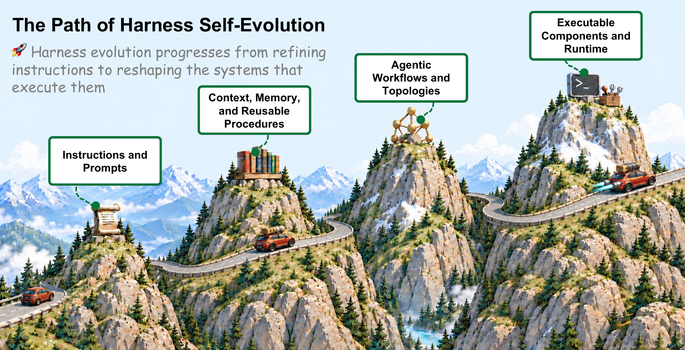
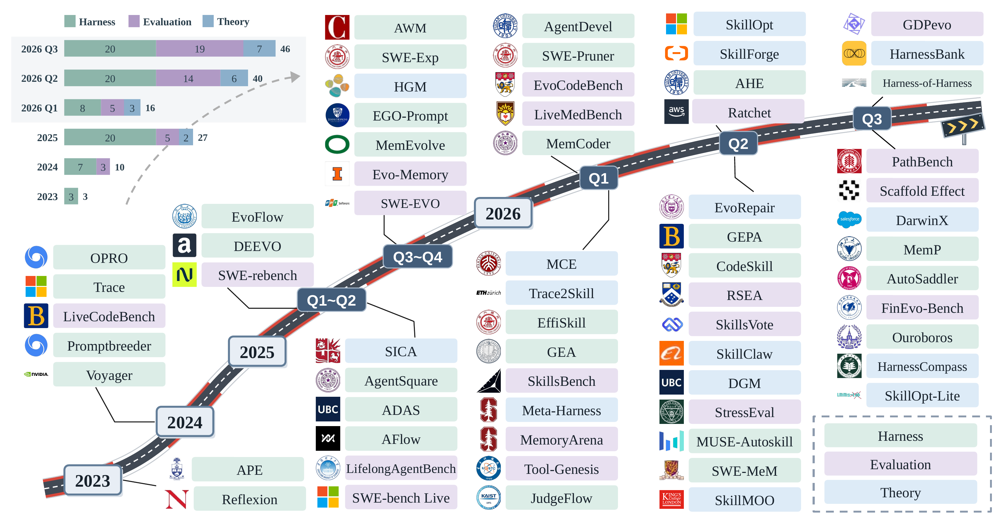
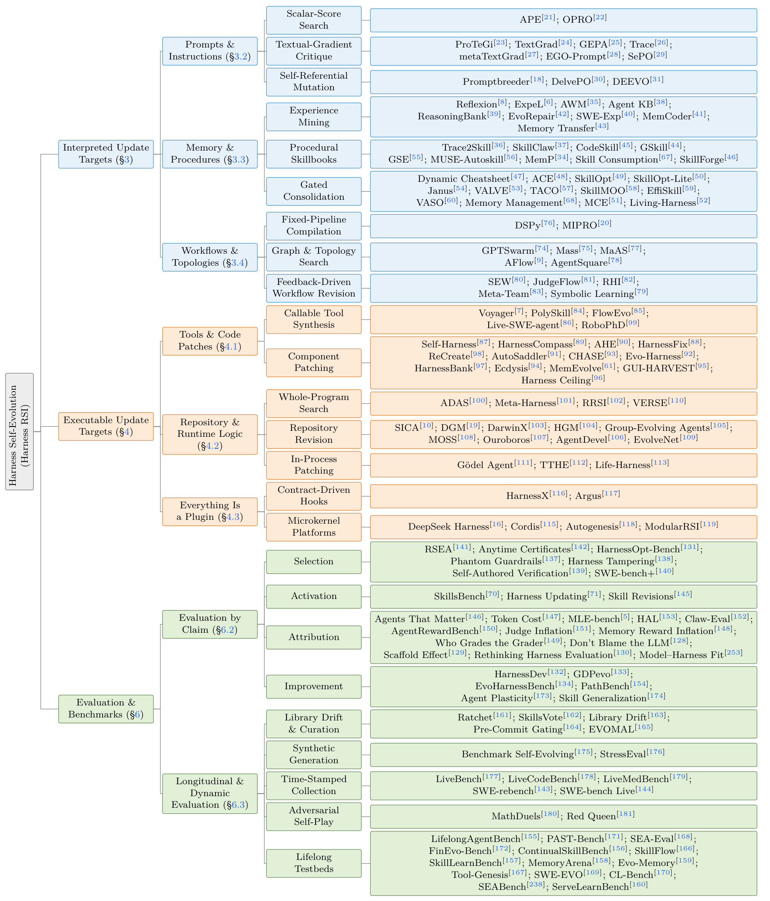
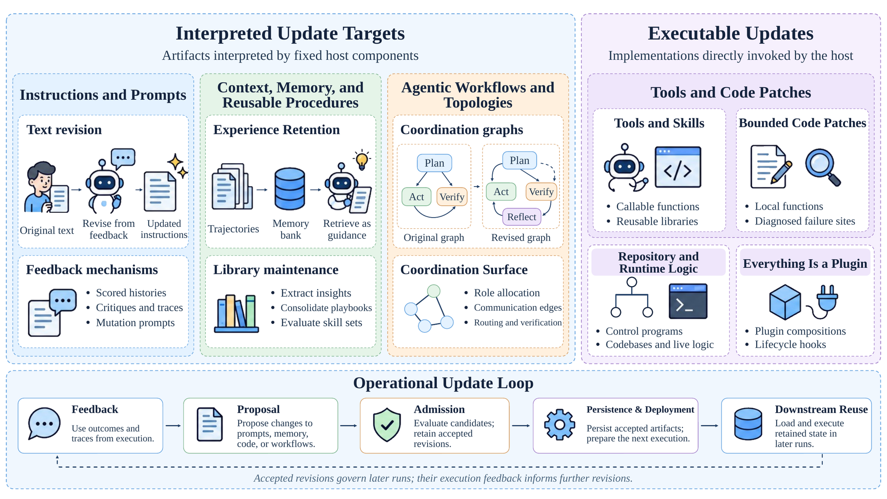
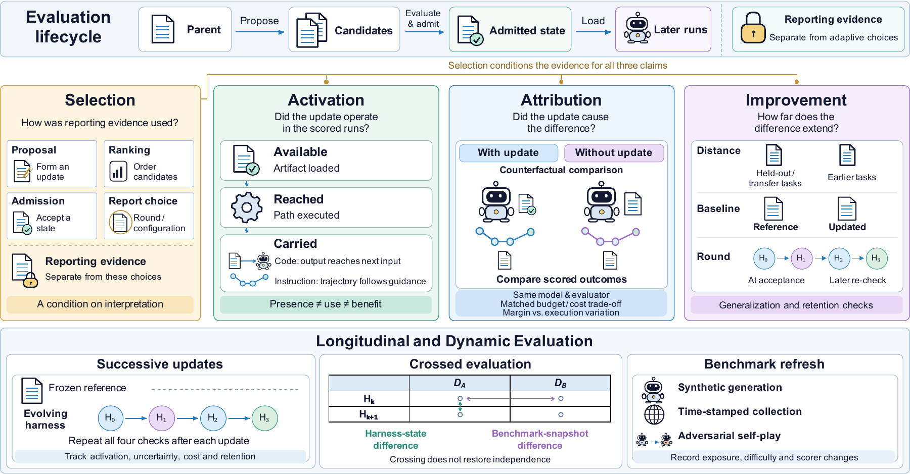

<div align="center">

# Awesome Harness RSI [](https://awesome.re)

**A theory-organized reading list on harness recursive self-improvement — agents that rewrite their own instructions, memory, workflows, and code while the model stays fixed.**

Zhongguancun Academy · Zhongguancun Institute of Artificial Intelligence

<p align="center">
  
  
  
  
  <a href="LICENSE"></a>
</p>

<p align="center">
  <a href="#what-is-harness-rsi">📘 Definition</a>
  &nbsp;·&nbsp;
  <a href="#how-this-list-is-organized">🧭 Taxonomy</a>
  &nbsp;·&nbsp;
  <a href="docs/claim-audit.md">🔬 Claim Audit (96 methods)</a>
  &nbsp;·&nbsp;
  <a href="#related-surveys">📚 Surveys</a>
  &nbsp;·&nbsp;
  <a href="CONTRIBUTING.md">🤝 Contributing</a>
</p>

[中文版](README_zh.md)

</div>





<p align="center"><sub><b>The corpus by quarter.</b> A representative subset of 46 of the 96 reviewed methods; the cumulative count rises from 3 in 2023 to 46 in 2026 Q3. Color is the primary emphasis — harness updates, evaluation, or theory. The classification is descriptive: inclusion implies neither continuing self-evolution nor measured improvement.</sub></p>

> This repository is the companion reading list for **Harness Self-Evolution: Theory, Algorithm, Evaluations, Applications, and Social Impacts**. Sections 1–4 below mirror the four branches of the article's taxonomy; the [claim audit](docs/claim-audit.md) releases the per-method evidence verdicts behind its Table 5.

---

## Contents

- [What Is Harness RSI](#what-is-harness-rsi)
- [How This List Is Organized](#how-this-list-is-organized)
- [Reading Roadmap](#reading-roadmap)
- [Precursors](#precursors)
- [1. Interpreted Update Targets](#1-interpreted-update-targets)
  - [1.1 Prompts & Instructions](#11-prompts--instructions)
  - [1.2 Memory & Reusable Procedures](#12-memory--reusable-procedures)
  - [1.3 Workflows & Topologies](#13-workflows--topologies)
- [2. Executable Update Targets](#2-executable-update-targets)
  - [2.1 Tools & Code Patches](#21-tools--code-patches)
  - [2.2 Repository & Runtime Logic](#22-repository--runtime-logic)
  - [2.3 Everything Is a Plugin](#23-everything-is-a-plugin)
- [3. Evaluation & Benchmarks](#3-evaluation--benchmarks)
  - [3.1 Claim-Specific Evidence](#31-claim-specific-evidence)
  - [3.2 Longitudinal & Dynamic Evidence](#32-longitudinal--dynamic-evidence)
- [4. Theory](#4-theory)
  - [4.1 Evolutionary Paradigms](#41-evolutionary-paradigms)
  - [4.2 PAC Learning & Stability](#42-pac-learning--stability)
  - [4.3 Background Statistical & Optimization Tools](#43-background-statistical--optimization-tools)
- [5. Evidence Audit of 96 Methods](#5-evidence-audit-of-96-methods)
- [6. Persistent-State Risks](#6-persistent-state-risks)
- [7. Deployed Harnesses & Product Surfaces](#7-deployed-harnesses--product-surfaces)
- [Boundary Cases & Exclusions](#boundary-cases--exclusions)
- [Related Surveys](#related-surveys)
- [Maintenance](#maintenance)

---

## What Is Harness RSI

A **harness** `H` is the software and configuration around a model `M` that governs its execution in an environment `E`: the agent loop, tool and skill orchestration, context construction, memory, compaction, scheduling, and execution infrastructure. A rollout is `τ ~ Run(M, H, E)`, scored by an evaluation procedure `J` that is **not** part of `H`.

**Harness recursive self-improvement** is the iterative process

```
B_t = { τ_t,i ~ Run(M, H_t, E_t,i) }         # a batch of execution experience
H_{t+1} = Update(H_t, B_t)                    # a persistent revision of the harness
```

with the backbone `M` held fixed. Three conditions make an entry belong on this list:

| Condition | Test |
|---|---|
| **Persistence** | The revision is written into harness state that later runs load, so it governs rollouts it did not generate. |
| **Recursion** | Adopted revisions govern later execution, and the resulting rollouts inform further revisions. |
| **Fixed model** | No weight update. A behavioral change is assignable to a named state transition rather than to movement in model competence. |

Rejected revisions leave `H_{t+1} = H_t`. Ordinary execution under unchanged rules — appending a session log, firing a fixed compaction policy — is not harness RSI. **An update is not an improvement**: whether an accepted change helps is the empirical question [Section 3](#3-evaluation--benchmarks) is about.

<details>
<summary><b>What this list excludes, and why</b></summary>

- **Runtime-only self-correction** (Self-Refine, Self-Debug): the correction is a task output consumed inside the same rollout; nothing is loaded by a later run.
- **Weight-side self-improvement** (SPIN, TTRL, self-rewarding LMs): violates the fixed-model premise, so a reported difference is no longer assignable to a named harness revision.
- **Static agent frameworks** (ReAct, CodeAct, AutoGen): scaffolding that is not revised from feedback.
- **Deployed products without a reported update loop**: they persist state across sessions but report no feedback-driven revision. Listed separately in [Section 7](#7-deployed-harnesses--product-surfaces).

Two in-scope systems are listed with an explicit caveat rather than excluded: **Live-SWE-agent** synthesizes tools that die with the task container, and **Gödel Agent** patches live process memory that disappears when the process ends. Both are instructive on the mechanism and weak on persistence.

</details>

---

## How This List Is Organized

Entries are classified by **what a proposal modifies** — the update target — because that is the only property of a proposal itself, rather than of the search procedure that produced it or the number that reported it. Feedback source, admission rule, resource envelope, and safety constraint then enter as *properties* of an update that bear on what its evaluation can claim, not as competing classification axes.

| Branch | Mutable object | Enforceability | Sections |
|---|---|---|---|
| **1. Interpreted update targets** | Model-readable content and coordination state read by a fixed host | Behavioral: an instruction shifts tendencies, it cannot impose a runtime invariant | [1.1](#11-prompts--instructions) · [1.2](#12-memory--reusable-procedures) · [1.3](#13-workflows--topologies) |
| **2. Executable update targets** | Implementations the host invokes directly: tools, component files, control programs, plugins | Enforceable: the revision runs | [2.1](#21-tools--code-patches) · [2.2](#22-repository--runtime-logic) · [2.3](#23-everything-is-a-plugin) |
| **3. Evaluation & benchmarks** | Works whose own contribution is an evaluation protocol or an audit | — | [3.1](#31-claim-specific-evidence) · [3.2](#32-longitudinal--dynamic-evidence) |
| **4. Theory** | Works whose contribution is an analysis or a mapping | — | [4.1](#41-evolutionary-paradigms) · [4.2](#42-pac-learning--stability) |

**Placement rule.** A work is listed **once**, under the node matching what the work itself contributes. The systems audited in Section 3 therefore appear under the update target they change, not under evaluation. [Section 4](#4-theory) is the single declared exception: its contribution *is* a mapping, so it re-lists systems already placed in Sections 1–2.

Third-level headings name a **mechanism**, not a topic. Two systems share a heading when they instantiate the same propose–admit structure, even if they target different artifacts.



<p align="center"><sub><b>The full taxonomy.</b> Four branches, one per section; second level is the subsection; third level is the mechanism. This list is a one-to-one expansion of this figure.</sub></p>

**Jump to a mechanism.** Counts are entries in that node.

**1. Interpreted update targets** — [Scalar-Score Search (2)](#scalar-score-search) · [Textual-Gradient Critique (7)](#textual-gradient-critique) · [Self-Referential Mutation (3)](#self-referential-mutation) · [Experience Mining (10)](#experience-mining) · [Procedural Skillbooks (10)](#procedural-skillbooks) · [Gated Consolidation (16)](#gated-consolidation) · [Fixed-Pipeline Compilation (2)](#fixed-pipeline-compilation) · [Graph & Topology Search (5)](#graph--topology-search) · [Feedback-Driven Workflow Revision (5)](#feedback-driven-workflow-revision)

**2. Executable update targets** — [Callable Tool Synthesis (5)](#callable-tool-synthesis) · [Evidence-Grounded Component Patching (10)](#evidence-grounded-component-patching) · [Whole-Control-Program Search (3)](#whole-control-program-search) · [Repository Revision (9)](#repository-revision) · [In-Process Patching (3)](#in-process-patching) · [Contract-Driven Hooks (2)](#contract-driven-hooks) · [Microkernel Platforms (4)](#microkernel-platforms)

**3. Evaluation & benchmarks** — [Selection & Admission (6)](#selection--admission) · [Runtime Activation (2)](#runtime-activation) · [Attribution Controls (11)](#attribution-controls) · [Reach & Retention (4)](#reach--retention) · [Active-Set Integrity (5)](#active-set-integrity) · [Synthesized Boundary Tasks (2)](#synthesized-boundary-tasks) · [Temporal Streams (5)](#temporal-streams) · [Adversarial Play (2)](#adversarial-play) · [Lifelong Testbeds (15)](#lifelong-testbeds)

**4. Theory** — [Evolutionary Paradigms (8 systems, mapped)](#41-evolutionary-paradigms) · [Stability & Retention (2)](#stability--retention) · [Confidence-Gated Admission (4)](#confidence-gated-admission) · [Self-Improvement Limits (2)](#self-improvement-limits) · [Background Tools (10)](#43-background-statistical--optimization-tools)

**Entry format.** Mechanism sentences state what the system *does to its own harness*, not what it scores. A second link appears only when the paper itself states one: `[[code]]` for a repository, `[[project]]` for a project page, `[[list]]` for a sibling reading list.

```markdown
- **Name** `Venue'YY` — one-sentence mechanism. [[paper]](url) [[code]](url)
```

---

## Reading Roadmap

Eight papers, in order, to locate the field:

1. **[Reflexion](http://papers.nips.cc/paper_files/paper/2023/hash/1b44b878bb782e6954cd888628510e90-Abstract-Conference.html)** `NeurIPS'23` — the minimal loop: write a verbal reflection on failure, reload it on the next attempt.
2. **[Voyager](https://openreview.net/forum?id=ehfRiF0R3a)** `TMLR'24` — the minimal *executable* loop: self-verified programs accumulate into a retrievable skill library.
3. **[DSPy](https://openreview.net/forum?id=PFS4ffN9Yx)** `ICLR'24` — the compilation view: optimize prompts and demonstrations inside a pipeline whose control flow is fixed.
4. **[ADAS](https://openreview.net/forum?id=t9U3LW7JVX)** `ICLR'25` — the search view: a meta-agent writes the control program, and candidates live in an archive.
5. **[DGM](https://openreview.net/forum?id=pUpzQZTvGY)** `ICLR'26` — the open-ended view: repository variants branch, and the archive is the population.
6. **[Harness Updating Is Not Harness Benefit](https://arxiv.org/abs/2605.30621)** `arXiv'26` — the load rate and the adherence rate come apart: 0.96 vs 0.35.
7. **[HarnessBank](https://arxiv.org/abs/2607.13683)** `arXiv'26` — what a full evidence chain looks like: immutable kernel, per-attempt activation beacons, paired significance gate.
8. **[Agents That Matter](https://arxiv.org/abs/2407.01502)** `TMLR'25` — why a terminal score is not an answer.

---

## Precursors

*Pre-LLM statements of the propose–evaluate–retain structure.*

- **Speculations Concerning the First Ultraintelligent Machine** `Adv. Computers'65` — frames recursive improvement as a machine designing a better successor to itself. [[paper]](https://doi.org/10.1016/S0065-2458%2808%2960418-0)
- **EURISKO** `Artif. Intell.'83` — learned heuristics, including heuristics that modify other heuristics, shape later search. [[paper]](https://doi.org/10.1016/S0004-3702%2883%2980005-8)
- **Gödel Machines** `arXiv'03` — a self-rewrite executes only after the system proves the rewrite improves expected utility. [[paper]](https://arxiv.org/abs/cs/0309048)

---

## 1. Interpreted Update Targets



<p align="center"><sub><b>What Sections 1 and 2 operate on.</b> Interpreted targets (left) are artifacts a fixed host reads; executable targets (right) are implementations the host invokes. The lower panel is the loop every entry below sits in: feedback → proposal → admission → persistence and deployment → downstream reuse. Persistence alone establishes neither activation nor improvement.</sub></p>

*The revision changes model-readable content or coordination state. Native tools, operator implementations, and low-level execution machinery stay fixed. The mutation surface is bounded, which makes candidates comparable — and leaves the accepted artifact dependent on a fixed model choosing to follow it.*

### 1.1 Prompts & Instructions

System instructions, prompt templates, few-shot demonstrations, and mutation specifications. Three generations, separated by **what the feedback carries**.

#### Scalar-Score Search

*Feedback is one number per candidate.*

- **APE** `ICLR'23` — proposes instructions from input–output demonstrations and keeps the highest-scoring candidate. [[paper]](https://openreview.net/forum?id=92gvk82DE-) [[project]](https://sites.google.com/view/automatic-prompt-engineer)
- **OPRO** `ICLR'24` — conditions an optimizer LLM on the scored history of prior candidates to propose the next instruction. [[paper]](https://openreview.net/forum?id=Bb4VGOWELI) [[code]](https://github.com/google-deepmind/opro)

#### Textual-Gradient Critique

*Feedback is an error, a critique, or a trajectory, turned into a proposed edit.*

- **ProTeGi** `EMNLP'23` — converts task errors into natural-language "gradients" and beam-searches over the edited prompts. [[paper]](https://aclanthology.org/2023.emnlp-main.494/)
- **TextGrad** `Nature'25` — backpropagates textual critiques through a graph of LLM calls to edit any text variable in the system. [[paper]](https://doi.org/10.1038/s41586-025-08661-4)
- **GEPA** `ICLR'26 Oral` — reflective prompt evolution over execution traces, with candidates selected on a Pareto split kept apart from the reported test. [[paper]](https://openreview.net/forum?id=RQm2KQTM5r)
- **Trace** `NeurIPS'24` — treats the execution trace as a computation graph and generates edits from rich feedback through a generative optimizer. [[paper]](https://arxiv.org/abs/2406.16218) [[project]](https://microsoft.github.io/Trace/)
- **metaTextGrad** `arXiv'25` — optimizes the optimizer's own prompts, accepting an update only when a validation split improves. [[paper]](https://arxiv.org/abs/2505.18524)
- **EGO-Prompt** `arXiv'25` — co-adapts the prompt and a semantic causal graph for domain deployments. [[paper]](https://arxiv.org/abs/2510.21148)
- **SePO** `arXiv'26` — rewrites a long-lived system prompt from accumulated task feedback rather than a one-shot search. [[paper]](https://arxiv.org/abs/2606.04465) [[code]](https://github.com/taowangcheng/SePO)

#### Self-Referential Mutation

*The mutation process is itself part of the search space.*

- **Promptbreeder** `ICML'24` — co-evolves task prompts and the mutation prompts that generate them. [[paper]](https://proceedings.mlr.press/v235/fernando24a.html)
- **DelvePO** `arXiv'25` — decouples prompt components and steers mutation along identified directions. [[paper]](https://arxiv.org/abs/2510.18257)
- **DEEVO** `arXiv'25` — evolves instructions through structured debates, ranking candidates by Elo tournament. [[paper]](https://arxiv.org/abs/2506.00178)

> **Where this layer stops.** Most prompt optimizers are *offline antecedents*: they select a high-scoring prompt, freeze it, and end the loop. Extending prompt updates across an operational lifecycle turns into a context-management problem — accumulated instructions consume a finite attention budget and raise inference cost — which is what [1.2](#12-memory--reusable-procedures) addresses, and which no amount of prompt text turns into enforceable runtime control.

### 1.2 Memory & Reusable Procedures

Persistent, model-readable state built from prior experience and retrieved into later contexts. Separated by **how long the extracted experience is meant to stay useful** and **whether the library is maintained**.

#### Experience Mining

*Turn trajectories into retrievable entries.*

- **Reflexion** `NeurIPS'23` — stores verbal self-reflection on a failure and reloads it for another attempt at the same task. [[paper]](http://papers.nips.cc/paper_files/paper/2023/hash/1b44b878bb782e6954cd888628510e90-Abstract-Conference.html)
- **ExpeL** `AAAI'24` — extracts cross-task insights from a training pool of trajectories, with add/edit/upvote/downvote curation. [[paper]](https://doi.org/10.1609/aaai.v38i17.29936)
- **AWM** `ICML'25` — induces recurring sub-goal workflows from trajectories, offline from a training split or online from the task stream. [[paper]](https://proceedings.mlr.press/v267/wang25bx.html)
- **Agent KB** `arXiv'25` — a cross-domain experience base whose top-k retrieved items are injected into later runs. [[paper]](https://arxiv.org/abs/2507.06229)
- **ReasoningBank** `ICLR'26` — consolidates reasoning strategies from successes and failures into a bank injected into the system instruction. [[paper]](https://openreview.net/forum?id=jL7fwchScm)
- **EvoRepair** `arXiv'26` — accumulates, scores, and reuses vulnerability-repair experience across long-horizon repairs. [[paper]](https://arxiv.org/abs/2605.30105)
- **SWE-Exp** `arXiv'25` — distills issue-resolution experience from prior search trajectories into a bank queried on new issues. [[paper]](https://arxiv.org/abs/2507.23361) [[code]](https://github.com/YerbaPage/SWE-Exp)
- **MemCoder** `arXiv'26` — structured memory of repository knowledge and repair outcomes that grows alongside the codebase. [[paper]](https://arxiv.org/abs/2603.13258)
- **Behavioral Rules** `arXiv'26` — accumulates engineer-reviewed behavioral rules from deployment sessions into a version-controlled file loaded as session context. [[paper]](https://arxiv.org/abs/2607.13091)
- **Memory Transfer** `arXiv'26` — measures how memories formed in one domain transfer to another, across four memory formats. [[paper]](https://arxiv.org/abs/2604.14004)

#### Procedural Skillbooks

*The reusable unit is an explicit, documented procedure.*

- **Trace2Skill** `arXiv'26` — distills trajectory-local lessons into transferable skill documents, ranked on a validation subset of the evolving set. [[paper]](https://arxiv.org/abs/2603.25158)
- **SkillClaw** `arXiv'26` — an agentic evolver whose validator admits a candidate skill only if it beats the deployed pool on validation tasks. [[paper]](https://arxiv.org/abs/2604.08377)
- **CodeSkill** `arXiv'26` — learns self-evolving coding skills through preparatory passes that build the bank before deployment. [[paper]](https://arxiv.org/abs/2605.25430)
- **GSkill** `ACM AIAS'26` — automatically learns `SKILL.md` files for coding agents from prior runs. [[paper]](https://doi.org/10.1145/3786335.3813196)
- **Socratic-SWE** `arXiv'26` — derives skills from traces by Socratic questioning, gated by a held-out validation pool. [[paper]](https://arxiv.org/abs/2606.07412)
- **GSE** `arXiv'26` — learns globally reusable skills gated by local and replay-driven validation under one-project-held-out splits. [[paper]](https://arxiv.org/abs/2608.06153)
- **MUSE-Autoskill** `arXiv'26` — couples skill creation, memory, and management, registering a skill only once it passes its own generated tests. [[paper]](https://arxiv.org/abs/2605.27366)
- **MemP** `ACL'26 Findings` — distills procedural memory from trajectories and compares update strategies and abstraction granularities. [[paper]](https://doi.org/10.18653/v1/2026.findings-acl.866)
- **Skill Consumption** `arXiv'26` — tests whether model-generated skills are actually consumed downstream, and finds they reshape the default policy rather than trigger explicit calls. [[paper]](https://arxiv.org/abs/2605.23899)
- **SkillForge** `SIGIR'26 Industry` — forges domain-specific self-evolving skills for cloud support, reserving a chronological final quartile the loop never sees. [[paper]](https://doi.org/10.1145/3805712.3808466)

#### Gated Consolidation

*Library maintenance is part of the learning problem: rewrite, prune, verify, or replace the active set.*

- **Dynamic Cheatsheet** `EACL'26` — maintains an adaptive memo of strategies curated at test time. [[paper]](https://aclanthology.org/2026.eacl-long.333/)
- **ACE** `ICLR'26` — grows and consolidates an evolving context playbook through incremental delta updates instead of rewrites. [[paper]](https://openreview.net/forum?id=eC4ygDs02R)
- **SkillOpt** `arXiv'26` — evaluates a revised skill set on validation before it replaces the active library. [[paper]](https://arxiv.org/abs/2605.23904)
- **SkillOpt-Lite** `arXiv'26` — the same gate at lower cost, admitting skill edits through a dead-band validation rule plus a compile-and-smoke test. [[paper]](https://arxiv.org/abs/2607.03451) [[code]](https://github.com/EvolvingLMMs-Lab/SkillOpt-Lite)
- **MemEvolve** `arXiv'25` — meta-evolves the memory system itself, retaining a top-1 Pareto survivor per round. [[paper]](https://arxiv.org/abs/2512.18746)
- **SWE-MeM** `arXiv'26` — learns adaptive memory-management policies for long-horizon coding agents. [[paper]](https://arxiv.org/abs/2606.28434)
- **SWE-Pruner** `arXiv'26` — self-adaptive context pruning under a tuned retention threshold. [[paper]](https://arxiv.org/abs/2601.16746) [[code]](https://github.com/Ayanami1314/swe-pruner)
- **TACO** `arXiv'26` — observational context compression for terminal agents, with a write-back gate and a reward-free retention stop. [[paper]](https://arxiv.org/abs/2604.19572) [[code]](https://github.com/multimodal-art-projection/TACO)
- **SkillMOO** `arXiv'26` — selects skill bundles under several competing objectives via NSGA-II ranking rather than one score. [[paper]](https://arxiv.org/abs/2604.09297)
- **EffiSkill** `arXiv'26` — mines efficiency skills from verified code pairs, ranking candidates on a public split and reporting on a private one. [[paper]](https://arxiv.org/abs/2603.27850)
- **VASO** `arXiv'26` — formally verifiable skills: each plan is model-checked against the skill's specification before it may run. [[paper]](https://arxiv.org/abs/2606.05395)
- **Memory Management** `ACL'26` — empirical study of how retention, deletion, and retrieval rules change task outcomes, with a similarity-based adherence measure. [[paper]](https://aclanthology.org/2026.acl-long.27/)
- **Memory as Action** `ACL'26 Findings` — treats context curation as an action the agent takes, trained end-to-end rather than fixed by policy. [[paper]](https://aclanthology.org/2026.findings-acl.956/)
- **MCE** `ICML'26` — a history-informed (1+1) evolution strategy over skills, with agentic crossover and a validation archive. [[paper]](https://icml.cc/virtual/2026/poster/64296)
- **Living-Harness** `arXiv'26` — an interactive-agent evolver that consolidates retrieved memory into a reusable graph across cycles. [[paper]](https://arxiv.org/abs/2607.26598) [[code]](https://github.com/anotherbricki/Living-Harness)
- **Janus** `arXiv'26` — wraps an existing updater and, when a candidate deviates from the recent update direction, compares old and candidate memory on a compact coverage/boundary/fresh set before deploying either. [[paper]](https://arxiv.org/abs/2606.31121)

> **Where this layer stops.** Stored experience is data interpreted probabilistically. A useful skill may not be retrieved, and may still be ignored after retrieval — see [Harness Updating](#runtime-activation), where load rate and adherence rate diverge from 0.96 to 0.35. Persistent stores also carry stale strategies and injection payloads forward across sessions ([Section 6](#6-persistent-state-risks)).

### 1.3 Workflows & Topologies

Coordination specifications enacted by a **fixed** orchestration framework: role allocation, communication graphs, conditional routing, verification and termination cycles. Node implementations and tool interfaces stay fixed.

#### Fixed-Pipeline Compilation

*The pipeline is programmer-defined; only its text parameters are searched.*

- **DSPy** `ICLR'24` — compiles declarative LM pipelines, optimizing prompts and demonstrations while control flow stays fixed. [[paper]](https://openreview.net/forum?id=PFS4ffN9Yx) [[code]](https://github.com/stanfordnlp/dspy)
- **MIPRO** `EMNLP'24` — jointly optimizes instructions and demonstrations across the stages of a multi-stage LM program. [[paper]](https://aclanthology.org/2024.emnlp-main.525/) [[project]](https://dspy.ai)

#### Graph & Topology Search

*The connection structure itself is the search space.*

- **GPTSwarm** `ICML'24` — makes edges between fixed operations learnable and optimizes the resulting communication graph. [[paper]](https://proceedings.mlr.press/v235/zhuge24a.html) [[code]](https://github.com/metauto-ai/gptswarm)
- **Mass** `ICLR'26` — jointly searches agent prompts and communication topologies over predefined multi-agent blocks. [[paper]](https://proceedings.iclr.cc/paper_files/paper/2026/hash/1ab4e0e8f35078109bc78d7b465d306f-Abstract-Conference.html)
- **MaAS** `ICML'25` — samples query-dependent architectures from an agentic supernet over predefined operators. [[paper]](https://proceedings.mlr.press/v267/zhang25bi.html)
- **AFlow** `ICLR'25` — serializes workflows as operator-composing code and searches structure and prompts over it; the operators themselves stay fixed. [[paper]](https://openreview.net/forum?id=z5uVAKwmjf) [[code]](https://github.com/FoundationAgents/AFlow)
- **AgentSquare** `ICLR'25` — searches module compositions in a modular design space while also generating new module implementations. [[paper]](https://openreview.net/forum?id=mPdmDYIQ7f) [[code]](https://github.com/tsinghua-fib-lab/AgentSquare)

#### Feedback-Driven Workflow Revision

*Execution outcomes, not a search budget, decide the next topology.*

- **SEW** `arXiv'25` — jointly mutates prompts and topology while comparing alternative workflow representations. [[paper]](https://arxiv.org/abs/2505.18646)
- **JudgeFlow** `arXiv'26` — uses block-level judge diagnoses to revise sequence, loop, and conditional blocks. [[paper]](https://arxiv.org/abs/2601.07477)
- **RHI** `arXiv'26` — applies pairwise feedback to roles, instructions, communication contracts, and interaction hops within one task episode. [[paper]](https://arxiv.org/abs/2607.15524)
- **Evolve as a Team** `arXiv'26` — carries experience across tasks to update a reusable scaffold of prompts, teammate profiles, and shared coordination rules. [[paper]](https://arxiv.org/abs/2605.29790)
- **Symbolic Learning** `AI Open'25` — jointly revises pipeline structure, prompts, and tools through back-propagated language loss. [[paper]](https://doi.org/10.1016/j.aiopen.2025.11.004)

> **Boundary note.** AgentSquare and Symbolic Learning also generate executable module and tool implementations; they are listed here because their primary contribution is modular search and joint symbolic optimization. The mutable executable surface they add is discussed in [2.1](#21-tools--code-patches).

---

## 2. Executable Update Targets

*The host or runtime executes the revision directly. An update is classified by the object it changes, not by the file format it is written in. The three subsections are **parallel software boundaries**, not capability levels: what separates them is how far a faulty edit can propagate, and what contract has to hold before it may be mounted.*

### 2.1 Tools & Code Patches

The surrounding executor is fixed; the update lands in one declared executable unit — a callable tool, a skill implementation, a function, a component file. The boundary makes testing and rollback local. It does not stop errors from propagating through the component's outputs or shared state.

#### Callable Tool Synthesis

*Successful execution becomes independently invokable code.*

- **Voyager** `TMLR'24` — turns self-verified programs into a growing skill library retrieved and composed in later tasks. [[paper]](https://openreview.net/forum?id=ehfRiF0R3a) [[project]](https://voyager.minedojo.org/)
- **PolySkill** `arXiv'25` — induces polymorphic skill abstractions so a learned skill generalizes past its originating site. [[paper]](https://arxiv.org/abs/2510.15863) [[code]](https://github.com/simonucl/PolySkill)
- **FlowEvo** `arXiv'26` — compiles a successful workflow into a validated callable artifact in a persistent skill bank, then either executes it or describes it to workflow generation. [[paper]](https://arxiv.org/abs/2607.21596) [[code]](https://github.com/DEFENSE-SEU/FlowEvo)
- **Live-SWE-agent** `arXiv'25` — synthesizes Bash and Python tools on the fly; they are discarded with the task container, so the loop demonstrates tool synthesis *without* persistent harness evolution. [[paper]](https://arxiv.org/abs/2511.13646)
- **RoboPhD** `arXiv'26` — co-evolves a deterministic Python analysis tool with model-readable SQL instructions, then ships the pair without its evolutionary infrastructure. [[paper]](https://arxiv.org/abs/2601.01126)

#### Evidence-Grounded Component Patching

*Execution evidence selects one declared component; the enclosing agent loop stays closed to revision. The systems differ mainly in their **admission procedure**.*

- **Self-Harness** `arXiv'26` — proposes several edits from one incumbent and promotes only those that do not drop on either split and rise on at least one. [[paper]](https://arxiv.org/abs/2606.09498) [[code]](https://github.com/qzzqzzb/Self-Harness)
- **HarnessCompass** `arXiv'26` — optimizes harness components separately then combines them, ranking on a 50-task evolution set and reporting 450 held-out tasks apart. [[paper]](https://arxiv.org/abs/2608.01918)
- **AHE** `arXiv'26` — observability-driven evolution: per-run submit and shell-layer beacons ground each shipped edit, which is reverted at file granularity when harmful. [[paper]](https://arxiv.org/abs/2604.25850)
- **HarnessFix** `arXiv'26` — diagnoses harness faults from failed trajectories and admits a repair only through a validation-set assessment. [[paper]](https://arxiv.org/abs/2606.06324)
- **ReCreate** `ACL'26` — edits role, process, tool, and memory components at both text and code level on a small dev set, explicitly excluding environment and infrastructure adaptation. [[paper]](https://aclanthology.org/2026.acl-long.1432/)
- **AutoSaddler** `arXiv'26` — keeps a patch only on a mini-batch gain, argmaxes on dev, and evaluates the group-disjoint test split once. [[paper]](https://arxiv.org/abs/2608.23041)
- **Evo-Harness** `arXiv'26` — compiles accumulated context into harness-level skills along an online stream, matching fail→pass traces to skill content. [[paper]](https://arxiv.org/abs/2608.15071) [[code]](https://github.com/A-EVO-Lab/a-evolve)
- **HarnessBank** `arXiv'26` — a MAP-Elites-style gene bank with semantic descriptors, per-attempt activation beacons, and a paired significance gate; elites that never fire are culled. [[paper]](https://arxiv.org/abs/2607.13683)
- **Ecdysis** `arXiv'26` — trains runtime harnesses with promotion on a training objective, then scores the frozen harness on a held-out split. [[paper]](https://arxiv.org/abs/2609.11677)
- **CHASE** `arXiv'26` — counterfactual-guided evolution: a Challenger proposes protocol transformations meant to destroy the candidate's gain over the parent, and a patch is admitted only if its gain survives every confirmed transformation. [[paper]](https://arxiv.org/abs/2609.18366)

### 2.2 Repository & Runtime Logic

The end-to-end control program becomes mutable. An update may cross component boundaries and revise context construction, tool dispatch, verification, recovery, the agent loop, or the code that proposes later changes. The substrate may be one program, a multi-file repository, or live process memory; the defining property is that **several harness functions can be recomposed at once**.

#### Whole-Control-Program Search

*A fixed outer loop synthesizes the whole control program. All three are offline optimization antecedents: the output is a harness selected for deployment, and the deployed harness does not keep updating.*

- **ADAS** `ICLR'25` — a fixed meta-agent writes new agent `forward` implementations and keeps evaluated candidates in an archive. [[paper]](https://openreview.net/forum?id=t9U3LW7JVX) [[project]](https://shengranhu.com/ADAS)
- **Meta-Harness** `COLM'26` — hands an external coding agent the source, scores, and traces of prior candidates and asks for a complete task-specific harness program. [[paper]](https://arxiv.org/abs/2603.28052)
- **RRSI** `arXiv'26` — regularizes that search with annealed edit budgets, leakage screening, and noise-adjusted acceptance floors, trading evolution-set gain for OOD transfer. [[paper]](https://arxiv.org/abs/2609.24972) [[code]](https://github.com/google-research/rrsi)

#### Repository Revision

*A versioned harness implementation is edited. Archive membership identifies candidates for future evolution; it does not imply any stored version becomes the active runtime.*

- **SICA** `arXiv'25` — exposes its own multi-file Python codebase — tools, subagents, control flow — to the best archived agent. [[paper]](https://arxiv.org/abs/2504.15228)
- **DGM** `ICLR'26` — branches repository variants into an open-ended archive, with parent selection over performance and novelty. [[paper]](https://openreview.net/forum?id=pUpzQZTvGY)
- **DarwinX** `arXiv'26` — evolves harnesses by natural selection on a train split frozen before the held-out split is touched. [[paper]](https://arxiv.org/abs/2608.07545)
- **HGM** `arXiv'25` — approximates clade-level productivity and allocates lineage-expansion and evaluation budgets by Thompson sampling. [[paper]](https://arxiv.org/abs/2510.21614) [[code]](https://github.com/metauto-ai/HGM)
- **Group-Evolving Agents** `arXiv'26` — lets selected parents share code patches, tools, and execution experience before producing framework-level patches. [[paper]](https://arxiv.org/abs/2602.04837)
- **MOSS** `arXiv'26` — rewrites routing, hooks, state management, and dispatch code, then swaps the container behind a health check plus human authorization. [[paper]](https://arxiv.org/abs/2605.22794) [[code]](https://github.com/hkgai-official/Moss)
- **Ouroboros** `arXiv'26` — evolves its own core through reviewed commits, with run manifests, seed attestation, and public per-task traces. [[paper]](https://arxiv.org/abs/2608.08311)
- **AgentDevel** `arXiv'26` — reframes self-evolution as release engineering: versioned diffs, release-candidate regression, per-iteration fail→pass and pass→fail records. [[paper]](https://arxiv.org/abs/2601.04620)
- **EvolveNet** `arXiv'26` — collaborative harness evolution across clients, merging validated patches into broadcast shared state behind a disjoint validation gate. [[paper]](https://arxiv.org/abs/2608.04968)

#### In-Process Patching

*The revision is applied to the running process rather than written to a repository.*

- **Gödel Agent** `ACL'25` — monkey-patches decision methods, action spaces, and its own modification routines in live Python memory; the revision dies with the process. [[paper]](https://aclanthology.org/2025.acl-long.1354/)
- **TTHE** `arXiv'26` — evolves executable harness programs from traces at test time and carries the selected program into subsequent inputs. [[paper]](https://arxiv.org/abs/2607.08124)
- **Life-Harness** `arXiv'26` — adapts environment contracts, action realization, and trajectory regulation together, then freezes the runtime interface for evaluation. [[paper]](https://arxiv.org/abs/2605.22166) [[code]](https://github.com/Tianshi-Xu/Life-Harness)

### 2.3 Everything Is a Plugin

Executable components sit behind a fixed microkernel, declared interfaces, and lifecycle hooks. The mutable object is a plugin implementation or the composition binding tools, memory, providers, loops, and verifiers into the runtime. **The contribution of this category is not a larger mutation radius but a more explicit contract around replacement and activation**: the kernel decides which hooks exist, which dependencies are valid, and how a component may be mounted.

#### Contract-Driven Hooks

- **HarnessX** `arXiv'26` — checks hook types, singleton constraints, and smoke tests before committing a proposed configuration, and requires each edit to declare the trace feature that must appear if it fired. [[paper]](https://arxiv.org/abs/2606.14249)
- **Argus** `arXiv'26` — a general-purpose agentic reasoning runtime that exposes skills rather than injecting them, evolving along a long-horizon stream. [[paper]](https://arxiv.org/abs/2608.05144)

#### Microkernel Platforms

- **DeepSeek Harness** `Product'26` — the Cordis kernel connects runtime components through declared dependencies, with append-only records supporting checkpointing and replay; it illustrates the substrate, not a reported self-evolution lifecycle. [[page]](https://www.deepseek.com/harness/en/)
- **Cordis / Spatiotemporal Composability** `arXiv'26` — the formal calculus behind that kernel; self-evolving harnesses are stated as future work. [[paper]](https://arxiv.org/abs/2608.25512)
- **Autogenesis** `arXiv'26` — a self-evolving agent protocol with an explicit propose–evaluate–commit cycle over lineage and versioning. [[paper]](https://arxiv.org/abs/2604.15034) [[code]](https://github.com/DVampire/Autogenesis)
- **ModularRSI** `arXiv'26` — evolves modules behind a composer under reward-blind gates, on externally curated, benchmark-disjoint evolve tasks. [[paper]](https://arxiv.org/abs/2609.14857)

> **What contracts do not buy.** A sandbox can restrict permissions and a typed hook can reject an incompatible binding, but neither establishes that the resulting behavior is correct. Within runtime-managed state, checkpoints and component replacement may restore a prior logical configuration; they cannot reverse an API request, a database mutation, an outbound message, or a physical action already committed outside that boundary. Those require prevention, idempotence, or compensating actions — not rollback.

---

## 3. Evaluation & Benchmarks

A terminal task score conflates **four dependent claims**. Evidence for one does not establish another, and each is uninterpretable without the ones before it.



| Claim | Question | Fails silently when |
|---|---|---|
| **Selection** | Was the reported state chosen without spending the evidence used to report it? | A candidate ranks first and is then reported on the same tasks that ranked it; a "held-out" split is also an input to the promotion rule; the peak round of a trajectory is reported with no stopping rule fixed in advance. |
| **Activation** | Did the accepted artifact or code path operate in the reported runs? | A skill is loaded and ignored; a component runs and its output is dropped in prompt assembly or cut by truncation. Persistence is not activation. |
| **Attribution** | Did the difference come from that state? | Execution variance, a resource envelope that grew with the update (retries, verifier calls, longer context), or a drifting evaluator moved instead. |
| **Improvement** | How far does the difference extend? | Measured only on the tasks that produced it; or credited once at the accepting round and never re-checked at a later one. |

Three activation rates, with the denominators that carry the content — `R(u)` is the executions where update `u` applies, `L(u)` those that load it, `B(u)` those where its beacon fires, `F(u) ⊆ L(u)` those whose trajectory conforms:

```
load(u)   = |L(u)| / |R(u)|          # available
reach(u)  = |B(u)| / |R(u)|          # the mutated path ran
adhere(u) = |F(u)| / |L(u)|          # the trajectory followed it
```

Works below are listed under **the evidence function they serve**, not by benchmark family.

### 3.1 Claim-Specific Evidence

#### Selection & Admission

- **RSEA** `arXiv'26` — assigns separate data to proposal, admission, and reporting through explicit held-out selection. [[paper]](https://arxiv.org/abs/2606.28374)
- **Anytime Certificates** `arXiv'26` — anytime-valid certificates for repeated, data-dependent admission decisions. [[paper]](https://arxiv.org/abs/2607.00871)
- **Phantom Guardrails** `arXiv'26` — documents self-improving harnesses that fix failures which never occurred, the patch grounded in no observed execution. [[paper]](https://arxiv.org/abs/2607.13083)
- **Harness Tampering** `arXiv'26` — audits candidates that modify verification logic rather than the behavior under test. [[paper]](https://arxiv.org/abs/2609.00069)
- **Self-Authored Verification** `arXiv'26` — finds self-written checks unreliable as admission evidence in heuristic self-improving agents. [[paper]](https://arxiv.org/abs/2607.24300)
- **SWE-bench+** `arXiv'24` — documents solution leakage and weak assertions that corrupt promotion and reporting together. [[paper]](https://arxiv.org/abs/2410.06992)

> **The structural failure.** The three statistical ways a reporting score gets spent — on the split, on the gate, on the round — are different in kind from the fourth: the candidate shaping the record that judges it. Statistics do not fix that one. HarnessBank puts evaluation and bookkeeping code in a kernel candidates cannot modify; HarnessX applies the reference test patch before the model patch and blocks writes to test files.

#### Runtime Activation

- **SkillsBench** `arXiv'26` — records whether task-provided skills are read or referenced, across diverse tasks. [[paper]](https://arxiv.org/abs/2602.12670)
- **Harness Updating ≠ Harness Benefit** `arXiv'26` — scores load rate and trajectory-adherence rate separately: two agents load at 0.961 and 0.957 while adhering at 0.350 and 0.757, and adherence decays along the trajectory. [[paper]](https://arxiv.org/abs/2605.30621) [[code]](https://github.com/A-EVO-Lab/a-evolve)

#### Attribution Controls

*Each names a way a reported difference can come from something other than the update.*

- **Agents That Matter** `TMLR'25` — shows agent comparisons confound capability with cost, and asks for cost-controlled evaluation. [[paper]](https://arxiv.org/abs/2407.01502)
- **Token Cost** `arXiv'26` — analyzes and predicts agent token consumption, giving the envelope a measurable unit. [[paper]](https://arxiv.org/abs/2604.22750)
- **MLE-bench** `ICLR'25` — ML-engineering tasks with repeated runs and an explicit compute envelope. [[paper]](https://arxiv.org/abs/2410.07095)
- **AgentRewardBench** `COLM'25` — meta-evaluates automatic judges of web-agent trajectories against expert annotation. [[paper]](https://arxiv.org/abs/2504.08942) [[project]](https://agent-reward-bench.github.io)
- **Judge Inflation** `arXiv'24` — documents spontaneous reward hacking in iterative self-refinement. [[paper]](https://arxiv.org/abs/2407.04549)
- **Memory Reward Inflation** `arXiv'26` — shows stored memory can inflate the reported reward rather than improve the behavior. [[paper]](https://arxiv.org/abs/2608.00017)
- **Who Grades the Grader** `arXiv'26` — when metrics and skills co-evolve, a rising score no longer identifies which of them moved. [[paper]](https://arxiv.org/abs/2607.12790) [[code]](https://github.com/amazon-science/Self-Evolving-Agents-Double-Ratchet)
- **Don't Blame the LLM** `arXiv'26` — attributes measured coding-agent differences to harness evolution rather than to the model. [[paper]](https://arxiv.org/abs/2607.03691)
- **Scaffold Effect** `arXiv'26` — treats harness choice as a hidden variable in coding-agent comparisons. [[paper]](https://arxiv.org/abs/2607.22585)
- **Rethinking Harness Evaluation** `arXiv'26` — argues current protocols leave reported harness-evolution gains uncontrolled. [[paper]](https://arxiv.org/abs/2607.12227)
- **HAL** `ICLR'26` — standardized run records, model snapshots, and cost accounting as shared evaluation infrastructure. [[paper]](https://proceedings.iclr.cc/paper_files/paper/2026/file/a0928f924a344aaebbb7f6cd8d56e34c-Paper-Conference.pdf)

#### Reach & Retention

- **Claw-Eval** `arXiv'26` — separates re-solving the originating failure from evidence that the gain reaches further. [[paper]](https://arxiv.org/abs/2604.06132)
- **PATH-Bench** `arXiv'26` — path-dependent evaluation: deliberately varied task order and retained frozen reference histories. [[paper]](https://arxiv.org/abs/2608.01149)
- **HarnessOpt-Bench** `arXiv'26` — measures end-to-end harness optimization with a held-out partition and audited resource use. [[paper]](https://arxiv.org/abs/2608.06301)
- **HarnessDev** `arXiv'26` — separates harness *creation* from iterative *evolution*, reporting capability, cost, and held-out transfer. [[paper]](https://arxiv.org/abs/2609.01437)

### 3.2 Longitudinal & Dynamic Evidence

Persistent self-evolution adds no fifth claim. It requires the same four to be re-established after **every** accepted update, under two forms of drift: the harness changes each round, and the task stream may change alongside it.

<details>
<summary><b>Seven controls that extend a one-shot evaluation into a longitudinal audit</b></summary>

| Claim | Control | What to record | Confound removed |
|---|---|---|---|
| Selection | Evidence separation | Which tasks and signals inform generation, ranking, admission, and post-freeze reporting — including which round was reported | Adaptive feedback leakage; post-selection reporting |
| Selection | Oracle integrity | That scoring, verification, and bookkeeping code lie outside the editable surface | Metric exploitation by the updating system |
| Activation | Activation record | Per task and attempt: artifact available, path ran, trajectory followed | Crediting an update that never operated |
| Attribution | Execution variation | Re-executions of frozen checkpoints, with the margin read against that dispersion rather than against zero | Sampling noise read as progress |
| Attribution | Declared compute envelope | Tokens, model and verifier calls, tool executions, retries, wall-clock, candidate count — including growth that alters no declared limit | Added inference compute read as a harness gain |
| Attribution | Model snapshot record | Provider model id and version, decoding parameters, any provider-side change in the window | A provider-side model change read as a harness gain |
| Improvement | Controlled histories | Varied task order, frozen reference histories, probes on earlier distributions the loop does not control, and a re-check several rounds after a gain was credited | Curriculum effects read as transfer; a one-time gain read as a standing property |

Each control buys less than its name suggests. Permuting task orders measures curriculum sensitivity, not transfer. Historical probes measure retention only until their results start guiding later updates. None of them restores independence to an adaptively reused stream.

</details>

#### Active-Set Integrity

*Once updates accumulate, activation becomes a moving target: later revisions change which artifacts remain reachable, preferred, or followed.*

- **Ratchet** `arXiv'26` — asks how reliable an LLM judge must be before a skill may be retired. [[paper]](https://arxiv.org/abs/2605.22148) [[code]](https://github.com/amazon-science/Self-Evolving-Agents-Ratchet)
- **SkillsVote** `arXiv'26` — lifecycle governance of skills across collection, recommendation, and voting-based curation. [[paper]](https://arxiv.org/abs/2605.18401)
- **Library Drift** `arXiv'26` — diagnoses and fixes silent drift in a growing self-evolving skill library. [[paper]](https://arxiv.org/abs/2605.19576) [[code]](https://github.com/amazon-science/Self-Evolving-Agents-Ratchet)
- **Pre-Commit Gating** `arXiv'26` — blocks skill contamination before commit, showing when self-evolution backfires. [[paper]](https://arxiv.org/abs/2608.05810)
- **EVOMAL** `arXiv'26` — documents self-poisoning in self-evolving coding agents. [[paper]](https://arxiv.org/abs/2608.25776)

#### Synthesized Boundary Tasks

*New instances derived from existing ones or from diagnosed failures. Because the generator and the candidate update may read the same traces, that overlap has to be recorded.*

- **Benchmark Self-Evolving** `arXiv'24` — a multi-agent framework that derives new instances from existing ones for dynamic evaluation. [[paper]](https://arxiv.org/abs/2402.11443) [[code]](https://github.com/NanshineLoong/Self-Evolving-Benchmark)
- **StressEval** `arXiv'26` — failure-driven dynamic benchmarking that generates instances from diagnosed failures. [[paper]](https://arxiv.org/abs/2605.01939)

#### Temporal Streams

*Tasks admitted after a stated cutoff. A later release date reduces direct overlap; it does not equalize difficulty across releases or prove related patterns were absent from earlier development.*

- **LiveBench** `ICLR'25 Spotlight` — contamination-limited benchmark refreshed from post-cutoff sources with objective ground truth. [[paper]](https://arxiv.org/abs/2406.19314)
- **LiveCodeBench** `arXiv'24` — time-stamped competitive-programming problems collected after a cutoff. [[paper]](https://arxiv.org/abs/2403.07974) [[project]](https://livecodebench.github.io/)
- **LiveMedBench** `arXiv'26` — contamination-free medical benchmark with automated refresh. [[paper]](https://arxiv.org/abs/2602.10367)
- **SWE-rebench** `arXiv'25` — automated pipeline for task collection and decontaminated evaluation. [[paper]](https://arxiv.org/abs/2505.20411) [[project]](https://swe-rebench.com)
- **SWE-bench Live** `arXiv'25` — continuously refreshed SWE-bench built from freshly merged issues. [[paper]](https://arxiv.org/abs/2505.23419) [[project]](https://swe-bench-live.github.io/)

#### Adversarial Play

*The challenge distribution moves with the participants, so harness, task generator, and evaluator must be reported separately — no single number says which moved.*

- **MathDuels** `COLM'26` — a self-play benchmark that grows with the participant pool. [[paper]](https://arxiv.org/abs/2604.21916)
- **Red Queen Gödel Machine** `arXiv'26` — co-evolves agents and their evaluators in one loop. [[paper]](https://arxiv.org/abs/2606.26294)

#### Lifelong Testbeds

*A sequential benchmark becomes evidence for harness evolution only when it observes the **state transition**, not merely a time-ordered list of scores.*

- **LifelongAgentBench** `arXiv'25` — evaluates agents as lifelong learners over skill-dependent task sequences. [[paper]](https://arxiv.org/abs/2505.11942) [[project]](https://caixd-220529.github.io/LifelongAgentBench/)
- **PAST-Bench** `arXiv'26` — benchmarks RSI foundations in personal agents, comparing persistence enabled against disabled. [[paper]](https://arxiv.org/abs/2608.04003) [[code]](https://github.com/Gen-Verse/PAST-Bench)
- **SEA-Eval** `arXiv'26` — evaluates self-evolving agents beyond episodic assessment. [[paper]](https://arxiv.org/abs/2604.08988)
- **FinEvo-Bench** `arXiv'26` — longitudinal professional-finance benchmark with matched persistence-on/off conditions. [[paper]](https://arxiv.org/abs/2608.06144)
- **ContinualSkillBench** `arXiv'26` — asks whether agents truly evolve capability across a continual stream. [[paper]](https://arxiv.org/abs/2608.03874)
- **SkillFlow** `arXiv'26` — benchmarks lifelong skill discovery and evolution. [[paper]](https://arxiv.org/abs/2604.17308)
- **SkillLearnBench** `arXiv'26` — benchmarks continual-learning methods for agent skill generation. [[paper]](https://arxiv.org/abs/2604.20087) [[code]](https://github.com/cxcscmu/SkillLearnBench)
- **MemoryArena** `arXiv'26` — interdependent multi-session tasks in which earlier writes affect later work. [[paper]](https://arxiv.org/abs/2602.16313)
- **Evo-Memory** `arXiv'25` — benchmarks test-time learning with self-evolving memory. [[paper]](https://arxiv.org/abs/2511.20857)
- **Tool-Genesis** `arXiv'26` — task-driven tool-creation benchmark for self-evolving agents. [[paper]](https://arxiv.org/abs/2603.05578)
- **EvoCodeBench** `arXiv'26` — human-performance benchmark for self-evolving code agents. [[paper]](https://arxiv.org/abs/2602.10171)
- **SWE-EVO** `arXiv'25` — long-horizon software-evolution scenarios for coding agents. [[paper]](https://arxiv.org/abs/2512.18470)
- **GDPevo** `arXiv'26` — evaluates agent self-evolution on real business tasks. [[paper]](https://arxiv.org/abs/2608.03764) [[code]](https://github.com/Prism-Shadow/GDPevo)
- **CL-Bench** `arXiv'26` — frontier systems in real-world stateful continual-learning settings. [[paper]](https://arxiv.org/abs/2606.05661)
- **EvoHarnessBench** `arXiv'26` — isolates non-stationarity in the supplied harness and tests retention as capabilities are added. [[paper]](https://arxiv.org/abs/2609.04280)

> **Crossed evaluation.** Comparing `H_t` on snapshot `D_A` against `H_{t+1}` on `D_B` mixes harness drift with benchmark drift. Evaluate both states on both snapshots under the same scoring procedure: within-snapshot differences are then attributable to the harness, within-state differences to the snapshot. Crossing does not restore independence if either snapshot already informed candidate generation or admission. Where full crossing is too costly, keep a versioned set of anchor tasks across adjacent snapshots and report the coverage and replication chosen.

---

## 4. Theory

Expressivity is not the binding constraint — a harness in a Turing-complete language can express arbitrary control logic. What binds is **how such a program is searched** and **what its evaluation supports**. Refinement runs on objective evaluations and rollout feedback rather than gradients, which places harness search with zeroth-order optimization over programs.

> This is the one section that re-lists systems already placed in Sections 1–2, because here the contribution *is* the mapping.

### 4.1 Evolutionary Paradigms

| EA paradigm | Mapping scope | Systems |
|---|---|---|
| Elitist (1+1) / evolution strategies | One candidate compared with the incumbent; MCE explicitly adopts a history-informed (1+1)-ES, the others share its selection structure | SICA · MCE · SkillOpt · SkillOpt-Lite · SkillClaw |
| Elitist (1+λ)-style | Several edits proposed from one incumbent and evaluated before acceptance; merging compatible edits departs from canonical (1+λ) survivor selection | Self-Harness |
| Archive-based program search | Programs as individuals, with parent selection, modification, and lineage retention — not classical tree-based GP operators | DGM · DarwinX · HGM |
| Recombination / crossover | Complementary content combined across candidates; Trace2Skill supplies a patch-consolidation analogy only, without a complete selection loop | DarwinX · HarnessCompass · Self-Harness · MCE · Trace2Skill |
| Quality-diversity / MAP-Elites | Semantic descriptors partition the archive into cells with per-cell elites; HarnessBank modifies parent selection and adds verification gates | HarnessBank |
| Cooperative coevolution | Component-wise optimization then combination; the correspondence is limited — no independently evolving subpopulations | HarnessCompass |
| Pareto selection in multi-objective EAs | Performance–cost frontiers or multi-criterion acceptance gates; a selection-level correspondence, not an NSGA-II implementation | Meta-Harness · Self-Harness · SkillMOO |
| Bandit-guided evolution | Thompson sampling allocates lineage-expansion and evaluation budgets | HGM |

**The shared limitation.** Evolutionary selection operates on *observed* fitness. Retaining an empirically better candidate establishes neither improvement on unseen tasks nor preservation of earlier capabilities.

### 4.2 PAC Learning & Stability

#### Stability & Retention

- **Learnability, Stability and Uniform Convergence** `JMLR'10` — relates an algorithm's sensitivity to individual observations to its generalization gap. [[paper]](https://www.jmlr.org/papers/v11/shalev-shwartz10a.html)
- **Memory Bounds for Continual Learning** `FOCS'22` — lower bounds on the memory a continual learner needs, motivating generalization and retention as one joint question. [[paper]](https://arxiv.org/abs/2204.10830)

The stability argument gives `|E[R_s(H_t) − R̂_s(H_t)]| ≤ β_{s,t}` under exogenous, independent task draws, and the retention decomposition `E R_s(H_t) ≤ E R̂_s(H_s) + β_{s,s} + E F_{s,t}` with `F_{s,t} ≤ Σ_u ε_{s,u}`: **even small tolerated regressions accumulate across rounds**. Abstraction and small edits do not themselves bound `β` — one observation can still change a shared rule or the selected lineage.

#### Confidence-Gated Admission

- **Hoeffding Bounds** `JASA'63` — the concentration inequality behind a paired admission gate on bounded losses. [[paper]](https://doi.org/10.1080/01621459.1963.10500830)
- **Selection Overfitting** `JMLR'10` — over-fitting in model selection and the selection bias it leaves in the reported performance. [[paper]](https://jmlr.org/papers/v11/cawley10a.html)
- **The Reusable Holdout** `Science'15` — preserves validity of a holdout reused across adaptive, data-dependent decisions. [[paper]](https://doi.org/10.1126/science.aaa9375) · [[companion]](https://arxiv.org/abs/1506.02629)
- **SkillForge** `SIGIR'26 Industry` — reserves a final temporal partition so the reported number is not the one the gate consumed. [[paper]](https://doi.org/10.1145/3805712.3808466)

Accepting a candidate only when `Δ̂_t(H′) + sqrt(2 ln(KT/δ) / m) < 0` certifies improvement on that round's task mixture. The condition is conservative, and it applies to the **evaluated candidate** — not to an untested merge, nor to a revision made after inspecting the validation set. The independent unit is a *task*: repeated executions of one task reduce execution noise without creating new independent evidence.

#### Self-Improvement Limits

- **Harness Evolution as Learning** `arXiv'26` — approximation, generalization, and optimization limits of self-improving personal agents. [[paper]](https://arxiv.org/abs/2609.36892)
- **A Theory of Reliable Self-Evolution** `arXiv'26` — derives adoption conditions whose ceiling depends on verification and evaluation cost. [[paper]](https://arxiv.org/abs/2609.08175)

### 4.3 Background Statistical & Optimization Tools

*Not harness-specific, and not part of the article's taxonomy — the lenses the questions above are borrowed from.*

- **The Ladder** `ICML'15` — a leaderboard mechanism that stays reliable under repeated adaptive submissions. [[paper]](https://proceedings.mlr.press/v37/blum15.html)
- **Train Faster, Generalize Better** `ICML'16` — stability of SGD as a route to generalization bounds. [[paper]](https://proceedings.mlr.press/v48/hardt16.html)
- **PAC-Bayes for Prompts** `arXiv'23` — prompt engineering may not require rethinking generalization. [[paper]](https://arxiv.org/abs/2310.03957)
- **ZOPO** `arXiv'24` — localized zeroth-order prompt optimization. [[paper]](https://arxiv.org/abs/2403.02993)
- **Statistical Limits** `TMLR'26` — statistical limits of self-improving agents. [[paper]](https://arxiv.org/abs/2510.04399)
- **AdaEvolve** `arXiv'26` — adaptive LLM-driven zeroth-order optimization. [[paper]](https://arxiv.org/abs/2602.20133)
- **GAMBLe** `arXiv'26` — an analytical framework for AI-driven research systems. [[paper]](https://arxiv.org/abs/2606.02863)
- **Mutation Without Variation** `GECCO'26` — convergence dynamics in LLM-driven program evolution. [[paper]](https://arxiv.org/abs/2606.05408) [[code]](https://github.com/can-gurkan/lmca)
- **What Fits Doesn't Overfit** `arXiv'26` — compression and generalization in ML research agents. [[paper]](https://arxiv.org/abs/2606.11045)
- **IMABO** `arXiv'26` — bandit hyperparameter optimization at inference time. [[paper]](https://arxiv.org/abs/2609.01335) [[code]](https://github.com/Tiime-Software/IMABO)

---

## 5. Evidence Audit of 96 Methods

Every method in Sections 1–2 was read from its primary source against the four claims. **Full per-method verdicts, the rubric, and the recorded basis for each cell are in [`docs/claim-audit.md`](docs/claim-audit.md).**

| Claim | ✅ full | ◐ partial | — absent |
|---|---:|---:|---:|
| Selection | 26 | 56 | 12 |
| Activation | 33 | 60 | 1 |
| Attribution | 53 | 38 | 3 |
| Improvement | 57 | 23 | 14 |

*94 of 96 methods scored; 2 report no empirical evaluation. Bar lengths are **not** comparable across claims: a full mark for selection is a conjunction of three conditions, while a full mark for improvement is a disjunction over its three indices. The ordering reflects how demanding each criterion is as much as how carefully the field reports.*

**Claims with full evidence in the same report**, since a conclusion stops at the earliest claim its evidence fails:

| 0 of 4 | 1 | 2 | 3 | 4 of 4 |
|---:|---:|---:|---:|---:|
| 13 | 29 | 22 | 24 | **6** |

Three findings worth stating plainly:

1. **Activation is usually assumed from storage.** It is almost never wholly absent (1 of 94) and rarely established (33): an artifact is routinely shown to be *present* and seldom shown to have *governed* the run.
2. **Selection draws the fewest full marks** (26 of 94) — the reporting score is repeatedly spent on the split, the gate, or the round.
3. **The round index is empty.** Of 57 methods earning a full improvement mark, all but two rest on a held-out or transfer partition read *at the accepting round*. **No reviewed report re-checks a credited gain at a later round.**

The five systems whose reports expose the most procedural detail:

| System / target | Sel. | Act. | Att. | Imp. | Operational evidence | Weakest link |
|---|:-:|:-:|:-:|:-:|---|---|
| **HarnessBank** · harness surface | ✅ | ✅ | ✅ | ✅ | Immutable kernel and held-out test; per-attempt beacons; paired *z* tests against the parent with an off-diagonal counterfactual | [Att.] envelope declared within 2.1×, not matched |
| **AHE** · workflow / code | — | ✅ | ✅ | ✅ | Per-run submit and shell-block beacons; one evolved layer swapped at a time; frozen transfer to SWE-bench Verified | [Sel.] best round selected on the evolution set |
| **Self-Harness** · harness edits | ◐ | ✅ | ◐ | ◐ | Dual-split promotion rule; injected middleware turn visible in traces | [Sel.] held-out split reused by the gate |
| **HarnessX** · code / workflow | — | ✅ | ◐ | — | Declared trace feature; identical-config replay | [Sel.] peak round reported on the evolution set |
| **MOSS** · deployed image | ◐ | ◐ | ◐ | — | Health probes on the swapped image; three trials per task | [Sel.] evolution batch reused as the test set |

<sub>✅ full evidence of the kind the claim requires · ◐ partial · — not supported. *Weakest link* is the earliest claim whose support is thinnest; for HarnessBank it is a residual limitation, not a shortfall.</sub>

---

## 6. Persistent-State Risks

*Retained state is the attack surface that a stateless agent does not have. These works sit outside the four-branch taxonomy — they describe what persistence costs, not what it updates.*

- **Bad Memory** `arXiv'26` — evaluates prompt-injection risk arriving through agent memory. [[paper]](https://arxiv.org/abs/2607.14611)
- **From Untrusted Input to Trusted Memory** `arXiv'26` — systematic study of memory-poisoning attacks on LLM agents. [[paper]](https://arxiv.org/abs/2606.04329)
- **SoftSkill** `arXiv'26` — behavioral compression for contextual adaptation; a reminder that a stored skill is data interpreted probabilistically, not an enforced rule. [[paper]](https://arxiv.org/abs/2606.20333)
- **AgentDojo** `NeurIPS'24 D&B` — dynamic environment for prompt-injection attacks and defenses; bounds what rollback can undo once an external effect is committed. [[paper]](https://openreview.net/forum?id=m1YYAQjO3w)
- **AgentHarm** `ICLR'25` — benchmark for measuring harmfulness of LLM agents. [[paper]](https://proceedings.iclr.cc/paper_files/paper/2025/hash/c493d23af93118975cdbc32cbe7323f5-Abstract-Conference.html)

---

## 7. Deployed Harnesses & Product Surfaces

*These persist state across sessions and mark the update target, but report no feedback-driven update loop — so they are listed here rather than in the taxonomy. Useful as ground truth for what the interface actually exposes.*

- **Claude Code memory** — project memory files loaded as session context. [[docs]](https://code.claude.com/docs/en/memory)
- **Agent Skills** — file-based skills packaged for reuse across runs. [[post]](https://www.anthropic.com/engineering/equipping-agents-for-the-real-world-with-agent-skills)
- **Gemini CLI auto memory** — automatic memory capture in the CLI. [[docs]](https://github.com/google-gemini/gemini-cli/blob/main/docs/cli/auto-memory.md)
- **GitHub Copilot memory** — persistent memory for the coding agent. [[docs]](https://docs.github.com/en/copilot/concepts/agents/copilot-memory)
- **Building Effective AI Agents** — the harness-design vocabulary most of these products assume. [[post]](https://www.anthropic.com/engineering/building-effective-agents)
- **Effective Context Engineering for AI Agents** — why an accumulating instruction set is a budget problem. [[post]](https://www.anthropic.com/engineering/effective-context-engineering-for-ai-agents)

---

## Boundary Cases & Exclusions

| Work | Why it is not in the taxonomy |
|---|---|
| **Harness-of-Harness** `arXiv'26` [[paper]](https://arxiv.org/abs/2609.01481) | Multi-day autonomous development in which planning, coding, and testing revise the *task's* software artifact while the harness–model configuration stays fixed. No harness revision, so the scope test fails. |
| **Live-SWE-agent** (listed, flagged) | Tools are synthesized per task and discarded with the container: tool synthesis without persistence. |
| **Gödel Agent** (listed, flagged) | Patches live process memory; the revision governs later decision steps but disappears when the process ends. |
| **Deployed products** ([Section 7](#7-deployed-harnesses--product-surfaces)) | State persists across sessions, but no feedback-driven update loop is reported. |
| **Self-Refine / Self-Debug class** | Correction consumed within the same rollout. |
| **SPIN / TTRL / self-rewarding LMs** | Weight-side updates; violates the fixed-model premise. |

---

## Related Surveys

How recent surveys cover the lifecycle. ✅ dedicated section reviewing multiple methods · ◐ substantive discussion without dedicated treatment (including future work) · — no body-text treatment beyond a table entry or scope exclusion.

| Dimension | [Gao](https://arxiv.org/abs/2507.21046) | [Fang](https://arxiv.org/abs/2508.07407) | [Zhou-E](https://arxiv.org/abs/2604.08224) | [Ning](https://arxiv.org/abs/2605.18747) | [Chen](https://arxiv.org/abs/2607.07663) | [Ren](https://arxiv.org/abs/2607.13104) | [Zhou-C](https://arxiv.org/abs/2608.03392) | **Ours** |
|---|:-:|:-:|:-:|:-:|:-:|:-:|:-:|:-:|
| *Scope:* base model held fixed | — | — | ◐ | — | — | ◐ | ◐ | ◐ |
| *Target:* instructions and prompts | ✅ | ✅ | ◐ | — | — | ✅ | ✅ | ✅ |
| *Target:* context and memory | ✅ | ✅ | ✅ | ✅ | ✅ | ✅ | ✅ | ✅ |
| *Target:* workflow and control | ✅ | ✅ | ◐ | ✅ | ◐ | ◐ | ✅ | ✅ |
| *Target:* executable artifacts | ✅ | ◐ | — | ◐ | ◐ | ✅ | ✅ | ✅ |
| *Claim:* selection | — | — | — | ◐ | — | ✅ | ◐ | ✅ |
| *Claim:* activation | — | — | — | — | — | — | — | ✅ |
| *Claim:* attribution | ◐ | — | ◐ | ◐ | ✅ | ✅ | ◐ | ✅ |
| *Claim:* improvement | ✅ | ◐ | ◐ | ◐ | ◐ | ✅ | ◐ | ✅ |
| Theory | ◐ | ◐ | — | ◐ | — | ◐ | — | ✅ |
| Applications | ✅ | ✅ | ◐ | ✅ | ◐ | ✅ | ✅ | ✅ |
| Societal impact | — | ◐ | ◐ | — | ◐ | — | — | ✅ |

<sub>No column attains ✅ on *base model held fixed*, ours included, because no survey runs its own controlled experiment; the ◐ columns separate the two channels by definition while deliberately keeping model-side updates in scope. For the four claims, ✅ requires an explicit evidentiary criterion rather than inference from a terminal score. For theory, ✅ requires formal results developed by the survey itself. **Zhou-E** is the externalization review; **Zhou-C** is the coding-agent survey, whose declared scope is software engineering alone.</sub>

**Full entries.**

- **A Survey of Self-Evolving Agents** `TMLR'26` — organizes self-evolution by what, when, how, and where to evolve. [[paper]](https://arxiv.org/abs/2507.21046)
- **A Comprehensive Survey of Self-Evolving AI Agents** `arXiv'25` — organizes methods by optimizer feedback. [[paper]](https://arxiv.org/abs/2508.07407) [[list]](https://github.com/EvoAgentX/Awesome-Self-Evolving-Agents)
- **Externalization in LLM Agents** `arXiv'26` — unified review of memory, skills, protocols, and harness engineering. [[paper]](https://arxiv.org/abs/2604.08224)
- **Code as Agent Harness** `arXiv'26` — organizes by the role of code in the agent loop. [[paper]](https://arxiv.org/abs/2605.18747) [[list]](https://github.com/YennNing/Awesome-Code-as-Agent-Harness-Papers)
- **Recursive Self-Improvement in AI** `arXiv'26` — from bounded self-refinement to autonomous research loops, organized by loop closure. [[paper]](https://arxiv.org/abs/2607.07663)
- **Self-Improvements in Modern Agentic Systems** `arXiv'26` — separates model and scaffold channels under an explicit frozen-parameter assumption; the closest prior work on evaluation discipline, and it passes over activation. [[paper]](https://arxiv.org/abs/2607.13104) [[list]](https://github.com/selfimproving-agent/awesome-Self-Improving-Agents)
- **Self-Evolving Coding Agents** `arXiv'26` — separates model-side from memory, skill, and workflow updates, and names benchmark overfitting under adaptive selection as open. [[paper]](https://arxiv.org/abs/2608.03392)

---

## Maintenance

| Date | Change |
|---|---|
| 2026-10-02 | Added 43 `[[code]]` / `[[project]]` / `[[list]]` links, every one taken from the paper's own abstract or comment field. Added the mechanism jump index. Corrected five citations: one venue label, four links that claimed a published venue while pointing at the preprint. |
| 2026-10-01 | Initial release. 187 works across the four taxonomy branches; claim audit for 96 methods. |

Refreshed monthly, and on acceptance news for any listed preprint — `arXiv'YY` labels are upgraded to the venue when a work is accepted, which is the single most common correction. Open an issue for a missing work rather than waiting for the sweep.

Three invariants are checked before each refresh: every entry appears exactly once (with [Section 4](#4-theory) as the declared exception), every link resolves to the right paper rather than merely to an HTTP 200, and the two language versions cover the same set of works. The badge counts and the audit rates in [Section 5](#5-evidence-audit-of-96-methods) are regenerated from [`docs/claim-audit.md`](docs/claim-audit.md), not edited by hand.

---

## Contributing

Pull requests welcome. The bar is deliberately specific, because the point of this list is the classification rather than the coverage.

**Adding a paper** — see [CONTRIBUTING.md](CONTRIBUTING.md) for the full checklist. In short:

1. **Scope.** State which of the three conditions in [What Is Harness RSI](#what-is-harness-rsi) the work satisfies — persistence, recursion, fixed model. A work failing any of them belongs in [Boundary Cases](#boundary-cases--exclusions), with the reason.
2. **One node.** Name the single branch → subsection → mechanism the work belongs under, and say what the work *itself* contributes. If it contributes an evaluation protocol, it goes in Section 3 even if it also ships a system.
3. **Format.** One line, mechanism rather than results, with a confirmed arXiv ID, DOI, or venue page — no guessed links:

   ```markdown
   - **Name** `Venue'YY` — one-sentence mechanism. [[paper]](url)
   ```
4. **Claim verdicts are optional but welcome.** If you add a Section 1–2 method, a row for [`docs/claim-audit.md`](docs/claim-audit.md) with the four verdicts and the recorded basis (table, figure, number, or sentence each was read off) makes the entry far more useful. Read the [rubric](docs/claim-audit.md#rubric) first.

**Disagreeing with a verdict** is a legitimate PR. The basis is recorded for every cell so a disagreement can be taken up against the source rather than against the verdict.

---

## Citation

```bibtex
@misc{wei2026harnessrsi,
  title  = {Harness Self-Evolution: Theory, Algorithm, Evaluations,
            Applications, and Social Impacts},
  author = {Wei, Chuyang and Guan, Haoxiang and Zhu, Minghang and
            Zhou, Kexin and He, Jiyan and Shen, Yifei},
  year   = {2026},
  note   = {Working draft. arXiv identifier to be added on release.},
  url    = {https://github.com/zgcagi/Awesome-Harness-RSI}
}
```

---

<sub>Released under [CC BY 4.0](LICENSE). The listed works remain under their own licenses; this repository contains only bibliographic metadata, one-sentence summaries, and evidence verdicts. Figures are reproduced from the companion article by its authors.</sub>
