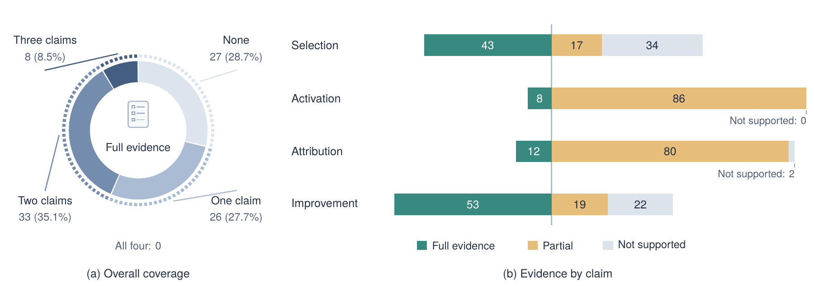

# Evidence Audit

The audit covers **96 methods** in the manuscript’s two update-target branches. Of these, 2 have no empirical evaluation and 94 reports are scored. Every row fixes one headline comparison before assigning all four verdicts.

| Claim | ✅ Full | ◐ Partial | — Not supported |
|---|---:|---:|---:|
| Selection | 43 | 17 | 34 |
| Activation | 8 | 86 | 0 |
| Attribution | 12 | 80 | 2 |
| Improvement | 53 | 19 | 22 |

Verdicts describe reported evidence. The criteria differ, so full-evidence counts are not a ranking of method quality. Activation can meet its criterion with one confirmed case; the per-method basis records the coverage.

Number of claims at full evidence within one report:

| 0 | 1 | 2 | 3 | 4 |
|---:|---:|---:|---:|---:|
| 27 | 26 | 33 | 8 | 0 |

The most common profile has full Selection and Improvement with partial Activation and Attribution. 8 reports meet Activation and 12 meet Attribution; interpret each verdict within its headline comparison and recorded coverage.

Read the [rubric](audit-rubric.md) for the evidence criteria. The [reading-list summary](../README.md#audit) provides a shorter introduction.

Source: [machine-readable audit](../data/claim-audit.json), [taxonomy](../data/taxonomy.json), and [manuscript snapshot](../data/source-snapshot.json). Regenerate with `python3 scripts/build_audit.py`.

## By update target

| Update target | n | Sel. ✅ | Act. ✅ | Att. ✅ | Imp. ✅ |
|---|---:|---:|---:|---:|---:|
| Prompts & Instructions | 12 | 6 | 0 | 3 | 12 |
| Memory & Procedures | 32 | 14 | 3 | 4 | 15 |
| Workflows & Topologies | 12 | 4 | 1 | 2 | 8 |
| Tools & Code Patches | 18 | 13 | 3 | 2 | 9 |
| Repository & Runtime Logic | 16 | 4 | 0 | 1 | 8 |
| Everything Is a Plugin | 4 | 2 | 1 | 0 | 1 |

## Verdicts

All four cells refer to the same headline. `n/a` denotes no empirical evaluation.

| Method | Branch · mechanism | Sel. | Act. | Att. | Imp. |
|---|---|:-:|:-:|:-:|:-:|
| [**ACE**](https://openreview.net/forum?id=eC4ygDs02R) `ICLR'26` | Interpreted · Gated Consolidation | ◐ | ◐ | ◐ | ✅ |
| [**ADAS**](https://openreview.net/forum?id=t9U3LW7JVX) `ICLR'25` | Executable · Whole-Control-Program Search | ◐ | ◐ | ◐ | ✅ |
| [**AFlow**](https://openreview.net/forum?id=z5uVAKwmjf) `ICLR'25` | Interpreted · Graph & Topology Search | ✅ | ◐ | ◐ | ✅ |
| [**Agent KB**](https://arxiv.org/abs/2507.06229) `arXiv'25` | Interpreted · Experience Mining | — | ◐ | ◐ | ◐ |
| [**AgentDevel**](https://arxiv.org/abs/2601.04620) `arXiv'26` | Executable · Repository Revision | ◐ | ◐ | ◐ | ✅ |
| [**AgentSquare**](https://openreview.net/forum?id=mPdmDYIQ7f) `ICLR'25` | Interpreted · Graph & Topology Search | — | ◐ | ◐ | — |
| [**AHE**](https://arxiv.org/abs/2604.25850) `arXiv'26` | Executable · Evidence-Grounded Component Patching | — | ✅ | ◐ | — |
| [**APE**](https://openreview.net/forum?id=92gvk82DE-) `ICLR'23` | Interpreted · Scalar-Score Search | — | ◐ | ◐ | ✅ |
| [**Argus**](https://arxiv.org/abs/2608.05144) `arXiv'26` | Executable · Contract-Driven Hooks | — | ◐ | ◐ | — |
| [**Autogenesis**](https://arxiv.org/abs/2604.15034) `arXiv'26` | Executable · Microkernel Platforms | ✅ | ◐ | ◐ | ◐ |
| [**AutoSaddler**](https://arxiv.org/abs/2608.23041) `arXiv'26` | Executable · Evidence-Grounded Component Patching | ✅ | ◐ | ◐ | ✅ |
| [**AWM**](https://proceedings.mlr.press/v267/wang25bx.html) `ICML'25` | Interpreted · Experience Mining | ✅ | ◐ | ◐ | ◐ |
| [**Behavioral Rules**](https://arxiv.org/abs/2607.13091) `arXiv'26` | Interpreted · Experience Mining | ◐ | ◐ | — | ◐ |
| [**CHASE**](https://arxiv.org/abs/2609.18366) `arXiv'26` | Executable · Evidence-Grounded Component Patching | ✅ | ◐ | ◐ | ✅ |
| [**CodeSkill**](https://arxiv.org/abs/2605.25430) `arXiv'26` | Interpreted · Procedural Skillbooks | ◐ | ◐ | ◐ | ◐ |
| [**Cordis / Spatiotemporal Composability**](https://arxiv.org/abs/2608.25512) `arXiv'26` | Executable · Microkernel Platforms | n/a | n/a | n/a | n/a |
| [**DarwinX**](https://arxiv.org/abs/2608.07545) `arXiv'26` | Executable · Repository Revision | — | ◐ | ◐ | — |
| [**DeepSeek Harness**](https://www.deepseek.com/harness/en/) `Product'26` | Executable · Microkernel Platforms | n/a | n/a | n/a | n/a |
| [**DEEVO**](https://arxiv.org/abs/2506.00178) `arXiv'25` | Interpreted · Self-Referential Mutation | ◐ | ◐ | ✅ | ✅ |
| [**DelvePO**](https://arxiv.org/abs/2510.18257) `arXiv'25` | Interpreted · Self-Referential Mutation | ◐ | ◐ | ✅ | ✅ |
| [**DGM**](https://openreview.net/forum?id=pUpzQZTvGY) `ICLR'26` | Executable · Repository Revision | — | ◐ | ◐ | ◐ |
| [**DSPy**](https://openreview.net/forum?id=PFS4ffN9Yx) `ICLR'24` | Interpreted · Fixed-Pipeline Compilation | — | ◐ | ◐ | ✅ |
| [**Dynamic Cheatsheet**](https://aclanthology.org/2026.eacl-long.333/) `EACL'26` | Interpreted · Gated Consolidation | — | ◐ | ◐ | ◐ |
| [**Ecdysis**](https://arxiv.org/abs/2609.11677) `arXiv'26` | Executable · Evidence-Grounded Component Patching | ✅ | ◐ | ◐ | ✅ |
| [**EffiSkill**](https://arxiv.org/abs/2603.27850) `arXiv'26` | Interpreted · Gated Consolidation | ✅ | ◐ | ✅ | ✅ |
| [**EGO-Prompt**](https://arxiv.org/abs/2510.21148) `arXiv'25` | Interpreted · Textual-Gradient Critique | — | ◐ | ◐ | ✅ |
| [**Evo-Harness**](https://arxiv.org/abs/2608.15071) `arXiv'26` | Executable · Evidence-Grounded Component Patching | ✅ | ◐ | ◐ | ◐ |
| [**EvolveNet**](https://arxiv.org/abs/2608.04968) `arXiv'26` | Executable · Repository Revision | ✅ | ◐ | ◐ | ✅ |
| [**EvoRepair**](https://arxiv.org/abs/2605.30105) `arXiv'26` | Interpreted · Experience Mining | — | ◐ | ◐ | — |
| [**ExpeL**](https://doi.org/10.1609/aaai.v38i17.29936) `AAAI'24` | Interpreted · Experience Mining | ✅ | ◐ | ✅ | ✅ |
| [**FlowEvo**](https://arxiv.org/abs/2607.21596) `arXiv'26` | Executable · Callable Tool Synthesis | ✅ | ✅ | ✅ | ◐ |
| [**GEPA**](https://openreview.net/forum?id=RQm2KQTM5r) `ICLR'26 Oral` | Interpreted · Textual-Gradient Critique | ✅ | ◐ | ◐ | ✅ |
| [**GPTSwarm**](https://proceedings.mlr.press/v235/zhuge24a.html) `ICML'24` | Interpreted · Graph & Topology Search | — | ◐ | ◐ | — |
| [**Group-Evolving Agents**](https://arxiv.org/abs/2602.04837) `arXiv'26` | Executable · Repository Revision | — | ◐ | ◐ | ◐ |
| [**GSE**](https://arxiv.org/abs/2608.06153) `arXiv'26` | Interpreted · Procedural Skillbooks | ✅ | ◐ | ◐ | ✅ |
| [**GSkill**](https://doi.org/10.1145/3786335.3813196) `ACM AIAS'26` | Interpreted · Procedural Skillbooks | ✅ | ◐ | ◐ | ✅ |
| [**GUI-HARVEST**](https://arxiv.org/abs/2610.00948) `arXiv'26` | Executable · Evidence-Grounded Component Patching | ◐ | ◐ | ◐ | ◐ |
| [**Gödel Agent**](https://aclanthology.org/2025.acl-long.1354/) `ACL'25` | Executable · In-Process Patching | ◐ | ◐ | ◐ | ✅ |
| [**Harness Ceiling**](https://arxiv.org/abs/2610.11655) `arXiv'26` | Executable · Evidence-Grounded Component Patching | ✅ | ◐ | ✅ | ✅ |
| [**HarnessBank**](https://arxiv.org/abs/2607.13683) `arXiv'26` | Executable · Evidence-Grounded Component Patching | ✅ | ◐ | ◐ | ✅ |
| [**HarnessCompass**](https://arxiv.org/abs/2608.01918) `arXiv'26` | Executable · Evidence-Grounded Component Patching | — | ◐ | ◐ | — |
| [**HarnessFix**](https://arxiv.org/abs/2606.06324) `arXiv'26` | Executable · Evidence-Grounded Component Patching | ✅ | ◐ | ◐ | ✅ |
| [**HarnessX**](https://arxiv.org/abs/2606.14249) `arXiv'26` | Executable · Contract-Driven Hooks | — | ✅ | ◐ | — |
| [**HGM**](https://arxiv.org/abs/2510.21614) `arXiv'25` | Executable · Repository Revision | — | ◐ | ◐ | — |
| [**Janus**](https://arxiv.org/abs/2606.31121) `arXiv'26` | Interpreted · Gated Consolidation | — | ◐ | ◐ | ✅ |
| [**JudgeFlow**](https://arxiv.org/abs/2601.07477) `arXiv'26` | Interpreted · Feedback-Driven Workflow Revision | ◐ | ◐ | ◐ | ✅ |
| [**Life-Harness**](https://arxiv.org/abs/2605.22166) `arXiv'26` | Executable · In-Process Patching | ✅ | ◐ | ◐ | ✅ |
| [**Live-SWE-agent**](https://arxiv.org/abs/2511.13646) `arXiv'25` | Executable · Callable Tool Synthesis | ✅ | ◐ | ◐ | — |
| [**Living-Harness**](https://arxiv.org/abs/2607.26598) `arXiv'26` | Interpreted · Gated Consolidation | — | ◐ | ◐ | — |
| [**MaAS**](https://proceedings.mlr.press/v267/zhang25bi.html) `ICML'25` | Interpreted · Graph & Topology Search | ◐ | ✅ | ◐ | ✅ |
| [**Mass**](https://proceedings.iclr.cc/paper_files/paper/2026/hash/1ab4e0e8f35078109bc78d7b465d306f-Abstract-Conference.html) `ICLR'26` | Interpreted · Graph & Topology Search | ✅ | ◐ | ✅ | ✅ |
| [**MCE**](https://icml.cc/virtual/2026/poster/64296) `ICML'26` | Interpreted · Gated Consolidation | ✅ | ◐ | ◐ | ✅ |
| [**MemCoder**](https://arxiv.org/abs/2603.13258) `arXiv'26` | Interpreted · Experience Mining | ◐ | ◐ | ◐ | ◐ |
| [**MemEvolve**](https://arxiv.org/abs/2512.18746) `arXiv'25` | Executable · Evidence-Grounded Component Patching | ✅ | ◐ | ◐ | ✅ |
| [**Memory Management**](https://aclanthology.org/2026.acl-long.27/) `ACL'26` | Interpreted · Gated Consolidation | ✅ | ✅ | ◐ | ◐ |
| [**Memory Transfer**](https://arxiv.org/abs/2604.14004) `arXiv'26` | Interpreted · Experience Mining | — | ✅ | ◐ | ✅ |
| [**MemP**](https://doi.org/10.18653/v1/2026.findings-acl.866) `ACL'26 Findings` | Interpreted · Procedural Skillbooks | ◐ | ◐ | ◐ | ✅ |
| [**Meta-Harness**](https://arxiv.org/abs/2603.28052) `COLM'26` | Executable · Whole-Control-Program Search | ✅ | ◐ | ◐ | ✅ |
| [**Meta-Team**](https://arxiv.org/abs/2605.29790) `arXiv'26` | Interpreted · Feedback-Driven Workflow Revision | ✅ | ◐ | ◐ | ✅ |
| [**metaTextGrad**](https://arxiv.org/abs/2505.18524) `arXiv'25` | Interpreted · Textual-Gradient Critique | ✅ | ◐ | ◐ | ✅ |
| [**MIPRO**](https://aclanthology.org/2024.emnlp-main.525/) `EMNLP'24` | Interpreted · Fixed-Pipeline Compilation | ✅ | ◐ | ✅ | ✅ |
| [**ModularRSI**](https://arxiv.org/abs/2609.14857) `arXiv'26` | Executable · Microkernel Platforms | ✅ | ◐ | ◐ | ✅ |
| [**MOSS**](https://arxiv.org/abs/2605.22794) `arXiv'26` | Executable · Repository Revision | — | ◐ | ◐ | — |
| [**MUSE-Autoskill**](https://arxiv.org/abs/2605.27366) `arXiv'26` | Interpreted · Procedural Skillbooks | — | ✅ | ◐ | — |
| [**OPRO**](https://openreview.net/forum?id=Bb4VGOWELI) `ICLR'24` | Interpreted · Scalar-Score Search | — | ◐ | ◐ | ✅ |
| [**Ouroboros**](https://arxiv.org/abs/2608.08311) `arXiv'26` | Executable · Repository Revision | ◐ | ◐ | ◐ | ◐ |
| [**PolySkill**](https://arxiv.org/abs/2510.15863) `arXiv'25` | Executable · Callable Tool Synthesis | — | ◐ | ◐ | ◐ |
| [**Promptbreeder**](https://proceedings.mlr.press/v235/fernando24a.html) `ICML'24` | Interpreted · Self-Referential Mutation | ✅ | ◐ | ◐ | ✅ |
| [**ProTeGi**](https://aclanthology.org/2023.emnlp-main.494/) `EMNLP'23` | Interpreted · Textual-Gradient Critique | — | ◐ | ✅ | ✅ |
| [**ReasoningBank**](https://openreview.net/forum?id=jL7fwchScm) `ICLR'26` | Interpreted · Experience Mining | ✅ | ◐ | ◐ | ◐ |
| [**ReCreate**](https://aclanthology.org/2026.acl-long.1432/) `ACL'26` | Executable · Evidence-Grounded Component Patching | ✅ | ◐ | ◐ | ✅ |
| [**Reflexion**](http://papers.nips.cc/paper_files/paper/2023/hash/1b44b878bb782e6954cd888628510e90-Abstract-Conference.html) `NeurIPS'23` | Interpreted · Experience Mining | ✅ | ◐ | ◐ | — |
| [**RHI**](https://arxiv.org/abs/2607.15524) `arXiv'26` | Interpreted · Feedback-Driven Workflow Revision | — | ◐ | ◐ | — |
| [**RoboPhD**](https://arxiv.org/abs/2601.01126) `arXiv'26` | Executable · Callable Tool Synthesis | ✅ | ◐ | ◐ | ✅ |
| [**RRSI**](https://arxiv.org/abs/2609.24972) `arXiv'26` | Executable · Whole-Control-Program Search | ✅ | ◐ | ✅ | ✅ |
| [**Self-Harness**](https://arxiv.org/abs/2606.09498) `arXiv'26` | Executable · Evidence-Grounded Component Patching | ◐ | ✅ | ◐ | ◐ |
| [**SePO**](https://arxiv.org/abs/2606.04465) `arXiv'26` | Interpreted · Textual-Gradient Critique | ✅ | ◐ | ◐ | ✅ |
| [**SEW**](https://arxiv.org/abs/2505.18646) `arXiv'25` | Interpreted · Feedback-Driven Workflow Revision | ◐ | ◐ | ◐ | ✅ |
| [**SICA**](https://arxiv.org/abs/2504.15228) `arXiv'25` | Executable · Repository Revision | — | ◐ | ◐ | — |
| [**Skill Consumption**](https://arxiv.org/abs/2605.23899) `arXiv'26` | Interpreted · Procedural Skillbooks | ✅ | ◐ | ◐ | ✅ |
| [**SkillClaw**](https://arxiv.org/abs/2604.08377) `arXiv'26` | Interpreted · Procedural Skillbooks | — | ◐ | ◐ | — |
| [**SkillForge**](https://doi.org/10.1145/3805712.3808466) `SIGIR'26 Industry` | Interpreted · Procedural Skillbooks | ✅ | ◐ | ◐ | ✅ |
| [**SkillMOO**](https://arxiv.org/abs/2604.09297) `arXiv'26` | Interpreted · Gated Consolidation | — | ◐ | ✅ | — |
| [**SkillOpt**](https://arxiv.org/abs/2605.23904) `arXiv'26` | Interpreted · Gated Consolidation | — | ◐ | ◐ | ✅ |
| [**SkillOpt-Lite**](https://arxiv.org/abs/2607.03451) `arXiv'26` | Interpreted · Gated Consolidation | ✅ | ◐ | ◐ | ✅ |
| [**SWE-Exp**](https://arxiv.org/abs/2507.23361) `arXiv'25` | Interpreted · Experience Mining | — | ◐ | ◐ | ◐ |
| [**Symbolic Learning**](https://doi.org/10.1016/j.aiopen.2025.11.004) `AI Open'25` | Interpreted · Feedback-Driven Workflow Revision | — | ◐ | — | — |
| [**TACO**](https://arxiv.org/abs/2604.19572) `arXiv'26` | Interpreted · Gated Consolidation | — | ◐ | ◐ | — |
| [**TextGrad**](https://doi.org/10.1038/s41586-025-08661-4) `Nature'25` | Interpreted · Textual-Gradient Critique | ✅ | ◐ | ◐ | ✅ |
| [**Trace**](https://arxiv.org/abs/2406.16218) `NeurIPS'24` | Interpreted · Textual-Gradient Critique | ✅ | ◐ | ◐ | ✅ |
| [**Trace2Skill**](https://arxiv.org/abs/2603.25158) `arXiv'26` | Interpreted · Procedural Skillbooks | ✅ | ◐ | ✅ | ✅ |
| [**TTHE**](https://arxiv.org/abs/2607.08124) `arXiv'26` | Executable · In-Process Patching | — | ◐ | ◐ | — |
| [**VALVE**](https://arxiv.org/abs/2609.32990) `arXiv'26` | Interpreted · Gated Consolidation | ✅ | ◐ | ◐ | ✅ |
| [**VASO**](https://arxiv.org/abs/2606.05395) `arXiv'26` | Interpreted · Gated Consolidation | — | ◐ | ◐ | — |
| [**VERSE**](https://arxiv.org/abs/2610.02616) `arXiv'26` | Executable · Whole-Control-Program Search | ◐ | ◐ | ◐ | ✅ |
| [**Voyager**](https://openreview.net/forum?id=ehfRiF0R3a) `TMLR'24` | Executable · Callable Tool Synthesis | ✅ | ◐ | ◐ | ◐ |

## Recorded basis

Section and table references below refer to each linked primary report. SEL / ACT / ATT / IMP separate the four claims. Coverage and audit computations are preserved from the manuscript audit.

| Method | Headline | Recorded basis |
|---|---|---|
| [**ACE**](https://openreview.net/forum?id=eC4ygDs02R) | Table 1 AppWorld, offline adaptation with GT labels: ReAct + ACE averages 59.4% (test-normal TGC 76.2 / SGC 64.3, test-challenge TGC 57.3 / SGC 39.6) against ReAct 42.4% (+17.0), the number the paper matches to the top-ranked IBM CUGA 60.3%; the online variant with offline warmup reaches 59.5% but adapts on the test stream | SEL: the offline loop spends no reporting evidence in principle - updates are distilled from the training split, the Curator merges delta bullets deterministically with no score-based admission gate, grow-and-refine appends or updates bullets in place with embedding de-duplication, and the epoch count is fixed at 5 - but the partition is only asserted: "All datasets follow the original train/validation/test splits" with no split sizes printed anywhere (the sole number given is GEPAs 57-query validation set in A.3); the hyperparameter sweeps in Tables 20 and 21 are also read off the FiNER reporting split (dedup 50/70/90% giving 77.0/73.9/78.6, pruning 10K/50K/100K giving 78.6/78.4/78.3), though the shipped setting is not the best row; ACT: the playbook is prepended to the ReAct agents context - availability; bullets carry "counters tracking how often it was marked helpful or harmful" and the Generator "highlights which bullets were useful or misleading", but that is an adaptation-time mechanism with no statistic reported, and in the offline setting the context is frozen before the scored runs; ATT: the ReAct vs ReAct+ACE contrast isolates the evolved playbook with sizeable margins (+12.5 TGC and +21.4 SGC on test-normal), but no seed, repeat, std, interval or significance test appears anywhere, so the margin is never placed against run-to-run variation, and the arms differ in the inference envelope - Sec 4.7 concedes "at evaluation time, while ACE may use more raw input tokens due to a richer playbook" and answers with a KV-cache billing argument rather than a matched budget; Table 4 controls only adaptation cost (82.3% less latency, 75.1% fewer rollouts than GEPA) and Table 3 ablates ACE components (Reflector, multi-epoch, offline warmup) rather than the evolved context; IMP: optimized on the training split and scored on the official AppWorld test-normal and test-challenge splits, the latter a deliberately harder held-out distribution |
| [**ADAS**](https://openreview.net/forum?id=t9U3LW7JVX) | Table 1 in-domain: Meta Agent Search 79.4 +/- 0.8 F1 on DROP vs 65.8 +/- 0.9 best hand-designed (+13.6); the paper leads with Table 1, the MGSM->GSM8K transfer in Table 2 is secondary | SEL: candidate agents are scored on a 20-question ARC validation set (128 for the other domains) and the partition is printed, but no rule is stated for which of the discovered agents supplies the reported number, and the transfer experiment selects the top 3 agents by test accuracy evaluated with GPT-3.5 on ARC; ACT: the discovered agent is an executable program whose forward() produces every scored answer, so the artifact runs by construction, but no executed-graph record, invocation count or adherence rate is reported for the test runs; the runtime-error retry in Algorithm 1 step 10 is a search-time mechanism and shows that a non-executing design cannot enter the archive, not that any particular accepted design ran; ATT: Table 1 reports 95% bootstrap intervals and the hand-designed baselines that seed the archive are the pre-update state run on the same GPT-3.5 and same test set with non-overlapping intervals, but the interval is a bootstrap over test questions (agents are evaluated once outside GPQA, App E) and there is no token, call-count or cost accounting anywhere while the discovered agents issue strictly more model calls (multi-CoT plus ensembling plus iterative refinement), so the arms differ in effort; IMP: the 800-question test set is disjoint from the 128-question validation set the search consumed (App E) |
| [**AFlow**](https://openreview.net/forum?id=z5uVAKwmjf) | Table 1: AFlow averages 80.3% across six benchmarks (HotpotQA 73.5, DROP 80.6, HumanEval 94.7, MBPP 83.4, GSM8K 93.5, MATH-lv5 56.2) on the divided test set with GPT-4o-mini, beating manual methods by 5.7% and ADAS by 19.5%, averaged over three test runs; the in-domain test-split number, not the Table 2 cross-executor transfer | SEL: the entire search runs on the validation side - Sec 4 partitions each dataset into a 20% validation and 80% test set with the random seed fixed at 42, Algorithm 1 line 6 evaluates every child workflow as Evaluate(child.workflow, G, D_V), line 8 updates W* only on validation improvement, the soft mixed probability selection uses validation scores, and the early-stopping rule fires when "the top-k average score shows no improvement for n consecutive rounds"; the partition is concrete (1:4 ratio with full GSM8K/HumanEval/MBPP, 1000 sampled each for HotpotQA and DROP, 617 level-5 MATH problems), and the validation-set refinement that keeps high-variance problems also happens inside D_V; ACT: the evolved artifact is executable workflow code whose best instance is printed in the appendix, so it runs by construction, but nothing per-run is reported - no node-execution record, operator-invocation count or branch-activation rate for the test runs behind Table 1; ATT: the envelope is controlled - Sec 5.1 says "for all datasets, we calculate the cost by tracking token usage to construct a pareto front", and Fig.4 places AFlow on the cost-performance Pareto front against baselines and stronger models - but the headline margin is never set against measured variation: Table 1 is a mean of three test runs with no std, interval or paired test printed (the 5-run mean and standard deviation of Sec 4 Evaluation are computed on the validation set, inside the search loop), and the only ablation (Fig.5, GSM8K with and without operators) removes a search input rather than the evolved workflow; IMP: reported on the 80% test split, disjoint by construction from the 20% validation split that drove every search decision, with sizes and seed given, plus Table 2 showing the discovered workflows transfer across executor models |
| [**Agent KB**](https://arxiv.org/abs/2507.06229) | GAIA validation set, smolagents + GPT-4.1: pass@3 73.9% quoted against baseline pass@1 55.2% for the abstract's "18.7pp gains at pass@3"; the matched same-pass comparison inside Table 1 is baseline pass@3 68.5% vs 73.9% (+5.5) | SEL: no train/test split exists for GAIA - the 165-task validation set is both the evolution stream and the report - and Sec 4.1 states "pass@2 enriches Agent KB with failure diagnoses from the first attempt, and pass@3 revisits unresolved cases using the expanded retrieval pool", so the instance's own failure diagnoses are written into the retrieval pool before its reported score, with no separation; the headline is additionally the last and highest of the three passes quoted against the baseline's first pass; ACT: retrieved experiences are injected into the plan and feedback prompts (availability); the disagreement gate "only refinements with G=1 are applied" is a per-refinement mechanism but no application rate is reported - Figure 5a sweeps the gate threshold against accuracy - and Appendix E.1 is a single qualitative trace walkthrough; ATT: the headline arms are baseline pass@1 at 55.2 against Agent KB pass@3 at 73.9, and the paper's own matched same-pass row is 68.5 versus 73.9, so most of the 18.7-point margin is the two extra attempts rather than the knowledge base; the Budget Cap column and the Reason/Retrieve/Refine ablation cover resources and components, but no seed, repeat, interval or significance test is reported and temperature is 1.0; IMP: the bulk of the knowledge base (about 9k workflow summaries and 7k execution snippets) was distilled from seven other benchmarks that GAIA never contributed to, giving genuine cross-domain distance at pass@1, but the pass@3 headline also retrieves diagnoses derived from the reporting instance's own earlier passes, so the distance is partial |
| [**AgentDevel**](https://arxiv.org/abs/2601.04620) | SWE-bench Lite Resolved 22.00% vs base agent b_0 11.00% (Table 1), the lead example of Sec 3.2 ("AgentDevel doubles the resolved rate from 11.0% to 22.0%"); all four benchmarks report in-domain held-out TestSet numbers, there is no separate transfer result | SEL: all four channels stay on the development set - diagnosis, RC synthesis, flip-centered gating and the stopping rule ("iteration continues until marginal gains are exhausted and further changes begin to show clear overfitting signals") are computed on D_train, and "the TestSet is reserved for a single, final evaluation"; what blocks C is that the partition is asserted but never shown - D_train and D_test are written as {x_i}_{i=1}^N and {x_j}_{j=1}^M with N and M never instantiated and no per-benchmark split sizes anywhere, which the rubric's procedure note 3 puts at O; ACT: the promoted blueprint (prompt, code, tool wrappers) is the deployed agent and structured execution traces are collected, but only on D_train for the critic; nothing per-run is reported for the single final TestSet evaluation, and the F2P/P2F flip sets are outcome records, which the rubric routes to attribution; ATT: base b_0 vs AgentDevel final isolates the evolved blueprint under a fixed Claude-Sonnet-4.5 engine, and Table 3 ablates the three pipeline components with "the same initial blueprint b_0, the same data split and budget", but those ablations target the evolution process rather than the evolved blueprint, no seeds, repeats, std, interval or significance test appears anywhere, test-set sizes are never stated so the margins cannot be sized (all scores are round: 11.00, 22.00, 15.00, 30.00, 54.00), the only resource statement is a qualitative "additional compute and wall-clock time" in Appendix A, and Table 1's WebArena 35.50 disagrees with Table 3's AgentDevel-full final test metric of 34.2; IMP: the number is read off a declared held-out TestSet that is used exactly once after the blueprint is frozen, so the reporting tasks sit at a distance from the D_train cases that produced every release candidate |
| [**AgentSquare**](https://openreview.net/forum?id=mPdmDYIQ7f) | Table 1 (GPT-4o): the searched AgentSquare agent scores Webshop 0.607, ALFWorld 0.695, SciWorld 0.781, M3Tool 0.524, TravelPlanner 0.583, PDDL 0.669, an average 17.2% gain over the best-known human designs (abstract; per-task +14.1/+26.1/+20.5/+30.6/+6.0/+6.0 in Sec 4.2); no transfer number is reported | SEL: there is no partition anywhere - Appendix A.1 names only the six benchmarks and their metrics, candidate agents are evaluated in the real task environment during search (Sec 3.2), the loop "terminates after 5 consecutive iterations without performance improvement", and Sec 4.4 reports "the searched best agent" read off the same trajectory plotted per iteration in Fig.4; the reporting tasks generated the update, ranked candidates, drove admission and chose which iteration is reported; ACT: the four module slots (Planning, Reasoning, Tooluse, Memory) are instantiated as executable code with a standardized IO interface and Table A.4 / Fig.6 name the specific modules in each searched agent (e.g. ALFWorld = Generative Agents memory + new TD planning + SF-ToT reasoning) - installed and available, but no invocation record, execution count or adherence rate for the scoring runs; ATT: the envelope is genuinely controlled - Figs A.7-A.12 plot performance versus API cost as a frontier per task and the search-method comparison is run "with a fixed LLM token budget ... maintaining the same number of search iterations", with per-iteration search cost in Table A.6 - but there is no variance evidence of any kind: no seeds, repeats, std, interval or significance test anywhere, and Table 2 ablates module evolution and module recombination, i.e. the two search operators, not the evolved agent; IMP: no distance - every reported score is measured on the same six task sets the search optimized against, with no held-out split, transfer benchmark or retention probe |
| [**AHE**](https://arxiv.org/abs/2604.25850) | Terminal-Bench 2 pass@1 77.0% vs the NexAU0 seed 69.7% (+7.3 pp, 89 tasks, k=2 rollouts), Table 1 - the in-domain evolution number the abstract and conclusion both lead with, not the SWE-bench-verified 75.6% transfer row of Table 2 | SEL: Sec 4.1 drives evolution on "the full 89 tasks of Terminal-Bench 2" and Sec 4.2 reports on the same 89 tasks, and the configuration is itself a pick - "We run a single AHE campaign of ten iterations ... the best resulting configuration is reported as AHE"; two of the four channels (the reporting tasks generated the update, and they chose which round is reported) overlap the reporting evidence; ACT: per-run records in the rollouts behind the reported figure: iteration 8 is the run's high-water mark at 76.97, and in its scoring rollouts the shell layer emits hard-block messages naming the protected web root and protected ref for the cleanup commands, while the middleware's FRAMEWORK reminder enters the next model turn and the agent fixes the violation rather than publishing over it; both are cases rather than rates over all 89 tasks (C.1.4, C.2.3) [coverage: case (iteration 8 rollouts)]; ATT: Table 3 does isolate each evolved layer against the seed (+memory only 75.3%, +tool only 73.0%, +middleware only 71.9%, +system_prompt only 67.4% vs NexAU0 69.7%), but no interval, std or paired test is given for Terminal-Bench 2 and the Limitations call it "a promising but high-variance setting"; the +7.3 pp margin sits close to a binomial band at 89 tasks x k=2, and the three positive single-component gains sum to +11.1 pp against full AHE +7.3 pp, which the paper itself reads as non-additive interaction; tokens are absent from Table 1 and reported only for the SWE-bench transfer (12% fewer than the seed, Succ/Mtok frontier in Table 5); IMP: no distance - the reporting set is the evolution set (same full 89 Terminal-Bench 2 tasks, no subsampling); the held-out evidence in the paper (SWE-bench-verified, five alternate bases) attaches to the Table 2 and Fig.3 numbers, not to this one |
| [**APE**](https://openreview.net/forum?id=92gvk82DE-) | Zero-shot test accuracy on the 24 Instruction Induction tasks: APE equals or beats human-engineered prompts on 24 of 24, with an Interquartile Mean of 0.810 versus humans' 0.749 (Fig 4, Fig 1); the 17-of-21 BIG-Bench Instruction Induction result is the secondary number | SEL: the cascade itself is scored on training data only (candidates filtered on non-overlapping training subsets, the survivor measured on the test split), but the headline is a picked configuration: Appendix F states that a previous iteration of APE reached human level on 19 of 24 tasks, that the proposal and demonstration hyperparameters were then retuned, and that APE was re-evaluated on exactly the 5 tasks below human level (Table 17), which is what turns 19/24 into the reported 24/24; the default scoring metric was also chosen by its Spearman correlation with test accuracy (Fig. 7 middle). The fourth channel is spent on the reporting partition; ACT: the selected instruction is simply prepended to each query as [rho; Q], pure availability, with no trace check, beacon or adherence rate establishing that the model followed the induced instruction rather than solving the task regardless; ATT: APE is run with five seeds and per-task standard deviations appear as error bars in Fig 4, and the envelope is identical across arms (one prepended instruction, same InstructGPT, zero-shot), but the headline compares against human-engineered prompts, for which no dispersion is given, through an IQM over 24 tasks (0.810 vs 0.749) and a count of tasks at equal-or-better, with no interval or test on either; the Greedy contrast, which APE outperforms on every task, is a different comparator; IMP: reported on the benchmark's held-out test split with the instruction induced from five training demonstrations, plus further distance via BIG-Bench Instruction Induction (17/21), TruthfulQA, and transfer of the discovered zero-shot-CoT prefix |
| [**Argus**](https://arxiv.org/abs/2608.05144) | SWE-Bench Pro 731 tasks: Argus approximately 78% accuracy versus Direct Copilot approximately 59% at 1.41x aggregate Tokens (Table 4, Fig 4a); the longitudinal 21%-fewer-solve-input-Tokens Wave result is the secondary number | SEL: the Skill and Wiki state evolves during the same single sequential pass over the 731 SWE-Bench Pro tasks whose accuracy is reported (Waves W1-W24), the Reviewer admits state edits from those task outcomes, and the official verifier for the benchmark is consulted inside the loop - 34 tasks pass it on a later revision after a Reviewer request - so the reporting signal is spent on the proposal and on admission, and no reporting partition is withheld; ACT: the 731-task run carries per-task execution records of the adaptive routing and review path (466/731 tasks invoke an independent Reviewer, 286 Reviewer revisions, 34 verifier recoveries, 89 session rolls, 16 Stage rollbacks on a typed append-only trace), but the paper's own account is that Skill libraries are 'exposed, not injected' and the acting agent retrieves them itself, so the routing counts establish that the base review machinery ran rather than that any accepted Skill or Wiki edit was reached or followed in a scored task; ATT: one pass per arm with no repeated executions, interval or dispersion, aggregate Tokens reported at 1.41x (3.72M versus 2.95M) in Argus's favour but not matched, and no ablation isolating the evolved state, which the paper concedes -- "The current results therefore characterize whole-system behavior over this sequence. Matched frozen-state runs, randomized task orders, and randomized review routing will separate the contributions of persistent state, role separation, and review" (Sec 8) and "attributing the reduction to an individual memory or Skill update calls for a matched frozen-state replay"; IMP: the 78% is read off the same 731 tasks over which the Skill and Wiki state accumulated, with no held-out partition, no retention probe, and the cross-backbone GLM-5.2 run excluded because it "has no matched Direct baseline, so it bounds nothing yet" |
| [**Autogenesis**](https://arxiv.org/abs/2604.15034) | GAIA Test overall Pass@1 89.04% with Agent-Evo (Table 2), improving the vanilla baseline by 12.6% on average (8.2% on Level 1 to 33.3% on Level 3), alongside the best reported Validation score of 93.33%; the paper leads with this GAIA result and there is no transfer number | SEL: the loop evolves inside the scored run, but the accepted-update signal is the agent's own evaluation against the task objective rather than the benchmark's scoring evidence: GAIA and HLE test labels are unavailable to the system, so no reporting verdict is consulted by proposal or admission and no round is picked; the self-evolution is test-time adaptation, and the reported 89.04 is a measurement of that process on the Test split; ACT: evolved prompts, tool code and agent code are hot-swapped into the registry and each sub-agent independently retrieves relevant prompt and tool resources from it, i.e. availability; the version manager and trace manager make invocation auditable in principle but no reuse rate, invocation record or adherence figure is reported for the GAIA runs; ATT: the vanilla vs Agent-Evo contrast does isolate the evolved component under the same gemini-3.1-pro-preview backbone and the step caps are stated (planner m = 30, sub-agents m = 20, reflection budget 3 rounds), but there is no interval, no seed count and no repeated run anywhere in the paper, and the limitations section concedes that self-evolution introduces additional inference rounds that increase latency and token consumption with the efficiency-effectiveness trade-off left to future work, so the envelope moved in the arms favour and is never quantified; IMP: the GAIA Test number is read off the same tasks the loop adapted on within inference (Fig 3 compares evolving and vanilla AGS within-inference), so there is no distance; the Validation score of 93.33 is a separate split but is not the headline |
| [**AutoSaddler**](https://arxiv.org/abs/2608.23041) | GAIA2 test-set Pass@1 average 62.0 vs Default Agent base harness 53.0 (+9.0), mean over three runs, Table 2; in-domain held-out (disjoint personas) is the lead, Appendix E cross-model transfer is secondary | SEL: Sec 5.1 and Table 6 show the partition explicitly and by disjoint task group rather than random split (GAIA2 train Universe 29 / 75 tasks, dev Universe 30 / 65, test Universes 21, 22, 27 = 107/112/81; SBP train qutebrowser 79, dev Vuls 40 + NodeBB 40, test Ansible 96 / Flipt 85 / Element-web 56); all four channels stay on train/dev - mini-batch acceptance criterion, dev-set generalization check, and argmax over dev to pick the round (Appendix J, global dev peak 72.3% at Iter27) - then "the selected harness is evaluated once on the held-out test set and is not further modified using test feedback"; ACT: the patched prompts, tools and middleware hooks are deployed code, but no firing count, beacon or adherence rate is reported for the test runs; the tool-call/file-access numbers in Appendix K (6.2 extra tool calls, 5.8 extra file accesses per step) describe the optimizer-side diagnosis session, and the "overly broad hook on a high-frequency tool" observation is a qualitative dev-time finding; ATT: route (b) - base harness versus AutoSaddler isolates the evolved harness under one backbone and the test sets are run three times with mean +/- std, so the +9.0 GAIA2 margin sits far outside the unchanged arm's dispersion - but the patches may change the agent configuration, iteration budget or environment settings, and the only cost accounting is an average evaluation cost per rollout that is not compared between the base and the evolved harness; IMP: the test sets are disjoint personas (GAIA2) and disjoint repositories in different languages (SBP), so the reporting tasks sit at a distribution distance from the training mini-batches that formed the patches |
| [**AWM**](https://proceedings.mlr.press/v267/wang25bx.html) | WebArena total success rate 35.5% with GPT-4, +12.0 points / 51.1% relative over the published BrowserGym baseline 23.5% (Table 1); the controlled same-representation arm BrowserGym ax-tree is 15.0%; this in-domain online number is the lead, the Mind2Web cross-website/cross-domain splits are the secondary transfer evidence | SEL: WebArena provides only test examples, so AWM runs online over the 812 tasks themselves, and the protocol is prequential in the sense that matters here: task t is solved from the workflows induced by tasks 1..t-1 and its success verdict is produced by the benchmark before it is converted into workflows, so no task is rescored after its outcome entered the state and no round or configuration is picked on the reported average; supervision for the induction signal comes from an LM-based evaluator rather than the benchmark reward (Sec 3.2); ACT: induced workflows are written into the agent memory, i.e. the system prompt or auxiliary context; Table 10 reports a WebArena "utility rate" of 0.94 ("How often are workflows used by test examples") but the metric is not operationalised and could equally be the fraction of stream positions at which any workflow existed, and the one genuine trajectory-conformance metric, step Coverage (0.40 on Mind2Web), is explicitly "not evaluated on WebArena since it requires canonical trajectories"; ATT: the headline comparator is the published BrowserGym result (23.5), produced in another report's setup with a different observation representation, so the headline arms differ in more than the workflow memory; the authors' same-representation rerun (BrowserGym ax-tree 15.0 vs AWM 35.5 on 812 tasks; 20.5 vs 33.2 on the cross-template subset) is a different comparator and is not borrowed for this cell; no std, interval or significance test is reported for either; envelope favourable on the rerun (5.9 vs 7.9 steps per task), temperature 0.0; IMP: the WebArena score is measured on the same task stream that produced the workflows, with only prequential ordering as separation - Figure 5 is literally a rising cumulative-success curve over that stream - though the cross-template subset of Table 2 removes template-level overlap |
| [**Behavioral Rules**](https://arxiv.org/abs/2607.13091) | 0 recurrences across 9 tracked error classes over 74 cumulative post-rule session-exposures (Table IV); in-domain deployment, no transfer headline | SEL: no ranking and admission is "every accepted review comment is codified as a rule"; Table IV shows per-rule add-session and post-rule exposure counts, but the 11-session production stream both generates rules (W1-S1..W2-S5) and supplies the exposures, so reporting sessions partly coincide with the evolution set; ACT: only "the updated instruction file is loaded in all subsequent sessions" plus "both loaded the same instruction file" - availability asserted, no beacon, no checklist-execution record, no adherence count; ATT: Sec VIII "we do not have a parallel control group, and we did not run a paired ablation"; "we do not report p-values"; single observational deployment, no baseline arm, no repeated runs; IMP: post-rule exposures are later sessions in the same adaptive production stream rather than a shown held-out partition; the only cross-boundary evidence (60%, 9/15, Table VI) is a secondary result not the headline |
| [**CHASE**](https://arxiv.org/abs/2609.18366) | Table 1, OfficeQA Full certification on the 76-question D_cert: CHASE reaches the highest archive-average 68.42% and worst-case 67.98% over A_3, against RawHarness 66.23% / 64.47%, with released-benchmark R_rel 68.86% vs RawHarness 67.98% (HarnessEvolve is higher at 69.30%); the paper leads with this certification result and reports the Pro V2 cross-corpus 30.37% second | SEL: the partition is explicit and the reporting set is walled off - the 246 OfficeQA Full questions are split into D_evo (49), D_disc (49), D_cert (76) and three round-specific D_conf,t (24 each), with rollout counts per role (2 on D_evo, 2 on D_disc, 5 per D_conf,t, 3 on D_cert); the Proposer sees only D_evo, the Challenger searches D_disc, counterfactuals are confirmed on D_conf,t, and the constrained final-harness selection among H_0..H_3 uses D_evo plus the archive constraints, so no channel reaches D_cert; ACT: the evolved harness is executable code around a fixed model and runs by construction, but nothing per-run is reported - no beacon, invocation record or adherence rate; the Challengers gain-destruction analysis (H_1 gain on D_evo falls from 8.16% under B_rel to -5.10% under B_b1) shows the gain depended on a protocol regularity, which is attribution evidence about the edit, not evidence its path executed; ATT: every certification number averages three rollouts per question-benchmark pair and token use is accounted on both sides (Table C.7 certification: RawHarness fewest total at 93.82M, Meta-Harness fewest excluding cached input at 20.68M; Table C.8 optimization), but no std, interval or paired test is printed for Table 1, the envelope is reported rather than matched and moves against the cheapest arm, and the margins are tiny relative to a 76-question set (R_rel +0.88, R_avg +2.19, R_min +3.51 over RawHarness; CHASE actually trails HarnessEvolve on R_rel and on Syn-Ledger B_rel); IMP: scored on D_cert, disjoint by construction from D_evo, D_disc and every confirmation set, plus the 90-question Pro V2 release over a separate receipts-and-expenditures corpus that the optimization never touched |
| [**CodeSkill**](https://arxiv.org/abs/2605.25430) | Macro-average pass rate 40.35 vs no-skill 29.32 (+11.03) under the frozen Qwen3.5-35B-A3B coding policy, Table 1 Avg. - the abstract's lead claim; the OOD Terminal-Bench 2 number (25.88 to 36.47) is secondary | SEL: Sec 4.1 declares training/eval partitions (SWE-bench Verified 150 eval / 350 RL train, EnvBench 150 eval / 844 split, TB2 unused in training), but the evaluated skill bank itself is built by "two preparatory passes over the test set before final evaluation"; the only separation is per-instance provenance filtering ("we exclude any skill whose provenance includes the current test instance"), so skills derived from the other evaluation instances are retrievable - the reporting set coincides with the evolution set at the set level; the two-pass-then-evaluate protocol is fixed in advance, no best-pass pick; ACT: at evaluation, task-level skills are "retrieved once before task solving and appended to the initial downstream policy user prompt" and event-driven skills are retrieved online - presence in context only; the alignment factor R_A that judges "whether the rollout actually matches the skill trigger condition and follows its workflow" is an RL reward term computed on training rollouts and is never reported as a statistic for the evaluation runs; ATT: no-skill vs CodeSkill holds the frozen downstream policy, retrieval procedure, prompt format and decoding settings fixed, and the envelope moves favourably (average reasoning steps on the commonly solved subset drop from 44.12 to 35.99), but no seeds, repeats, std, interval or significance test appear anywhere, the margin (+11.03 macro-average, +10.6 on 85 TB2 instances) is within a few standard errors, and the conclusion concedes future work should "evaluate the end-to-end cost of skill acquisition, maintenance, and use"; IMP: provenance exclusion gives a leave-one-instance-out distance, but the bank supplying the retrieved skills was produced by two passes over the same evaluation instances, so the distance is partial |
| [**Cordis / Spatiotemporal Composability**](https://arxiv.org/abs/2608.25512) |  | Formal calculus + Cordis; s5.3 Koishi case study is qualitative. Own threats to validity: "observational rather than a controlled comparison", "an existence-and-adoption result rather than a quantitative one; measuring the abstraction's overhead ... remains future work". Self-evolving harnesses = future work. |
| [**DarwinX**](https://arxiv.org/abs/2608.07545) | Terminal-Bench 2.1 avg@5 on a frozen GPT-5.5 Sol base: evolved Monet 83.2 +/- 1.2 against base Monet 75.5 +/- 3.5 and a neutral harness (Terminus-2) at xhigh 78.0 +/- 1.2, Table 2; the GPT-5.6 Sol / medium row at 84.7 is a separate leaderboard comparison, and the matched-model pair is the one the attribution verdict is about | SEL: the paper declares the defect itself -- "This is the in-domain regime: the search optimizes and is reported on the same task suite" -- with DarwinX evolving over the 89-task suite, "screening candidates at avg@3 on rotating subsets and confirming steering nodes at avg@5 on the full suite", and the fitness enabler (g(c) > 0 and R(c) <= delta), the verifier's promote/revert verdict and the higher-fidelity preservation probe all scored on those same tasks, so proposal, ranking, admission and the final report all run on the reporting evidence; ACT: the seven added skills all belong to the verification/artifact-contract family (Table 6) and are present in the evolved harness, but Sec 8 is explicitly "an exploratory attribution, not a per-skill causal ablation: the skills were co-selected, not independently randomized", with no execution beacon, trace-feature check or adherence rate for TB2.1 -- the per-trajectory validity audit with a rate (confirmed-invalid falling 23.5% to 1.4%) belongs to the WebArena-Infinity result, and the Sec 4.1 turn/token profile is edit-effect evidence; ATT: the pair is matched on model and paired per task and both arms carry avg@5 intervals, but the configurations are not matched on effort: Table 2 runs base Monet at the provider's default reasoning effort and evolved Monet at high, and Fig 5 shows the evolved harness taking 22 versus 11 median turns and 380K versus 89K median tokens on the six newly solved tasks (125K to 172K on the 69 already solved); the extra compute is concentrated rather than uniform, and the xhigh Terminus-2 control swaps harness and effort together, so neither rules out the higher effort setting as a source of part of the margin; IMP: the 84.7% is read off the same 89-task Terminal-Bench 2.1 suite the harness evolved on, with the held-out TerminalWorld split (41 disjoint tasks), WebArena-Infinity and the SWE-bench Verified transfer reported as separate numbers |
| [**DeepSeek Harness**](https://www.deepseek.com/harness/en/) |  | Cited artifact is the deepseek.com/en/harness/ product page (fetched live): features, demo transcript, setup docs. No benchmark, table, metric, ablation or before/after number. Obtained, so X not U. |
| [**DEEVO**](https://arxiv.org/abs/2506.00178) | ABCD accuracy 83.7% (Table 1, DEEVO vs SPO 77.3%) -- the lead close-ended result; in-domain, no transfer number | SEL: Sec 4.1 declares evolution on training portions and scoring on 'held-out test sets' and fixes 5 generations in advance, but ABCD/BBH-Nav partition boundaries are never shown (only 'we sampled portions from original datasets as test sets (Yan et al. 2024)'); only MT-Bench shows the split (5 train / 5 test subtasks per category); Figure 2 plots test-set F1 per generation, so the reporting partition was inspected across rounds; ACT: evolved prompt is substituted into the scored call (Table 1 caption 'All methods are executed with Claude 3.5 Sonnet V2 on the test set'), availability only -- no beacon, trace check or adherence rate showing the prompt content shaped the trajectory; ATT: the prompt is substituted into the scored call on one model, Table 1 averages three runs with a paired-significance column below 0.05 for every arm, and test-time decoding is matched at temperature 0; the comparison's inference envelope is one call with a prepended prompt in each arm, and the debate rounds belong to optimization rather than to the scored run; IMP: scored on held-out test sets disjoint from the training portions that drove evolution, MT-Bench partition explicit at 5 train / 5 test |
| [**DelvePO**](https://arxiv.org/abs/2510.18257) | Table 1, DeepSeek-R1-Distill-Llama-8B: DelvePO averages 70.48 over 7 datasets vs the best automated baseline EvoPrompt 65.55 and CoT-FS 62.81, with per-dataset std over three seeds (e.g. CoLA 76.25 (1.49) vs 66.75 (2.73)); in-domain test splits, no transfer headline | SEL: the evolutionary Top-N ranking and the ArgMax admission run on the training side, the Reproducibility Statement reports results on the test set, and the split rule is concrete where a predefined split exists (otherwise 100 random test examples with the remainder for training); the split that carries the Top-N score, D_dev, is neither sized nor located, so the partition is not fully shown; ACT: the evolved prompt is simply handed to the target LLM as its instruction - present in context, availability only; no beacon, trace feature, component-execution record or adherence rate is reported for the scored runs; ATT: Table 1 (task model DeepSeek-R1-Distill-Llama-8B) averages three training seeds with per-dataset standard deviations; computed from those SDs (audit computation, seeds treated as independent), the standard error of the seven-dataset average difference against EvoPrompt is about 0.55 points against a +4.93 margin; both arms hand one evolved instruction to the same task model at the same decoding temperature (0.5), so the scored-run envelope is equal, and the Fig 3 / Table 6 costs are per-epoch optimization cost, i.e. search rather than test-time compute; IMP: reported on the test split while the evolution runs on the training split, with the partition rule and the 100-example test size given |
| [**DGM**](https://openreview.net/forum?id=pUpzQZTvGY) | SWE-bench Verified 50.0% on the 200-task subset after 80 DGM iterations, up from the base agent 20.0% (Sec 4.4) -- the in-domain number the abstract and Sec 4.4 lead with; the genuinely held-out transfer figure (best SWE-bench agent scoring 28.9% on Polyglot, Fig 4 middle) is reported but not led with | SEL: all four channels run through the reporting evidence -- Sec 3 states each parent "analyzes its own benchmark evaluation logs, proposes the next feature to implement", so the update is generated from the reporting tasks; "Parent selection is roughly proportional to each agents performance score", so those scores drive ranking; the admission rule is Sec 4.2s staged gate, "if a coding agent achieves over 40% success on the 60-task subset and ranks among the top two performers in the archive, it is then evaluated on 200 tasks (140 plus the previous 60)", so the gate consults a subset of the very 200 tasks the headline is read off; and the headline agent is the archive maximum, Figure 3 Right tracking "the best score achieved by any agent in the archive at each iteration" down to a "Final best agent" node, with the 40% threshold itself only "a heuristic chosen based on the noise observed in preliminary runs" rather than a stopping rule fixed in advance; ACT: the update target is the agent's own code and Sec 3 keeps only agents that compile and retain the ability to edit a codebase, enforced by a 10-task screen during search; no per-run record shows that an accepted edit's path executed in the scored runs, and Appendix G's contrast between two implementations of the same feature is an outcome comparison rather than an execution record; ATT: counterfactual arms exist and the swing is large -- DGM w/o self-improve and DGM w/o open-ended exploration both isolate the evolved mechanism (Appendix A.1; on Polyglot DGM 51.3% against 32.5% and 32.5%) and Appendix A measures run-to-run variation directly, three DGM runs on Polyglot giving "a mean accuracy of 40.7% with a standard deviation of 2.3%", which no plausible noise band stretches to cover a 30-point SWE-bench swing; but the compared arms differ in effort setting, since the accepted self-modifications themselves include "multiple patch generations and ranking" and "non-empty patch validation and retry", and the paper reports no per-task token, model-call or retry accounting for base agent against best agent (Appendix E.1 is a whole-search cost estimate), so a changed resource envelope is not ruled out for the headline margin; IMP: distance is partial -- the 200 reporting tasks are drawn from the same SWE-bench Verified pool the loop evolved against and strictly contain the 60-task subset that supplied the proposal logs and the promotion gate, leaving 140 tasks outside that subset but inside the same staged pipeline, and the paper reserves its held-out claim for the cross-benchmark transfer ("each agent was optimized without ever accessing the alternate benchmark") rather than for the 50.0% |
| [**DSPy**](https://openreview.net/forum?id=PFS4ffN9Yx) | GSM8K GPT-3.5 CoT + bootstrap + ensemble, Dev 88.3% (Table 1) - the top of the paper's own lead claim "improves different LMs from 4-20% accuracy to 49-88% accuracy", where both 49 and 88 are Dev values; the test counterpart in that row is 81.6% | SEL: the 300-example devset is the compiler's valset - BootstrapFewShotWithRandomSearch is called as compile(program, trainset=trainset, valset=devset) with "10-20 trials over 150-300 validation examples", and Ensemble takes "the top-7 candidate programs from a bootstrapping compiler run", so both the random search and the ensemble ranking are scored on the exact partition the 88.3 is read off; the paper states it reports "extensive comparisons on the development set to avoid overfitting on test", confirming dev is the search set; ACT: compiled demonstrations sit in the prompt, i.e. present in context; the only execution-level evidence is the qualitative Appendix F prompt inspection ("the prompt allows the LM to leverage the answer field for reasoning first"), no per-run beacon or conformance rate; ATT: the none-vs-bootstrap contrast does isolate the compiled demonstrations with a margin no noise band covers (CoT none 50.0 to bootstrap 80.3), but the headline row adds a 7-program majority-vote ensemble whose inference cost is not matched against the single-call baseline and whose contribution is not separated from the evolved artifact; no std, interval or significance test is reported (the "average of 3-5 runs" note applies to the random-sampling LabeledFewShot setting); IMP: GSM8K is split 200 train / 300 dev / 1.3k official test and the bootstrapped demonstrations are drawn only from the 200-example trainset, so the dev partition sits at a distance from the tasks that formed the update even though the search then spent it |
| [**Dynamic Cheatsheet**](https://aclanthology.org/2026.eacl-long.333/) | Game of 24 with GPT-4o (Table 1): 10.0% baseline and 19.0% DC-empty rising to 99.0% under DC-RS; the abstract leads with "from about 10% to 99%" | SEL: the cheatsheet is curated online from the same benchmark sequence (x1, ..., xn) that is scored, with no ground-truth labels and no separate partition anywhere, and on top of that the reported variant is the best cell of Table 1 per benchmark (DC-RS for Game of 24 at 99.0 versus DC-Cu at 93.0, DC-Cu for AIME 2024 at 50.0 versus DC-RS at 46.7) with retrieval top-k also swept on the same benchmarks ("We also experimented with higher top-k values such as 5 and 7, but the gain was insignificant"); ACT: the curated memory is inserted into the generator prompt and individual memory items carry a usage count (the Game 24 Solver item shows "Count: 99"), which is a retrieval/usage tally, with no execution beacon, output-survival check or adherence rate establishing that the retrieved snippet drove the scored answer; ATT: DC-empty is built to isolate the evolved component, keeping the same structured problem-solving and explicit tool-use instructions while holding the memory content empty, so the arms differ only by the cheatsheet, and the 19.0-to-99.0 swing on Game of 24 is far outside any plausible noise band; but route (b) also needs the envelope controlled, and the only accounting is declared rather than matched (fn. 13: AIME 2024 output tokens 370 under the baseline, 494 under DC-empty and 1035 under DC-RS, so generation roughly doubles with the cheatsheet), while the headline Game of 24 runs carry no token or call accounting at all - the same reading as DarwinX's declared but unmatched envelope; IMP: the reporting set is the evolution set, memory accumulates across the same benchmark questions it is scored on, so the only evidence of reach is the online adaptive stream with no held-out partition, transfer benchmark or retention probe |
| [**Ecdysis**](https://arxiv.org/abs/2609.11677) | Held-out accuracy averaged over 15 combinations of 5 task models and 3 datasets: Ecdysis (w/ FDCR) 69.56% versus SE 58.67%, the +18.56% relative gain the abstract leads with (Table 1, with Pass@3 77.67 versus 72.67 and Pass^3 60.00 versus 46.67) | SEL: the protocol is operationally explicit, "All evolution decisions are based exclusively on the training split", candidates are "evaluated only in the subsequent complete evaluation and never on the trajectories used for their generation", the admission rule is strict improvement of J_train on the training set only, and the frozen output is the last validated harness after a fixed round count rather than a held-out-selected round, with the held-out matrix touched once after freezing (App C), so none of the four channels consumes the reporting evidence -- the one gap is that per-split task counts are never printed; ACT: the evolved harness is the runtime that executes the held-out tasks, so it enters every run by construction, but nothing above availability is reported, there is no trigger-firing count, executed-node record or adherence rate for any accepted modification, and the 11-13% held-out token reduction is an edit-effect outcome rather than an activation record; ATT: arms share the frozen task model, initial harness and training-time acceptance protocol, and the envelope moves against the gain (held-out inference tokens 8.301M to 7.240M, runtime 111.12s to 98.41s per trajectory, Table 2); each held-out task is run three times, but Pass@3 and Pass^3 are consistency statistics rather than a dispersion of the margin, Table 2's means and standard deviations are of cost and runtime, and no interval or test is reported for the 15-combination average accuracy (69.56 vs 58.67); IMP: reported on a held-out split the evolution never saw, with the further distance that harnesses evolved with Qwen3-8B are reused unchanged on four other task models (Qwen3-32B rises from 51.67% under SE to 68.33% on tau2-Airline) "without further evolution" |
| [**EffiSkill**](https://arxiv.org/abs/2603.27850) | Table 1, EffiBench-X Python with GPT-5-mini (the designated primary setting): EffiSkill OPT@1 26.48% / OPT@8 37.40% vs the best baseline FasterPy 21.19 / 32.42, part of the abstracts "3.69 to 12.52 percentage points over the strongest baseline across model and language settings" | SEL: none of the four channels touches the reporting evidence - the skill library is mined offline from 900 Python and 900 C++ slow/fast pairs drawn from PIE, Mercury, CodeContests and APPS, and Sec 4.2 states "we further verify that there is no overlap between the constructed mining corpus and the tasks in EffiBench-X"; within each task the partition is shown not asserted (fixed random seed 42, 20% public / 80% private) and "Public tests are used only for candidate selection ... Private tests are reserved exclusively for final evaluation", with candidate ranking by public-test runtime; ACT: Sec 5.4 counts 16412 candidate-skill pairs and 3134 problem-bundle observations and reports a usage distribution (implementation and constant-factor family 54.2% of pairs, top-5 skills 68.3% of usages under GPT-5-mini and 70.0% under Qwen3-Coder, ~10-13 effectively active skills by entropy), but a candidate-skill pair is defined as "one skill attached to one generated candidate" - an attachment/usage percentage, which is availability; the Sec 6.2 case study compares the EffiSkill and prompting candidates' code and runtime on one task but names neither the retrieved skill nor the backbone setting, so it is an outcome comparison rather than a record that a specific skill was followed; ATT: route (a) is met - Table 1 marks one-sided paired bootstrap tests against the best non-EffiSkill baseline in each model-language cell (* p<0.05, dagger p<0.10, computed by resampling paired task-level differences), each candidate is executed three times with the mean runtime reported to damp measurement noise, and the envelope is held equal across arms: identical generation budget k=8 per task for every method, the same two backbones, the same EffiBench-X canonical solution as input, and the same official execution harness and hardware; IMP: the evolved artifact was formed on an external corpus verified disjoint from EffiBench-X and is scored on EffiBench-X private tests, i.e. transfer to a benchmark the mining stage never saw, with RQ3 adding Python-to-C++ cross-language transfer |
| [**EGO-Prompt**](https://arxiv.org/abs/2510.21148) | Mean F1 0.410 across Pandemic, TrafficSafe and Swissmetro with GPT-4o mini as forward engine (Table 3), the +7.32% over the strongest baseline ProTeGi at 0.382 that the abstract leads with as "7.32%-12.61% higher F1" | SEL: the reported number is explicitly a maximum -- Sec 5 Experimental Settings states "we repeat each experiment three times and report the best result to represent the achievable upper-bound performance under identical settings", and Sec 8.6 repeats it ("To explore the upper-bound performance ... we perform multiple runs for each experiment and report best results"), so the headline is the best of three draws on the 100-instance test partition with no stopping rule fixed in advance; the reporting partition is also touched inside the loop, since Sec 8.4 describes each optimization step as "two evaluations on the validation set and zero or one evaluation on the test set (see Algorithm 1)"; ACT: availability only -- the evolved artifact is prompt text (system prompt, refined SCG, causal system prompt) that is in the context of the scored runs by construction, with the refined graphs and adjusted prompts printed in Figure 5 and Appendix 8.9, but nothing checks per run or per instance that the SCG-derived reasoning guidance was reached or that it carried into the prediction models decision; Table 4s instance-specific-guidance ablation is an effect measurement, which the rubric assigns to attribution rather than activation; ATT: dispersion is genuinely measured and it defeats the margin -- Sec 8.5 reports box plots of the organized prompt and EGO-Prompt "across 10 independent runs on three tasks" and concedes "our method may exhibit up to 20% variability in performance across the three tasks", which is wider than the 7.32% headline gap, and the headline is the best of three rather than a mean; the envelope is partly accounted (Table 9 prices EGO-Prompt on GPT-4o mini at $0.057 per 100 inferences against o4-mini $0.33 and o1 at over one hundred times, Table 10 gives optimization cost $0.310-$0.403 per step and $2-$5 per task) but that frontier is drawn against reasoning models, not against the Table 3 prompt-optimization arms, and EGO-Prompt runs a second forward pass per instance through the graph description model that ProTeGi and TextGrad do not, so the headline arms are not matched on effort; not N because both a variance estimate and a cost accounting exist; IMP: distance holds -- Sec 5 fixes "100 instances for validation, 100 for testing, and the rest for training" as randomly sampled balanced subsets, the textual gradients are computed on training batches and admission is "updated only when it yields an individual performance improvement" on the validation set, so the 100 test instances took no part in forming the prompt or the SCG; the in-loop test evaluation is scored against selection, not here |
| [**Evo-Harness**](https://arxiv.org/abs/2608.15071) | TerminalBench-2 success rate 73.03% with Claude Opus 4.6 (Table 1), vs No-Evolve 62.92 and best baseline XSkill 66.29 -- the gain Sec 4.2 calls out as 'especially large' in the main results table; in-domain online stream, not the Figure 5 train-split transfer number | SEL: the headline is the sequential continuous-learning protocol in which the harness is updated after each task batch and each batch is solved under the harness that existed before it, with reflection triggered only on failed or negatively judged executions, so no batch is rescored after its own outcome entered the harness; the train-split design that would be selection's C by construction is the Figure 5 side experiment rather than the headline; ACT: Sec 3 describes the harness as affecting behavior 'through selection and injection into the solver context' with injection budget b and x-tilde = Inject(x, S), and Appendix F says Claude Sonnet 4.5 retrieves relevant skills 'before task execution' -- injection into context is availability only; Appendix B further states 'some benchmarks do not record injected skills in every result file' and that the matched analysis 'is not a single-skill causal ablation'; the matched baseline-fail/evolved-pass cases in Table 6 are effect evidence, which the rubric excludes from activation; ATT: no variance evidence anywhere -- Appendix I.1 reports 'fixed random seeds (42) for task shuffling', a single run per task, with no std, interval, or significance test; Appendix I.1's compute note is aggregate only ('total API cost was on the order of K', 16 parallel workers, 2-8 hours per run), not per-arm token or call matching, while Evo-Harness adds an evolver call per task and extra injected context over No-Evolve; Table 3's component ablation (No Propose 33.28, General Only 30.28, Topic Only 33.70 vs full 34.02 on CL-Bench) and the No-Evolve contrast do isolate the evolved harness, but the +10.1-point TerminalBench-2 margin is never shown to exceed run-to-run variation; the five-model ladder in Table 2 is directionally consistent (+3.7/+4.5/+3.8/+1.1/+0.8) but still single-run; IMP: a rising online trajectory along one adaptive task stream is the only reach evidence -- 73.03 is the aggregate over the same stream the harness compiled skills from, with each task attempted once so no failures are re-solved |
| [**EvolveNet**](https://arxiv.org/abs/2608.04968) | DS-1000 held-out accuracy 68.5% after T=3 rounds vs 55.5% unevolved (+13.0), Table 1 - DS-1000 was "designated in advance as the primary confirmation benchmark" while BIRD was the development benchmark; the 90.0% in Sec 6.5 is merge-time retention of client gains, not the headline | SEL: Sec 5 - "Labels enter the loop at two points only: clients select candidates on their own shard, the server gates merges on its validation slice, and test sets are evaluated after the shared harness is frozen"; held-out sizes given (150 BIRD, 200 DS-1000, 40 SWE-V, 30 ClawEval/LCB), splits fixed with seed 0, per-client shards and split sizes in Appendix B; T=3 rounds fixed throughout so the reported artifact is the final round, not a best round; Sec 6.1 and 6.3 state the validation slice is read "only for per-item decisions, never to declare a winner"; design choices were made on BIRD and then frozen, so the DS-1000 headline is uncontaminated; ACT: the merged harness is the deployed program and merge reports "cite either a graded per-item verdict or a trace", but the trace evidence is merge-time on client-local runs; no execution beacon, declared-trace check or adherence rate is reported for the frozen held-out runs; the Sec 6.5 90.0% retention is outcome preservation across the merge, which the rubric routes to attribution; ATT: route (b) has both halves on the noise side - unevolved versus EvolveNet isolates the harness under a static auditor that rejects any candidate changing model, endpoint or credentials, and Sec 6.1 measures the variation of the unchanged state directly (three independent executions of the identical BIRD round-0 protocol, held-out finals 66.7 versus 69.3), against which the DS-1000 margin of +13.0 with exact McNemar p=6.2e-6 is far larger - but no inference envelope is reported for the frozen held-out runs, and the paper states only that implementation 'constrains growth relative to the base harness' without matching token or call counts; IMP: reported on the 200-item DS-1000 held-out split disjoint from the client shards, and Table 2 includes Pytorch, a library "held by no client" |
| [**EvoRepair**](https://arxiv.org/abs/2605.30105) | PATCHEVAL 93.47% (215/230 vulnerabilities fixed) with GPT-5-mini, Sec 5.1 Table 1; the paper leads with this, with VUL4J (RQ4) as the transfer number | SEL: the experience bank is built from repair trajectories on the same 230 PATCHEVAL instances it is scored on, Sec 4.5 makes the reported metric the stopping rule, and the headline configuration is itself picked on the reporting partition: Ablation 1 sweeps the retrieved-experience count k over 1,3,5,7,9 on PATCHEVAL and adopts Exp=5 for all subsequent experiments, so the reported margin is a selected maximum and the noise it has to clear is the maximum's rather than a single comparison's; ACT: availability only - Sec 3.3.1 retrieves top-M=10 then filters to 5 and Sec 3.3.2 says EvoRepair "injects them into the repair context", and Table 6 only counts the prompt-token overhead of injected experiences; the one carried-grade illustration (Fig 2: CVE-2020-8132 reusing the CVE-2020-7795 experience, exec to execFile) is the Section 2 motivation case study, run outside the reported evaluation, so it is not tied to the scored PATCHEVAL runs; ATT: the vanilla-agent arm isolates the experience bank on the same backbone and same 15 turns, with cost controlled near-equal in Table 6 ($1,663.7 vs $1,666.9, -0.19%), but every run is a single pass at temperature 0 with no seeds, std or interval, so the 194->215 margin is not shown to exceed run-to-run variation; IMP: the 93.47% is read off the same PATCHEVAL instances whose failed repair turns produced the experiences, i.e. re-solving the failures that prompted the repair |
| [**ExpeL**](https://doi.org/10.1609/aaai.v38i17.29936) | ALFWorld success rate 59.0 +/- 0.3 for ExpeL vs 40.0 +/- 0.3 for ReAct (Fig 5 and Table 3), four-fold mean and standard error; HotpotQA is 39.0 +/- 1.7 vs 28.0 +/- 1.4; the paper leads with these in-domain main results, the HotpotQA-to-FEVER transfer (70 +/- 0.7, Table 1 of Sec 5.4) is an additional experiment | SEL: App D.1 states the protocol - four-fold validation, train on one half of the dataset and evaluate on the other half and vice versa, with task counts given (100 HotpotQA distractor-dev tasks, 134 solvable ALFWorld tasks, 100 WebShop tasks, the same sets ReAct and Reflexion used) - so the experience pool and the extracted insights come only from the training half of each fold; the insight operations (ADD, UPVOTE, DOWNVOTE, EDIT) read training-task experiences, no gate consults the evaluation half, and the Table 3 comparisons are subtractive component ablations rather than a parameter sweep for a maximum; ACT: insights and retrieved trajectories are inserted into the prompt at inference - availability; the Sec 5.3 behaviours are shown in edited showcase trajectories (App H: irrelevant or non-representative steps are omitted) whose run provenance (fold, scored run) is not given, and each comes with only a possible influencing insight, so no recorded scored run ties a specific insight to the trajectory; ATT: every number is a mean and standard error across the four train/evaluate folds (App D.1), i.e. the dispersion of the whole extract-then-evaluate procedure over data partitions, each fold with fresh executions, and 59.0 +/- 0.3 against 40.0 +/- 0.3 is far beyond it; the arms hold the scaffold, model and decoding fixed and differ by the insight memory, with counts of thoughts (5.02 versus 5.19 on HotpotQA), actions (4.80 versus 5.18) and observations (4.87 versus 5.19) essentially equal in Table 6, so the added 4310 versus 1320 tokens is the artifact's own retrieved context rather than extra inference compute in the sense that buys attempts; IMP: each folds evaluation half took no part in building that folds experience pool or insights |
| [**FlowEvo**](https://arxiv.org/abs/2607.21596) | ALFWorld success rate 85.6% (+-3.8 over 3 seeds), 26.4 points above AFlow at 59.2% -- the abstract's lead number; in-domain online accumulation, not transfer (Sec 4.2 states each benchmark runs from an empty bank so there is no cross-domain transfer number) | SEL: the benchmark runs from an empty bank and each of the 134 ALFWorld episodes is solved and scored before its verified trace is compiled into the bank, so no episode is rescored after its outcome entered the state; compilation is gated on the episode's own verifier verdict and contrastive curation compares guided against withheld episodes of the same task type, both inside the measured stream, and no round or configuration is picked on the reported number; the 3-fold grow-to-frozen protocol is used for the MBPP mechanism analysis; ACT: per-episode execution records at the reached grade -- Figure 2b and Sec 4.5 report cumulative direct-reuse reaching 101 of 134 episodes with 99 of those 101 succeeding (98%), i.e. compiled skills were executed as code, not merely retrieved; ATT: route (a) satisfied -- 85.6 +- 3.8 over 3 seeds with paired McNemar tests (Sec 4.1) against a 26.4-point margin, shared GPT-4o-mini backbone with matched optimization budgets and per-task token caps (Sec 4.1, Appendix B fidelity check), and the envelope moved against the arm at 9,329 tokens per episode vs 29,671-32,958 for baselines so cost cannot explain the gain; Table 4's per-component ablation over 3 seeds additionally isolates skill feedback at +41.8 points; IMP: a rising online trajectory along one adaptive task stream is the only reach evidence -- the reported 85.6% is the cumulative rate over the very 134 tasks the bank grew on, with no held-out partition and no cross-benchmark transfer |
| [**GEPA**](https://openreview.net/forum?id=RQm2KQTM5r) | Table 1 Qwen3-8B aggregate test score 54.85 vs 45.23 baseline (+9.62); paper leads with the in-domain held-out test split, not the GEPA-Qwen-Opt cross-model transfer row of Table 2 | SEL: Alg.1 line 1 splits Dtrain into Dfeedback (update generation) and Dpareto (ranking + admission + final candidate choice, line 21 returns argmax on Dpareto); the reported test split feeds none of the four channels and partition sizes are printed in E.1 (HoVer 150/300/300, PUPA 111/111/221, LiveBench n=368 split equally, AIME 90 train+val vs 30x5 test); ACT: evolved instruction is simply placed in the module prompt (Fig.2, Appendix L prints the prompts) - availability only, no beacon, trace check or adherence rate on the scoring runs; ATT: Baseline-vs-GEPA rows do isolate the evolved prompt, but no repeats, seeds, std or CI anywhere for Table 1/2, per-task margins span +1.71 (IFBench) to +20.0 (HotpotQA) and GEPA loses to GRPO on AIME (32.00 vs 38.00) so noise is not excluded; Fig.18 reports aggregate prompt token count as a cost proxy showing GEPA prompts longer - envelope reported, not matched; Table 3 ablates the candidate-selection strategy, not the evolved component; IMP: test split is disjoint from Dfeedback and Dpareto with sizes shown (E.1), plus a cross-model transfer row (GEPA-Qwen-Opt +9.00 on GPT-4.1-Mini) |
| [**GPTSwarm**](https://proceedings.mlr.press/v235/zhuge24a.html) | Mini Crosswords (Sec 3.2): optimized edge distribution 0.575 +/- 0.0275 vs initial distribution 0.465 +/- 0.0509 (GPT-3.5-Turbo, mean and standard error over 3 runs), with an edge-density-matched control at theta = 12.5% scoring 0.510 +/- 0.0552; note the headline-looking GAIA Table 1 result (18.45 avg, +90.2% over GPT-4-Turbo) is NOT an evolution result - Sec 3.4 says it includes neither edge-based nor node-level optimization | SEL: Sec 3.2 states outright that a subset of 20 problems is used to optimize AND evaluate our methods, and the REINFORCE gradient is estimated by sampling M = 20 graphs each evaluated on a crossword problem from that same set, with the reported score taken after ten iterations on it; the same pattern holds for HumanEval (after each iteration the optimized solution is evaluated on the entire dataset), so the reporting tasks generate the update with no separation; ACT: the artifact is an edge-probability distribution over the agent graph, and Fig 3 shows the realized adjacency parameters over ten iterations with Table 2 recording per-swarm wall-clock scaling with executed agents, but no run reports how many edges actually executed or which sampled graph produced the reported score; ATT: both legs are present on paper - three repeated runs with standard errors, and a density-matched control at theta = 12.5% whose sole purpose is to rule out the larger graph buying the gain - but the margin over that control is 0.575 against 0.510, about one and a half combined standard errors, so the envelope-matched comparison does not separate the evolved distribution from noise on its own terms; IMP: zero distance - the 20 crossword problems that the edge optimizer was scored on are the 20 problems the result is read off |
| [**Group-Evolving Agents**](https://arxiv.org/abs/2602.04837) | SWE-bench Verified 71.0% for GEA's best-discovered agent versus 56.7% for the DGM-style self-evolving baseline under the same number of evolved agents, up from a 20.0% initial agent (Fig 3a); the paper leads with this and pairs it with Polyglot 88.3% versus 68.3% | SEL: the three-stage protocol scores candidates inside the reporting benchmark -- a 10-task sanity check, then ranking on the 50-task Verified-Mini subset of SWE-bench Verified, and only then "the top-2 performing agents from this stage are evaluated on the full SWE-bench Verified dataset" -- so the promotion rule runs on tasks that are part of the reported 500, and the headline figure is the peak of the evolution trajectory and the better of two finalists measured on the reporting partition; ACT: the evidence is integration rather than execution, Fig 4 marks "tools integrated into the best-performing agent" (8 of 9 tool-level modifications for GEA versus 5 for DGM) and Table 1 counts 17 unique ancestors integrated into GEA's best agent, with no invocation record, tool-call count or trace check showing any evolved tool fired during the scored runs; ATT: the envelope is matched by design, "we intentionally run the baseline for twice as many iterations as GEA so that the total number of evolved agents is comparable across methods, ensuring all comparisons are conducted under matched model schedules", and App A.1 reports near-equal spend ("approximately USD 13,000 per method on SWE-bench"), but the 71.0 versus 56.7 margin rests on one evolution run per method with no repeated execution, seed or interval, and the only dispersion-like statistic is Table 1's population worst-case (GEA top-5 worst 58.3% versus DGM best 56.7%), while Table 2's five independent trials cover the separate bug-repair experiment; IMP: the 71.0% is measured on the full 500-task SWE-bench Verified of which 60 tasks (the 10-task sanity set and the 50-task Verified-Mini) are exactly the tasks the evolution ran on, so the reporting set partly coincides with the evolution set, the cleaner separation being Polyglot where evolution is "conducted exclusively on a 10-task small set" and the 88.3% comes from "a separate, unseen 50-task medium set" |
| [**GSE**](https://arxiv.org/abs/2608.06153) | Bug-revealing test generation F1 0.31 on OpenHands (Table 1, RQ1, Sec 5.1) -- the first number the paper reports, +40.9% over the strongest baseline 0.22 | SEL: Sec 4.1 fixes a one-project-held-out protocol over 108 verified Java focal methods in 9 Multi-SWE-Bench projects -- "In each run, all cases from one project are held out for evaluation, while cases from the remaining projects are used to evolve the skill bank", so the partition boundary is the project and is shown with counts, not asserted; none of the four channels touches it: the held-out project does not generate proposals, does not enter clustering, and the admission gate (Sec 3.3.2 replay-driven validation) replays only "historical cases in which the affected skills were previously activated" and "all cases that generated the clustered proposals" -- all from the evolution projects; no round sweep and no tuned knob is reported on the eval set; ACT: skills reach the agent only through retrieval into context (Sec 2: "a retrieval mechanism fetches a relevant subset of skills"), which the rubric counts as availability; the single Figure 3 case study does show one trace where the generalized skill classifies a cache-state bug and the SRG dependency invokes the stateful test-construction skill, but the paper presents it as a simplified example rather than a recorded run from the evaluation behind F1 0.31, and no load, invocation or adherence rate is reported; ATT: envelope controlled -- Sec 4.2 gives all techniques "the same tools, execution environment, base LLM, and per-task budget", and Table 4(b) shows GSE execution at 593.21K tokens/case, fewer than human skills 620.58K, Live-SWE-agent 613.61K and Trace2Skill 619.65K, so the envelope moves against the gain; but no variance evidence -- temperature 0 (Sec 7) is an assertion of determinism, not a measured interval, and there are no repeats, seeds or dispersion; the Table 3 ablations isolate the evolved components (F1 0.31 to 0.27 w/o graph and 0.31 to 0.27 w/o gen) but 0.04 F1 on 108 cases is not shown to exceed run-to-run variation; IMP: the reported cases come from a project excluded from evolution -- "This protocol ensures that no evaluated focal method or bug report is used during evolution and tests whether the evolved skills generalize across projects" |
| [**GSkill**](https://doi.org/10.1145/3786335.3813196) | bleve, Claude Code with Claude Haiku 4.5: pass@1 79.3% without and 100.0% with the gskill skill (Fig. 3a), the abstract's lead number; the skill was learned with Mini-SWE-Agent on GPT-5-mini and copied unchanged, and the in-distribution Mini-SWE-Agent result (bleve 24% to 93%, Fig. 2) is the secondary number | SEL: about 300 SWE-smith tasks per repository split into training (~200), validation (~50) and test (~60); mini-batches of 3 training tasks drive the reflective proposer, Pareto-improving candidates are scored on validation and the best by validation score is selected, then deployed to Claude Code without further optimization, so no channel reaches the test split and no round or configuration is picked on it; ACT: the skill is installed as .claude/skills/{repo}/SKILL.md and the paper says only that capable agents 'often' retrieve it, with no invocation record, trace feature or adherence check from the scored runs; falling wall-clock duration is an aggregate, not evidence that the skill's guidance was followed; ATT: with-skill against no-skill isolates the artifact under one agent and model, and 20.7 points at roughly 58 test tasks clears three binomial standard errors (about 17 points), but every arm is a single pass with no repeats, interval or paired test, and the envelope is accounted only as wall-clock duration (173s to 130s), with no token, turn or call counts, so the falling duration suggests but does not show that inference compute did not grow; IMP: the ~60-task test split is held out from the training and validation tasks that formed and selected the skill, and the scored agent and model differ from the ones the skill was optimized with |
| [**GUI-HARVEST**](https://arxiv.org/abs/2610.00948) | OSWorld-Verified full suite (361 tasks), Qwen3-VL-32B-Instruct frozen in Agent S3, 15-step budget, K=3 runs per task: initial harness 38.61 versus GUI-HARVEST 50.94 (+12.33; Table 1), the number the abstract quotes; the sealed-test column is 43.02 to 53.18 | SEL: a fixed domain-stratified split assigns 80 search, 80 validation and 201 sealed test tasks before optimization, search trajectories generate the edits and validation scores enter the hard promotion gate (Sec 2, 3.5, 4.1), and optimization stops on a fixed rule (five failed attempts at one state); the headline Full number pools the search and validation tasks with the test tasks, so two channels (proposal, admission) overlap the reporting evidence; ACT: the behavioral soft gate checks predicted behavior changes against post-edit trajectories, but only on search executions during optimization (Sec 3.5), and the evidence-to-edit chain of App I comes from optimization runs; no execution record of an accepted edit is reported for the scored final runs; ATT: same backbone, decoding and 15-step limit in both arms, three runs per task, but no dispersion, interval or paired test is printed for the headline difference, and the scored-run envelope is declared and rises in the evolved arm's direction (target-model API cost for the 361-task evaluation 27.3 to 34.2 USD, App F.1); IMP: the reporting set includes the 160 search and validation tasks that formed and admitted the update, so the distance is partial; the sealed 201-task test column (+10.16) is the held-out reading and is recorded as secondary |
| [**Gödel Agent**](https://aclanthology.org/2025.acl-long.1354/) | Table 1 MGSM test accuracy: Godel-base (closed-book, GPT-3.5) 64.2 +/- 3.4 vs Meta Agent Search 53.4 +/- 3.5, the papers outperforms it by 11%; the unconstrained Godel-free row (90.6) is italicised as not a fair comparison; in-domain, no transfer number | SEL: the loop is gated on the validation side - Sec 5.2 runs 6 independent self-improvement cycles on the validation dataset per task at up to 30 iterations each, then tests the optimized agent on the test set, and App B prints the partition (128 validation / 800 test, GPQA 32 / 166) - but no rule is stated for which of the 6 independently optimized agents produces the single reported number, so the round/configuration channel is unaccounted; ACT: the evolved artifact is the agent's own runtime logic, which it rewrites and then executes to produce every test answer, and the report counts per-run agent actions by category (Fig 4: interact, analyze, self-aware, self-modify, call LLM, run code, error handling); those counts, the tool-usage ratio and the 100-trial robustness study describe the optimization process on the validation set, and no record ties an accepted policy's path to the test runs; ATT: Table 1 gives 95% bootstrap intervals on the test sets and 64.2 +/- 3.4 does not overlap 53.4 +/- 3.5, and App D reports lower optimization iterations and cost than Meta Agent Search, but footnote 3 states the baseline results are taken from Hu et al. (2024) rather than re-run in this papers window, and the evolved policys inference-time envelope is uncontrolled and unreported - it may execute Python/Bash and issue extra LLM calls - so the arms differ in more than the evolved component; IMP: the 800-question test set is disjoint from the 128-question validation set the self-improvement cycles ran against |
| [**Harness Ceiling**](https://arxiv.org/abs/2610.11655) | DeepPlanning held-out split (72 tasks), Qwen3.5-4B, temperature 0.7, 4-rollout means: seed harness 0.16 versus the closing harness of the 13-round evolution line 0.30 (abstract; Table 5 re-measures seed and final harness outside the loop, held-out gain +0.133) | SEL: 120 tasks split once before any experiment into 48 development and 72 held-out tasks; every evolution, training and ablation decision uses the development tasks only, and the held-out tasks are evaluated only for reporting (Sec 4.1); the reported harness is the closing harness of the line, not a pick on held-out scores; ACT: the gain is decomposed into delivery rate and failure composition (Tables 6-7) and components are ablated (App F), which are outcome comparisons; App F notes that an edit that never executes can pass the judge, and no execution record of an accepted edit is reported for the held-out runs; ATT: arms differ only in the harness (same model, decoding, step budget, official tools and scorer); execution variation is measured (per-rollout SD median 0.023 over 26 same-night cells, cross-night drift up to 0.05, App A) and the 0.133 held-out margin clears it, including the stated cross-night caveat that the evolved held-out cell is a closing anchor from two nights earlier with two rollouts; the envelope is bounded by the same step budget and one attempt per rollout in both arms, with loop and no-submission failures falling rather than rising; IMP: held-out tasks no loop saw |
| [**HarnessBank**](https://arxiv.org/abs/2607.13683) | AppWorld sealed-test Pass@1 56.7 vs vanilla 41.3 (+15.4, z=6.44, n=168), Table 1 - the top of the paper's headline range "+5.1% to +15.4%" across seven held-out test splits; in-domain held-out, the cross-model results of Table 2 are secondary | SEL: Sec 4.1 "seven domains with disjoint train/test splits" with sizes given (SWE-bench 101/26, AppWorld test n=168); all three screening gates (validity, activation, paired-2sigma significance, Eqs. 10-15) are computed on D_sub subset of D_tr and the winner is chosen by Eq. 7 on training, with a pre-fixed stop rule (T rounds or P rounds without a cell update); "the train-selected winner scored once on held-out tasks, so the many candidate comparisons during evolution cannot inflate it"; Sec 4.7 proves the test was not spent - on GDPval a variant that ranked below the winner on train scored higher on test (+11.5% vs +9.2%) and the paper still reports the train-selected +9.2%; ACT: Eq. 11 defines a deterministic beacon per harness increment, and the screening gate rejects an increment that never fires on any task or attempt of the training subset; the log is what decides admission, but no beacon or activation record is reported for the sealed test runs the headline is read off, and the gate's disjunction over all tasks and attempts cannot separate a patch that fires throughout from one that fires once; ATT: route (a) holds on the variance side - K=3 attempts per task, per-task paired differences with sample standard deviation, and all six credited test gains above z=1.96 (AppWorld z=6.44) - but the evidence offered for the envelope is search budget (evolution within 2.1x, 780-2310 rollouts) and a token/thinking control run on LiveCode, neither of which matches the AppWorld vanilla-versus-evolved inference envelope, and the credited patches add a verify-finalize step that raises calls and context per task; IMP: reported on sealed test splits, "tasks the evolving agent never saw", disjoint from the training tasks that produced the harness |
| [**HarnessCompass**](https://arxiv.org/abs/2608.01918) | SWE-Bench Verified Pass@1 66.0% on the 50-task evolution Sample after 5 iterations vs seed H0 54.0% - the abstract's lead ("improves Pass@1 from 54% to 66% in only 5 evolution iterations") and Figure 2's "peak performance of 66% at iteration 5"; the held-out 450-task 60.4% and the 500-task total 61.0% are reported alongside as the generalization result | SEL: the 66.0% is read off the same 50 tasks the loop evolved against, and it is explicitly a peak - Figure 2 plots best-so-far curves and its caption says "HarnessCompass reaches its peak performance of 66% at iteration 5"; the loop also decides on that same sample at two other points, "we evaluate both variants and select the one with the higher Pass@1 as the winner" each round, and an edit "is reverted in the next round if it does not help"; Table 2 shows the same 66.0% reached at 12 turns by a different configuration, so the reported row is the configuration-and-round combination that looked best on the sample; ACT: the evolved middleware, tools, skills, prompts and sub-agents are installed harness code and the constrained-evolution rule explicitly worries that misplaced edits "fail to activate when needed", yet activation is never measured; the change manifest records predicted_fixes and risk_tasks so "the next round uses [it] to attribute score changes to individual edits", which is effect-matching and the rubric routes to attribution, not activation; ATT: H0 vs evolved isolates the harness and the paper controls two envelope dimensions deliberately - all role agents share one base model "to ensure any measured gain is attributable to harness evolution rather than a stronger meta agent", all runs are non-thinking "to isolate the effect of harness design" - with Turns reported as an evolution-cost column (5 vs AHE's 20) and Table 2 giving a progressive ablation; but no std, interval or significance test is reported, Pass@1 is a mean over only k=2 rollouts, the headline margin is 6 tasks out of 50, the appendix itself warns that "a single trial flip can produce a change larger than most underlying effects", and the evolved harness adds sub-agents and an isolated-venv test runner whose inference cost is never compared with the bash-only seed; IMP: the 66.0% is measured on the 50 tasks that formed every edit, with zero distance; the genuine held-out evidence (450 disjoint tasks, 60.4%) is reported but is not the headline |
| [**HarnessFix**](https://arxiv.org/abs/2606.06324) | GAIA TCR 61.7% with GPT-5 mini vs H0 43.3% (+18.4), held-out 60-task GAIA test split (Tables III and IV); paper leads with this in-domain number, cross-model transfer (RQ4, +5.5 to +9.5) is secondary | SEL: Sec IV-B gives shown partitions - GAIA 150 tasks split 60/30/60, SWE 250 split 100/50/100, AppWorld 225 split 90/45/90, TB2 85 split 34/17/34; admission gate is stated and runs on the separate validation split ("evaluating the candidate patch on a held-out validation set... accepted only if it achieves the target improvement and stays within the regression limit"); the RQ2 annotation set drawn from test failures is explicitly "not used for harness repair or validation decisions"; ACT: patches are installed harness code and Table VIII lists layers edited, but no per-run beacon, trace check or adherence rate on test runs; the only per-task check (target-flaw mitigation) is an outcome check on validation, which the rubric routes to attribution; ATT: route (b) - H0 versus H0+HarnessFix isolates the evolved patches, every table is a mean over three independent runs, and one-sided paired sign tests on the repeated-run outcomes give p from 2.4e-4 to 4.9e-4 - but the only token figure, 57.6M against Meta-Harness 94.2M, is offline repair cost, and the repairs themselves include timeout bounding and verification-gated finalization, so the scored runs' inference envelope is neither held equal nor reported; IMP: reported on the 60-task held-out GAIA test split, disjoint from the 60 training and 30 validation tasks that formed the repairs |
| [**HarnessX**](https://arxiv.org/abs/2606.14249) | Table 4 average +14.5% pass@2 gain over the static harness across 15 model-benchmark configs, reported at the peak round (e.g. ALFWorld Qwen3.5-9B 53.0 to 97.0, best round 9) | SEL: Sec 6.1 Scope states "All reported gains are measured on the same task set used for evolution; held-out generalization to unseen tasks is not evaluated", and Table 4 defines Evolved = "peak accuracy achieved" with an explicit Best round column (R2-R11 varying by config) - the reporting tasks generated the update and also chose which round is reported; Fig.4 annotates its own peak as "Apparent peak, noise-inflated: identical-config replay (R12) fell to 81"; ACT: change-manifest field attribution_signature (Table 9) is a declared trace feature that must appear if the edit fired (type tool_call, tool_name WikiTextFetch, expected_min_calls 1) and the Critic checks it against the next round traces - App C.1 concludes "Since the tool triggered its target tasks, the attribution condition was satisfied", with five of seven predicted tasks flipping (hit rate 0.71) [coverage: one of 15 configurations (GAIA / Sonnet 4.6, round-10 edit checked in the following round)]; ATT: dispersion is available (binomial 95% CI +-8.5% at n=103 in Sec 6.3, SE ~3.3% in Sec 6.4, identical-config replay in Fig.4) and the static-harness arm isolates the evolved harness, but the envelope is only reported and moves with the arm - Sec 7.5 "per-task token consumption drops by ~25%" on GAIA and "rises by ~60%" on ALFWorld - and 3 of 15 configs (0.0, +1.1, +5.4) sit inside the stated noise band; IMP: no distance at all - Sec 6.1 Scope says the reporting set is the evolution set; the only named ablation set (GAIA 103 tasks) is the same set |
| [**HGM**](https://arxiv.org/abs/2510.21614) | Table 2: HGM's best-belief agent 56.7% on SWE-Verified-60 (+16.7 over the shared initial ancestor) versus DGM 53.3% and SICA 50.0%, at 517 CPU-hours versus DGM's 1231 for 800 evaluations; the paper leads with this in-domain comparison and treats SWE-Lite transfer as "last but not least" | SEL: the reported agent is literally the argmax of the search on the reporting tasks -- HGM "returns the agent with the highest epsilon percentile of the utility posterior in the final tree", that posterior is built from the 800 benchmark-task evaluations on SWE-Verified-60, and CMP ranks candidates by aggregating descendants' scores on those same tasks, so proposal, ranking, admission and the final configuration choice all consume the reporting evidence; ACT: the evolved artifact is the agent's own codebase so it unavoidably enters every scored run, but nothing above availability is shown, App F is a manual inspection of diff patch files ("By manually inspecting the diff patch files that were generated by self-modification") with no per-run record that any accepted edit's path executed, not even from the safe_log calls the discovered code itself adds; ATT: the envelope is well controlled, all three methods start from the same initial ancestor under the same DGM setup with the same cost-efficient backbones and the same 800-evaluation allowance, and the CPU-hours move against the gain (HGM 517 versus DGM 1231 on SWE-Verified-60, 347 versus 2385 on Polyglot), but there is no seed sweep, repeated search, interval or dispersion anywhere, and the SWE-Verified-60 margin is 2 tasks out of 60 (56.7 versus 53.3) with SICA additionally crippled by an "infinite loop" and a context-window failure after 360 evaluations; IMP: the 56.7% is read off the same 60 SWE-Verified tasks the search spent its 800 evaluations on, so no distance at all for this number, although Table 3 separately reports SWE-Lite filtered 40.1% versus the ancestor's 34.8% on tasks excluding the 93 that overlap SWE-Verified |
| [**Janus**](https://arxiv.org/abs/2606.31121) | Table 1 average over six datasets: DC-RS+Janus 83.2 vs DC-RS 79.5 (Qwen3-8B, +3.7); abstract leads with the +2.7 to +4.6 range; in-domain held-out test, no transfer number | SEL: Table 3 sweeps the load-bearing hyperparameter K on GPQA test accuracy and reports K=20 as the best value tested, and K=20 is the configuration behind the Table 1 headline, so the fourth channel is spent on one of the six reported datasets; the split itself is clean (memory is built from the training stream, the admission gate scores a support+fresh set drawn from it, and train/test counts are shown); ACT: the retained memory is retrieved/prepended into context at test time; the reported 72.4% trigger rate and #Trig=173 describe the control loop during training, not that memory reached or carried at test time; no adherence or beacon evidence; ATT: DC-RS vs DC-RS+Janus isolates the Janus controller on identical test sets and the same LLM, and Fig 5 gives error bars across five shuffled stream orders, but only on HumanEval (93.2 -> 93.9) and across stream order rather than execution noise; Janus strictly adds inference (Table 3 cost 4325 units at 173 triggers) so the envelope changed in the arms favour and is only reported; main table is one run per task at temperature 0.7; IMP: reported on held-out test sets disjoint from the memory-construction stream, with the split sizes given |
| [**JudgeFlow**](https://arxiv.org/abs/2601.07477) | Table 1 average 82.2 over GSM8K 93.0 / MATH 58.5 / MBPP 83.8 / HumanEval 93.4 vs the strongest baseline MermaidFlow 80.8 (+1.4), averaged over three independent runs with gpt-4o-mini-0718; in-domain test splits, not the Table 3 cross-benchmark transfer | SEL: the admission rule runs off the optimization set D, not the reporting set - Sec 3.2.2 scores each refined workflow as P_W on D and keeps a Top-K pool, and the next start workflow is drawn by softmax over that pool - but Sec 4.1 only asserts "each dataset is divided into training and test sets. Following previous studies", with no split sizes or boundaries anywhere in the paper or appendices, and no stated rule for which of the 20 iterations supplies the reported workflow (Fig.6 shows the authors tracked the testing curve alongside the training curve); split names asserted without the partition shown; ACT: the framework does record per-block intermediate outputs - the Judge consumes the quadruple Q = (W, q, a, {a_i} for i=1..M) and cond blocks execute only the selected branch (Sec 3.1) - but that instrumentation is reported only inside the optimization loop on D; nothing reports block execution, branch-activation or operator-call counts for the test runs behind Table 1; ATT: Table 1 is averaged over three independent runs and Fig.4 (AIME) over five, but no std, interval or paired test is printed, so the +1.4 average margin over MermaidFlow is never placed against run-to-run spread; the resource envelope is not matched - the discovered workflow adds a for-block retry loop and a self_refine branch (Fig.5) against single-call baselines like IO and CoT, and the only cost figure is optimization-side (Evaluation $0.45 vs Judge $0.01 per round on GSM8K); the one ablation (Fig.6, JudgeFlow vs AFlow on MBPP) swaps the optimizer, not the evolved workflow; IMP: reported on the test split of each dataset while optimization runs on the training split, plus Table 3 zero-shot cross-benchmark transfer (optimize on MATH evaluate GSM8K, optimize on MBPP evaluate HumanEval) |
| [**Life-Harness**](https://arxiv.org/abs/2605.22166) | Table 1 averaged over 18 model backbones: Life-Harness lifts all seven benchmarks by +10% to +84% relative (largest ALFWorld Pass@1 41.1% to 75.7%), improving 116 of 126 model-environment settings with an average relative improvement of 88.5% - the abstracts lead; the harness is evolved only from Qwen3-4B-Instruct trajectories so the aggregate is already largely cross-model transfer | SEL: Sec 5.1 states "In the harness evolve process, the test set is always hidden to ensure generalization", the Codex-driven update loop reads only training traces, and Fig.6 plots the evolution trajectory on the TRAINING set ("training-set performance ... improves steadily over evolution rounds and eventually saturates") so even the round choice is made off the reporting evidence; the partition is shown, not asserted - Appendix Table 3 lists raw training pool, Train Used, and held-out test counts per environment (e.g. Retail / Telecom 74 train used, 40 test, 114 total); the one fixed design knob, top-1 retrieved skill, is applied uniformly across all experiments; ACT: the four layers are installed in the runtime and their artifacts enter the context - the enhanced contract C = C + Delta_C "is shown to the model in place of C", the top-1 BM25-retrieved skill is attached, the regulator emits a recovery message - but this is availability; no firing rate, intervention count, trigger frequency or adherence check is reported for any scored episode; ATT: the headline is the 18-backbone aggregate, and the isolating evidence, the Table 2 leave-one-layer-out ablation, is run on Qwen3-4B-Instruct alone, i.e. on one component of the aggregate; each tau/tau2 task runs three times at temperature 0.0 and Pass^3 is reported (Airline 34.7 to 52.2, Telecom 41.5 to 52.6), but no std, interval or test is printed for any margin; the interaction budget is held equal (Table 4: max steps and max tokens per step) while token consumption is never accounted; 116 of 126 improved cells is a sign count, not measured execution variation; IMP: evaluation is on held-out tasks never used during harness construction, with the split sizes printed in Table 3, plus transfer of the frozen harness to 17 additional unseen model backbones |
| [**Live-SWE-agent**](https://arxiv.org/abs/2511.13646) | SWE-bench Verified 77.4% resolve rate with Gemini 3 Pro, single attempt without test-time scaling (Table 1 and Fig.1) against mini-SWE-agent 74.2% on the same backend; this is the number the abstract leads with, ahead of the SWE-Bench Pro 45.8% | SEL: Live-SWE-agent synthesizes a custom tool inside the run it is scored on, but the loop never reads the benchmark verdict: the tools are built from the repository and the issue text and are discarded with the task container (Sec 4.2; Table 2 lists its offline cost as 0 hours), so no reporting verdict is consulted by proposal or admission and no round is picked; the reported number is a measurement of the method on unseen scoring evidence, and its shortfall is distance rather than hygiene; ACT: Table 4 reports only the average "# of tools created" per problem (0.00 w/o tool creation, 2.92 w/o reflection, 3.28 full) and Fig.4 t-SNE embeds the created tool bodies - a creation count, i.e. availability, not an invocation or execution record; the only record of a created tool being used to solve an issue (Sec 4.2, Fig 5b go_analyzer.py) comes from the Claude 4.5 Sonnet runs analysed in Sec 4.2, not from the Gemini 3 Pro SWE-bench Verified runs behind the headline; ATT: the envelope is well controlled - the arm is built on mini-SWE-agent with its default hyperparameters retained (250-step limit, $3 max per issue), the same LLM per row, and Avg $ Cost reported side by side (Claude $0.56 vs $0.68, Gemini $0.46 vs $0.48, GPT-5 $0.27 vs $0.28 i.e. a slight saving) - but there is no variance evidence at all: one patch sampled per issue, no seeds, repeats, std or interval, and the margins (+3.2 to +4.8 pp at n=500) sit inside a binomial band; the Table 4 ablation that does isolate tool creation (62.0% vs 76.0%) runs on only 50 problems, and Table 5 shows the effect reversing on two of six backends (GPT-5-Nano 44.0% to 14.0%, GPT-5-Mini 60.0% to 58.0%); IMP: no distance - tools are created on the fly within each scored task, so the reporting tasks are exactly the tasks that produced the update, on SWE-bench Verified and on SWE-Bench Pro alike |
| [**Living-Harness**](https://arxiv.org/abs/2607.26598) | tau2-Bench average Pass@1 83.09 (Retail 85.96, Airline 88.00, Telecom 78.07), Table 1; in-domain evolution number - the Table 3 transfer result is cross-backbone on the same tasks, not cross-task | SEL: Table 1 Airline 88.00 is the Cycle-2 value from Table 2 while Retail 85.96 and Telecom 78.07 are Cycle 3 (Airline drops to 86.00 at Cycle 3, "-2.00"), and the weighted average reproduces exactly as 231/278 = 83.09, so the headline is a per-domain best-cycle pick on the tasks the loop evolved against with no pre-fixed stopping rule; no train/test split is defined anywhere; ACT: top-k=3 episodic-memory and state-graph entries are "retrieved and rendered as procedural context" - presence in context only; Figure 4 records a retrieved repair being executed (transfer_to_human_agents) in a Cycle 1 run, while the headline values are read at Cycles 2-3 (see SEL), so the case is not from the runs behind the number; ATT: Figure 3 ablations do isolate the evolved artifacts (w/o Memory 77.34, w/o State Graph 79.50 vs full 83.09) but no seeds, repeats, std or significance test appear anywhere, and Table 2 shows cycle-to-cycle swings of -2.00 on Airline and -1.82 on MultiWOZ that are the same size as those margins; arms also differ in rollout budget (4 evolution passes per task vs one pass for Reflexion); IMP: every cycle re-runs the identical task set (Cycle 0 Retail 57.02 = 65/114 equals the GPT-5.2 baseline row, Cycle 3 = 98/114), so the reported score is on the tasks that produced the update; the limitations section asks future work to evaluate "held-out task families" |
| [**MaAS**](https://proceedings.mlr.press/v267/zhang25bi.html) | Average 83.59% over GSM8K/MATH/MultiArith/HumanEval/MBPP with gpt-4o-mini (Table 1) -- Obs.1 in Sec 4.2 states "MaAS achieves an average best score of 83.59%"; GAIA 20.69 (Table 2) is secondary | SEL: a real procedure with a shown partition -- Appendix C.1 fixes a 1:4 TRAIN:TEST ratio and Table 6 prints the counts per dataset (GSM8K 264/1055, MATH 119/486, MultiArith 150/600, HumanEval 33/131, MBPP 86/341, GAIA 94/372), and Algorithm 1 optimises the supernet over Dtrain only, so proposal, ranking and admission never touch the test items; the fourth channel does overlap, though: Figure 7 sweeps the core hyperparameters against performance and cost and Sec 4.5 selects from that sweep -- "we observe a significant performance improvement as L increases from 2 to 4 (89.5% to 92.8%) ... Considering both performance and cost, we select L = 4", and the 92.8% matches Table 1 HumanEval 92.85 exactly, so the sweep is on the reporting partition; lambda is likewise left as a set {1e-3, 5e-3, 1e-2} with no stated per-benchmark rule; ACT: the executed architecture is recorded, not merely available -- MaAS samples and runs a per-query multi-agent graph, Figure 6 shows the actual systems sampled for specific HumanEval/MATH/GAIA queries, Figure 8 reports the inference-time operator distribution ("the probability of O_exit becomes increasingly high as supernet depth increases") and Obs.4 identifies concrete easy queries where the early-exit fires, while the Table 4 cost shift when O_exit is removed is counterfactual evidence and is not credited here [coverage: individual queries, Figs 5-6]; the inductive analysis adds that a held-out Debate operator is "reasonably activated and utilized" at inference; ATT: envelope strongly controlled -- Table 3 is a full training-plus-inference frontier on MATH (prompt/completion tokens, dollars, wall-clock) with the cheapest and best cells shaded, Figure 4 plots accuracy against training tokens and API cost, and MaAS is both cheaper and better (training 3.38$ vs AFlow 22.50$, 6.8x; abstract claims 15% of training and 25% of inference cost), so the envelope moves against the gain; but there is no variance evidence of any kind -- one run per benchmark at temperature 1, no seeds, no repeats, no intervals, and the only use of the word variance (Sec 4.5, K=2 vs K=4) concerns the Monte Carlo gradient estimator, not the reported scores; the Table 4 ablation does isolate the evolved component (MATH 51.82 to 48.23 w/o textual gradient, HumanEval 92.85 to 90.17) but 2.7 to 3.6 points on 131 and 486 items at temperature 1 is not shown to exceed run-to-run variation; IMP: the reported items are the test side of the declared 1:4 split and the supernet is optimised only over Dtrain, so the reporting tasks took no part in forming the update |
| [**Mass**](https://proceedings.iclr.cc/paper_files/paper/2026/hash/1ab4e0e8f35078109bc78d7b465d306f-Abstract-Conference.html) | Average held-out test score 78.79 across the eight tasks with Gemini 1.5 Pro (Table 1, quoted in the text as "78.8% ... on average") vs the best same-model baseline Multi-Agent Debate 70.26 and ADAS 69.72; the Claude 3.5 Sonnet and Mistral Nemo runs in Tables 4 and 5 are secondary cross-model checks | SEL: Table 2 shows the partition per task with sizes (MATH Val 60 / Test 100, DROP Val 60 / Test 200, etc.); every search channel runs on validation - block-level APO bootstraps demonstrations and instructions on it, the influence weights I_a come from stored validation performance, the topology argmax over 10 rejection-sampled configurations is "evaluated on the validation set 3 times to stabilize the prediction", and the Stage-3 workflow-level prompt optimization is also validation-driven - after which "the optimized MAS is then reported on the held-out test set over three runs"; ACT: the evolved artifacts are agent prompts (present in context) and a topology configuration that is executed by construction (Table 2 records the found MAS, e.g. {9,0,0} on MATH, and Fig. 8 visualizes it), but no per-run executed-node record, beacon or adherence rate is reported for the test runs; ATT: route (a) - every cell of Table 1 is a mean with standard deviation over 3 evaluation runs (Mass MATH 84.67 +/- 0.47 vs Multi-Agent Debate 78.67 +/- 0.94, Mass LCB 82.33 +/- 0.85 vs 73.67 +/- 1.65), so margins are read against measured execution variation, and the envelope is controlled: "we fairly compare all baselines with a comparable inference cost per query and a maximum number of agents of 10", Table 7 reports both training and per-query inference token cost, and Fig. 9 gives a Pareto front of token-effectiveness (the one mismatched arm, AFlow with a Claude optimizer, is flagged with an asterisk as reference-only); from the per-cell SDs the standard error of the eight-task average difference against Multi-Agent Debate is about 0.24 points against an 8.53-point margin (audit computation from the reported dispersion); IMP: reported on held-out test splits whose sizes are tabulated and which are disjoint from the validation splits that drove all three optimization stages |
| [**MCE**](https://icml.cc/virtual/2026/poster/64296) | Table 1 offline setting: MCE reaches 89.1% average relative gain over the base DeepSeek-V3.1 across five benchmarks (FiNER 75.0, USPTO50k 20.0, Symptom2Disease 89.2, LawBench 0.70 micro-F1, Aegis2.0 0.80 F1) against ACE 70.7%, i.e. the abstracts "5.6-53.8% relative improvement over SOTA agentic CE methods (mean of 16.9%)"; the offline held-out-test number, not the Table 2 strong-to-weak transfer | SEL: the bi-level objective in Eq.3 puts both optimizations off the test split - the inner argmax uses J_train and the outer skill choice uses J_val, Algorithm 1 records (s_k, c_k, J_k^train, J_k^val) and returns the best-so-far context by validation, while the offline protocol evaluates "on a held-out test set"; the partition is printed per dataset in Appendix A (FiNER 200/100/100, USPTO50k 50/30/100, Symptom2Disease 200/50/212, LawBench 200/50/100, Aegis2.0 400/128/140); ACT: the context interface is defined as "a one-shot retrieval function: query to context" whose output is placed in the prompt - availability; the paper quantifies context SIZE (1.5K and 20K tokens on FiNER, 44K on LawBench, 86K on USPTO50k) but never whether a retrieved item was reached or carried into a decision; ATT: the envelope is genuinely controlled - Fig.3 is a context-accuracy versus context-tokens frontier on which MCE wins at matched cost (MCE-S 73% vs ACE 65% at ~1.5K tokens) and at lower cost (MCE-L 75% at 20K vs ACE 70% at 79K), baselines are given "a training budget no less than that used in MCE" with GEPA matched on total rollouts, and Table 4 rules out the agentic-model confound by swapping MiniMax M2.1 into ACE (67% vs 70%) - but there is no variance evidence anywhere: no seeds, repeats, std, interval or significance test, and the headline margins over ACE are small on small test sets (75.0 vs 71.0 at n=100, 20.0 vs 18.0 at n=100, full vs w/o-skills 75 vs 73 in Table 3); IMP: scored on held-out test splits disjoint from the train and validation sets used for context and skill optimization, with every split size printed, plus Table 2 transfer of DeepSeek-V3.1-trained contexts to smaller models |
| [**MemCoder**](https://arxiv.org/abs/2603.13258) | SWE-bench Verified resolved 77.8% (389/500) with DeepSeek-V3.2 pass@1, the +9.4 pt claim over the 68.4% w/o-all state (Table 1, Table 2); Table 1 also lists MemCoder+GPT-5.2 83.8% at pass@2 | SEL: a temporal rule is stated ("we strictly restrict the agent at test time to retrieve only historical experiences created prior to the corresponding test issue", Sec 4.1) but the partition is asserted not shown, the self-internalization loop feeds human-validated solutions from earlier reporting instances back into memory for later ones, and the retrieval granularity (top-k) is read off Fig 4 and Fig 5 which are run on "a randomly sampled 200-instance subset of the SWE-bench Verified dataset", i.e. inside the reporting partition; ACT: Fig 4 reports average number of retrieved historical experiences and average tool call frequency, a retrieval/usage rate, with no check that the retrieved experience reached or carried into the patch; ATT: Table 2 ablates the evolved components (w/o DSR -1.4%/-7, w/o DSR and ER -4.8%/-24, w/o CR -6.2%/-31, w/o all -9.4%/-47) but reports one run per instance with no variance estimate and no token or cost accounting, and the headline table compares MemCoder at pass@1 or pass@2 against OpenHands baselines at pass@3; IMP: memory is built from repository commit history temporally prior to each test issue, which is distance, but the internalization loop makes the reporting set overlap the evolution set within the same 500 instances |
| [**MemEvolve**](https://arxiv.org/abs/2512.18746) | Table 2 xBench-DS pass@1: SmolAgent + GPT-5-Mini 51 -> 57 (+6pp) and Flash-Searcher 69.0 -> 74.0 (+5pp); both use the memory system evolved on TaskCraft and transferred with no task-specific meta-evolution, so the lead number is already a transfer number (the abstracts up to 17.06% is the Kimi K2 cross-LLM result on WebWalkerQA) | SEL: the architecture search scores candidates only on inner-loop batches of 60 TaskCraft trajectories (40 newly sampled plus 20 reused for inter-iteration comparability), with the iteration count fixed in advance at K_max = 3, survivor budget K = 1 and S = 3 descendants, and the fitness is the TaskCraft-side triple (Perf, -Cost, -Delay); Sec 5.2 states the memory systems used on WebWalkerQA and xBench are directly inherited from those evolved on TaskCraft without any task-specific meta-evolution, so none of the four channels touched the reporting benchmarks; ACT: the evolved artifact is executable encode/store/retrieve/manage code whose retrieval output feeds the policy decision, and Table 3 measures per-task consequences on the reported runs (xBench steps 14.69 to 14.20, GAIA cost 0.085 to 0.086), but the evidence is an effect on the trajectory rather than a record that a given evolved module's path executed, and no invocation rate or beacon is reported; ATT: the envelope is accounted and roughly held equal - Table 3 prints API cost per task, latency and interaction steps for every memory setting and the paper shows MemEvolve keeps cost comparable to No-Memory (GAIA $0.085 vs $0.086, xBench $0.136 vs $0.141) - and the memory-on/off arms share framework and backbone, but no interval, standard deviation, seed count or significance test is reported anywhere, so the +5 to +6pp margins are never set against run-to-run variation, which Fig 5 acknowledges is large early on; IMP: the reported benchmarks (GAIA, xBench-DS, WebWalkerQA) took no part in the evolution, which ran on TaskCraft |
| [**Memory Management**](https://aclanthology.org/2026.acl-long.27/) | Table 1: strict selective memory addition versus the fixed-memory baseline across four agents, EHRAgent ACC 38.50 versus 16.75 and AgentDriver SR 51.00 versus 40.11 (also RegAgent 70.95 versus 67.53, CIC-IoT 85.40 versus 71.50) | SEL: each agent runs its stream once, in order, and a record is added only after the task's own output has been produced and compared with its ground truth (Sec 3, the strict/coarse evaluators), so the outcome signal for task t enters memory after t is scored and no task is rescored afterwards; the initial banks come from disjoint training splits and the memory-addition policies are compared as studied conditions rather than the report picking a winner off the reporting partition; ACT: the paper's central measurement is an output-survival check, the experience-following property that "high similarity between a task input and the input in a retrieved memory record often results in highly similar agent outputs", quantified per execution as output similarity against input similarity with cumulative averages over the whole stream (Fig 3, Fig 9, Fig 12), plus retrieval counts used to define the retained set in Fig 6 ("retrieved more than 5 times"); ATT: the arms are a clean ablation over the memory-addition policy alone (same initial memory, agent, retrieval count and stream), with an error-free counterfactual (Fig 4, Fig 13), but no dispersion statistic, repeated run or test is printed; the margins (EHRAgent +21.75 on 2,392 tasks, CIC-IoT +13.9 on 1,000, AgentDriver +10.9 on 2,000, RegAgent +3.4) are large against an audit-computed binomial bound, but in a stream whose memory couples later outcomes to earlier ones that bound is not measured execution variation; the direction replicates across GPT-4o-mini, GPT-4o and DeepSeek-V3 (App B.2); IMP: the reporting set is the evolution set, each agent's score is read off the same online stream its memory grew on, so the evidence of reach is the adaptive trajectory (Fig 2, Fig 8) with no held-out partition or transfer benchmark |
| [**Memory Transfer**](https://arxiv.org/abs/2604.14004) | Table 1, GPT-5-mini: MTL with Insight memory averages 0.560 Pass@3 across 6 coding benchmarks vs 0.523 zero-shot, delta +3.7% (the number the abstract leads with); the whole headline is already a cross-domain transfer number | SEL: the reported configuration is the winner of a four-way comparison run on the same six reporting benchmarks - Table 1 gives MTL(T) 0.534, MTL(W) 0.538, MTL(S) 0.546, MTL(I) 0.560 and its own caption says "Among memory types, Insight achieves the highest average performance", with the Delta row and both cross-model rows (DeepSeek +2.6%, Qwen3-Coder +1.8%) reported only for the winning Insight format; Fig.6 likewise sweeps memory-pool size (1/4, 2/4, 3/4, full) on the reporting benchmarks; ACT: Sec 4.2.1 collects the trajectories of instances that fail zero-shot but succeed under MTL and uses GPT-5 to categorize how the transferred memory shows up in the successful trajectory, with quantified shares (Algorithmic Strategy Transfer only 5.5% of total gains, rest meta-knowledge) - per-task trajectory-conformance evidence at the carried grade, reinforced by Table 3 where the agent visibly follows Memory Item 2 from LiveCodeBench on a SWE-Bench task; the evidence covers only the flipped subset [coverage: flipped subset only]; ATT: Zero-shot vs MTL(I) does isolate the memory, but no std, CI, paired test or seed is printed anywhere - Pass@3 is a max over attempts, not a dispersion statistic, and the "three runs" statement covers only Table 2; margins are small enough that noise is not excluded (Aider-Polyglot 0.0%, MLGym-Bench +8.3% is 0.667 to 0.750 on a 12-task set, ReplicationBench 0.111 to 0.189) and the three retrieved memories added to the system prompt grow the context with no token accounting; IMP: the memory pool is constructed as P_tau(B_i) = {M \| t not in B_i}, explicitly excluding every memory generated from the benchmark being scored, so each number is transfer to a benchmark the memory never saw |
| [**MemP**](https://doi.org/10.18653/v1/2026.findings-acl.866) | Table 1 Build Policy, GPT-4o ALFWorld Test: No Memory 42.14 to Proceduralization 77.86 (+35.72), steps 23.76 to 15.01; the paper leads with this in-domain held-out-split table, not the Fig.5(a) stronger-to-weaker model transfer result | SEL: the memory is distilled from training-split gold trajectories and the retrieval key and memory format are picked per benchmark off the Dev and Test columns of the same tables (Sec 4.2 selects the Trajectory+Script combination that attains the optimal performance, Table 2 picks Key=AveFact over Random Sample and Key=Query on the same TravelPlanner #CS column), so one channel overlaps the reporting evidence; no train/test partition is shown for the granularity comparison; ACT: Sec 4.2 says only "Once a similar procedural memory is retrieved, it is appended to the task as part of the context, serving as prior knowledge" - availability; Fig.5(b) reports how performance moves with the number of memories retrieved, a retrieval-count sweep, not evidence the memory path executed or that its content carried into a decision; ATT: No Memory vs Proceduralization isolates the evolved artifact and the envelope moves against the arm (steps fall 23.76 to 15.01), but no std, seed, repeated run or test is reported for this table; the margins (+35.72 GPT-4o, +39.75 Claude-3.5-sonnet, +35.94 Qwen2.5-72b on ALFWorld Test, n~134) are far above an audit-computed binomial bound (SE ~4pp), but such a bound rests on assumed independence and is not measured execution variation; IMP: memory is built from gold trajectories of the TRAINING split (Sec 4.2 Trajectory and Script both say "from the training set") and scored on the ALFWorld Dev and Test splits, which Sec 4.1 describes as the split that evaluates generalization; the test-set-driven online refresh of Sec 4.3 applies to the Update study, not to this table |
| [**Meta-Harness**](https://arxiv.org/abs/2603.28052) | Table 2 online text classification: Meta-Harness average test accuracy 48.6 vs ACE 40.9 (+7.7) at 11.4k vs 50.8k additional context tokens; the abstract and Figure 1 lead with this, ahead of the +4.7 math transfer and TerminalBench-2 | SEL: Sec 3 states the proposer never sees test-set results and its only feedback comes from the search set; Sec 4.1 states candidates are selected solely on search-set performance with the test sets held out until the final evaluation; Table 9 confirms the reported Pareto frontier is the set of non-dominated variants selected solely by search-set performance, and Fig 4 plots the search curve on search-set accuracy, so proposal, ranking, admission and the final pick all avoided the reporting partition; search-set size given (50-100 classification examples, App D); ACT: the evolved harness is the single-file Python program that produces every prediction, so it runs by construction, and Table 2's Ctx column (11.4k vs 50.8k additional input tokens) is an aggregate token count of the context it assembled; neither records which accepted edit's path executed in the scored runs; the interface validation of Algorithm 1 step 11 is a search-time gate; ATT: the envelope is genuinely controlled - Fig 3 reports an accuracy-vs-context Pareto frontier and the winning arm uses 4x FEWER context tokens, a direction that cannot explain the gain - but no interval, no repeated executions and no dispersion are reported for the Table 2 numbers (the Median/Best columns of Tables 3-4 disperse over candidate harnesses, not over repeated runs of the reported one), and USPTO actually regresses 16.0 -> 14.0; IMP: test sets held out from the separate search set of task instances (Sec 3, Sec 4.1); note the TerminalBench-2 experiment in Sec 4.3 deliberately searches and evaluates on the same 89 tasks, but that is not the headline |
| [**Meta-Team**](https://arxiv.org/abs/2605.29790) | Meta-Team Avg. 62.7 across the nine held-out benchmark columns of Table 1 (vs initial MAS 56.1, SA 56.8), largest single column SWE-bench Pro Ansible 53.9 (+13.1 over MAS 40.8); in-domain held-out is the lead, the cross-language OOD result in Figure 3b is secondary | SEL: Sec 4.1 "we hold out around 20 instances per benchmark or subset as the evolution set" and "All evolution methods ... consume only this set during evolution and are evaluated on the disjoint held-out split with all learned artifacts frozen"; App F restates a strict evolution/test split enforced per baseline (AgentNet's online updater was patched with a freeze snapshot); the commit gate (role consistency, tool availability, formatting validity, budget) runs during evolution on the evolution set only, and held-out sizes are given in App E (n=76, 158, 240, 80, 81); ACT: evolved artifacts (agent patches, teammate profiles, collaboration notes, constitution revisions) are frozen and loaded into held-out runs - availability; the only execution-level claim is the qualitative "Meta-Team introduces two additional workers during evolution on 96K context"; no beacon, executed-node record or adherence rate; ATT: App E applies two-sided paired t-tests per column with the instance as unit (each instance's three rollouts averaged into avg@3; Wilcoxon as robustness check): six of nine columns are significant against the initial MAS (LOCA +6.0 n=240 p<0.001; LoCoBench +9.6 and +6.1, p<0.001 and p<0.01; ResearchRubrics +6.2 p<0.001; Ansible and DepMigrate p<0.05), three are positive but not significant (Qute, CrossRepo, GAIA), and the unweighted nine-column Avg that is the headline has no test or interval; since the dispersion of the non-significant columns is not reported, the aggregate's uncertainty cannot be recovered, so the variation condition holds for six components but not for the headline aggregate; envelope controlled (same executor, tools and per-case budget, Table 6; performance-cost frontier, Figure 4); IMP: reported on the disjoint held-out split with artifacts frozen, plus OOD checks (evolve on Python, evaluate C/C++/Java; evolve at 96K, evaluate 8K-256K) |
| [**metaTextGrad**](https://arxiv.org/abs/2505.18524) | Average TEST accuracy 0.53 across the four benchmarks vs 0.47 for the best baseline (zero-shot MIPROv2), Table 1 - the abstract's "average absolute performance improvement of up to 6%"; the largest single test gain is Dyck Languages 0.37 vs 0.26; the Sec 4.4 cross-model and cross-dataset transfer results are secondary | SEL: Appendix C shows the partitions with sizes (BBH Word Sorting and Dyck 50/100/100 train/val/test following TextGrad, MMLU Abstract Algebra 10/50/40, GPQA Diamond 30/100/68); the meta-optimizer's Propose step samples from the training set and its Update step evaluates the candidate optimizer on the validation set ("if the test results outperform those of the previously best optimizer, the optimizer is updated", "returns the best optimizer learned so far"), so ranking, admission and the best-so-far round are all decided on validation; Table 1 prints Val and Test side by side and the test column never enters the loop; ACT: the optimized optimizer's product (program prompts and structures, Appendices E and F) is what runs at test, which is availability; the behavioural claims are qualitative ("the generated program includes components such as n type analyzer and a stack validator", "this behavior is more frequently observed in the optimized optimizer") with no rate, beacon or conformance measurement; ATT: the envelope is controlled as a performance-cost frontier (Table 3 on Dyck: ours 0.37 at 0.44 dollars vs zero-shot GPT-4o 0.18 at 0.52 dollars, all programs on GPT-4o-mini; Table 2 token accounting at program/optimizer/meta levels) and Table 6 ablates the two meta-optimizers separately (TGD 0.10 to 0.24, ADAS-TG 0.16 to 0.37 on Dyck test), and test accuracy is averaged over five random seeds - but no std, interval or significance test is reported for any margin, and +6 average points on test splits of 40-100 instances is roughly two standard errors; IMP: reported on test splits disjoint from both the train and validation splits, with explicit sizes, plus cross-model (Claude 3 Haiku) and cross-dataset (GPQA Diamond to Abstract Algebra) transfer in Tables 4 and 5 |
| [**MIPRO**](https://aclanthology.org/2024.emnlp-main.525/) | Table 2 HotPotQA Conditional test: MIPRO 23.3 vs Bootstrap RS 10.4 (and 6.0 unoptimized), Llama-3-8B, averaged over 5 runs - the abstracts as much as 13% accuracy claim; in-domain held-out test, no transfer number | SEL: the optimizer is scored only on the trainset (Sec 4.3, candidate parameterizations with the highest mean score over trials are fully evaluated on the train-set and the highest scoring one is returned), and Table 3s caption states the division explicitly - training data trained the optimizers, dev data was used to internally iterate on methods, test was used for final evaluation and reporting - with per-dataset split sizes printed (500/500/2k, smaller where noted), so proposal, ranking, admission and the final pick all stayed off the test partition; ACT: the optimized instructions and bootstrapped demonstrations are simply the prompt the task LM receives at test time, i.e. availability; no beacon, trace check or adherence rate, and App Ds importance scores describe the proposer meta-prompt rather than the deployed program; ATT: 5 runs per method per task; the Wilcoxon signed-rank tests are taken over test examples, each example's outcome averaged over the 5 runs (Sec 5: between the averages of all runs for each example in the test set), and HotPotQA Conditional's MIPRO 23.3 is bolded alone against Bootstrap RS 10.4, i.e. significant at p < .05; the scored-run envelope is equal - same Llama-3-8B task model and DSPy program, both arms few-shot, MIPRO's only extra context being its optimized instruction (the artifact's own cost); the shared 20-50 trial optimization budget (App B) is search cost, not envelope; IMP: the 2k-example test set is disjoint from the 500-example trainset the optimizer scored on, with sizes given in Table 3 |
| [**ModularRSI**](https://arxiv.org/abs/2609.14857) | TerminalBench 2.0 accuracy 52.43 vs no-evolution baseline 47.57 (+4.86) with DeepSeek-V4-Flash-Preview, Table 2 in-domain setting - the lead sentence of Sec 6.1; the cross-domain transfer (SWE-Bench-Verified 75.80 from TB-evolved harness) is secondary | SEL: evolution runs on 120 instances sampled from a separately curated 2000-task set that is "fully disjoint from downstream evaluation benchmarks", built with "instance-level similarity filtering and fine-grained domain analysis to minimize overlap"; the validation gates (AST/import/protocol static checks, generalization-oriented diff review rejecting task-specific edits, execution validation) all run during evolution; "the evolved harness is frozen before evaluation" and "no modifications are allowed during downstream evaluation"; the round is fixed at 3 epochs in Sec 5.3 and Sec 6.4 states explicitly "for all methods, the harness from the final generation is evaluated on the downstream benchmark", so no best-generation pick (the Appendix F generation curve is reported as post-hoc analysis); ACT: the evolved modules (Agent Loop, Tool Use, Observation Management, Context Management, Task Completion Detection) are installed harness code with no firing record, beacon or adherence rate on the evaluation rollouts; the per-module StepNum shifts in Table 5 (Observation Management 34.70 to 22.50) are behavioural effects, which the rubric routes to attribution; ATT: baseline vs evolved isolates the harness under the same backbone, each task gets 3 independent rollouts, StepNum holds the envelope roughly equal (34.70 vs 35.57), and Table 6 matches evolution rounds across methods (16 epochs for AHE and Meta-Harness vs ModularRSI's module-wise 3 epochs plus merge), same 2M TPM limit, web search disabled for all; but no std, interval or significance test is reported for any margin, and the paper's own Pass@3 58.43 versus Pass^3 30.34 gap shows per-task rollout inconsistency far larger than the +4.86 Acc margin on 89 tasks; IMP: reported on benchmarks the evolution set was explicitly curated to be disjoint from, in both in-domain and cross-domain settings, plus cross-model transfer in Table 3 |
| [**MOSS**](https://arxiv.org/abs/2605.22794) | claweval four-task grader mean rises 0.2526 -> 0.6100 (+0.3574), Table 2, mean of 3 trials per task | SEL: Sec 4.1 states "We use these four tasks both as the input batch fed into evolution and as the test set on which the post-evolution candidate is re-scored"; the same four tasks generated the update and the Task-Evaluate/Verdict admission gate scores them, so two channels spend the reporting evidence; ACT: only availability - the candidate image is built and swapped in with a 90s four-check health probe (Sec 3.5) and Fig 3 traces the evolution pipeline stages, but no beacon or trace record shows the new annotation branch or pre-call deny gate fired during the four scored runs; ATT: baseline image vs candidate image isolates the harness patch with model and tasks fixed ("The model and the task definition are unchanged"), and 3 trials per task are run, but no std, interval or paired test is printed and no token/cost accounting despite the patch injecting usage hints - T137zh gain +0.2354 with "one trial reaching pass and two below threshold" shows the noise band is not negligible; IMP: reported only on the four claweval tasks that produced the update, i.e. re-solving the failures that prompted the repair |
| [**MUSE-Autoskill**](https://arxiv.org/abs/2605.27366) | SkillsBench 75-task common set, self-created skills 53.42% vs 46.95% without skills (+6.47pp over 375 runs, Tables 2 and 4) - Sec 4.2 calls this the headline self-created-skill result; the abstract instead leads with the covered-subset 85.24% vs 81.17%, and cross-agent transfer to Hermes (51.90%) is secondary | SEL: Sec 4.3 Phase 1 has the agent solve each of the 75 tasks without skills, the skill is distilled from that tasks own trajectory, and Phase 2 re-evaluates the same agent on the same task for 5 runs - the reporting tasks generated the update, with no separation at all; the covered/uncovered partition (47/28) is itself defined by whether generation succeeded on the reporting task; ACT: per-task trajectory-conformance evidence, not just injection - Sec 4.5 case studies tie run behaviour to named skill content (adaptive-cruise-control 40% -> 100% via the skills discrete PID and anti-windup procedure; hvac-control 80% -> 20% where the skills calibration window and gain-estimation routine are identified as running in fresh runs and producing gains outside the verifiers stability margin), and Table 6 shows the skill reshaping the trajectory on the same covered subset (turns 20 -> 15, latency 729.3s -> 434.7s) [coverage: case study + covered subset]; ATT: all arms run on the same gpt-5.5-2026-04-24 deployment and Docker verifier with five runs per task, and the envelope moves against the gain (499K vs 579K tokens, fewer turns and lower latency, Table 6 and Fig 5); but the only run-to-run dispersion reported (App K Table 15, average per-task std 0.109 over five runs) is for the self-created arm on its 47 covered tasks, the App I Table 13 standard deviations are across tasks rather than runs, and no dispersion is given for the no-skill arm or for the 75-task difference, so the +6.47pp margin is not set against the measured variation of the unchanged state; IMP: zero distance - the reported tasks are exactly the tasks whose Phase 1 trajectories produced the skills, i.e. re-solving the tasks that prompted the update |
| [**OPRO**](https://openreview.net/forum?id=Bb4VGOWELI) | Table 4 GSM8K zero-shot test accuracy: 80.2% with the PaLM 2-L scorer and PaLM 2-L-IT optimizer (Take a deep breath and work on this problem step-by-step) vs 71.8% for Lets think step by step (+8.4pp) - the abstracts up to 8% on GSM8K; in-domain, the MultiArith/AQuA transfer is secondary | SEL: stated outright in the Table 4 caption - we show the instruction with the highest TEST accuracy for each scorer-optimizer pair - so the reported configuration is the argmax over candidate instructions on the reporting partition; Sec 5.4 confirms there is no guard, for simplicity we do not set aside a validation set in our default setting of prompt optimization, while the search itself scores candidates on 3.5% of the GSM8K training set; ACT: the optimized instruction is prepended to the question at A_begin and the scorer decodes greedily; presence in the prompt is availability only, with no beacon, trace check or adherence rate; ATT: the arm comparison does isolate the instruction - same PaLM 2-L scorer, same 1,319-example test set, temperature 0 greedy decoding, so the evaluator and decoding are fixed - but there is one evaluation per instruction with no interval, no repeated optimization runs, and no accounting of prompt length or model calls; the Sec 5.3 ablations vary the meta-prompt, step width, initial instruction and optimizer temperature, i.e. the search machinery rather than the evolved prompt; and since the headline instruction is the test-set maximum over many candidates, the +8.4pp margin is never set against the across-instruction spread that Fig 5 itself documents; IMP: the 1,319-example GSM8K test set is distinct from the 3.5% training subset the optimizer scored against |
| [**Ouroboros**](https://arxiv.org/abs/2608.08311) | Terminal-Bench 2.1, Opus 5 high: 86.97% raw / 86.74% audited (386/445) vs Claude Code + Fable 5 at 83.8% (Table 2, Fig 4); the abstract leads with this, ahead of OSWorld-Verified 90.69% and CL-Bench 0.2301 | SEL: a real procedure is stated - benchmark campaigns evaluate frozen seeds with documented runtime configuration while the live lineage evolves separately, admission is a blocking diff-review panel rather than benchmark score (Table 1 contrasts Ouroboros reviewed commits with Darwin Godel Machines benchmark selection), and an anti-lookup paragraph forbids fetching benchmark definitions, tests or solutions - but no evolution/reporting partition of the benchmarks exists, benchmark task execution is part of the ordinary work that drives experience-driven core evolution, Sec 6 records trajectory audits of these very runs producing harness fixes, and no stated rule governs which frozen seed is reported; ACT: each campaign writes a run manifest before admission and attests the seed and runtime, with append-only ledgers of every requested instance and complete per-task traces, so what ran is identified; no accepted core-evolution edit is tied to a firing record in a scored run, and the reported audit is a trajectory-validity check that zeroes one trial rather than an activation record per update; ATT: variance is handled well - 5 trials on each of 89 tasks (445 trials), binomial SE about +/-1.7pp with the explicit statement that the audited score sits roughly two standard errors above the strongest baseline, plus McNemars test (p = 0.40) on 655 paired SWE-bench Pro tasks - but the headline arms differ in base model and effort (Ouroboros Opus 5 high vs Claude Code with Fable 5) and no per-task token, turn or cost envelope is reported for the campaigns; the model-matched rows are narrower (GPT-5.5 84.3 vs Codex CLI 83.1, inside the SE); IMP: partial distance - official third-party verifiers and a frozen seed, but the reporting benchmark families are also part of the experience stream the harness evolves from, and no held-out task partition is declared |
| [**PolySkill**](https://arxiv.org/abs/2510.15863) | Mind2Web Cross-task 63.2 +/- 2.4% SR for PolySkill (+Update) on GPT-4.1 (Table 6; same cell as Table 2) -- the in-domain number Sec 4.1 Results opens with and the abstract quotes as "+9.4%"; the transfer alternative (Cross-Domain 63.4) is reported but not led with | SEL: the headline is the best row of a sweep run on the reporting partition -- Table 6 reports four PolySkill retrieval configurations on the same 252 Cross-task test tasks (All Skills 55.4, Same domain 58.3, Same sub-domain 58.6, +Update 63.2) and bolds the maximum, which the abstract then quotes as "up to 9.4%"; worse, +Update induces skills online while running the evaluation stream (Table 2 "w/ Online Update"; the library grows 43 to 47 skills during Cross-task, and Sec 2 frames this as continual learning "during testing time"), so the reporting tasks also generate the update, and Sec 4.1 states the same GPT-4.1 judge is used "both in the skill induction stage and during the test time", coupling the admission signal to the reported metric; ACT: Appendix E.1 defines a skill adoption rate over trajectories and the converted library is retrieved into context for the Mind2Web runs, but the instrumented adoption and reusability numbers are reported for WebArena Shopping and the self-exploration suite, while the Tables 2 and 6 cells behind the headline print only success rate and skill count, so the headline's runs carry no per-trajectory record that a skill was invoked; ATT: dispersion is measured -- Table 6 prints +/- standard error over three runs (PolySkill +Update 63.2 +/- 2.4 vs ASI +Update 59.4 +/- 2.1 vs Baseline 53.8) -- but neither leg of route (a) closes: against the Baseline the +9.4 margin clears the interval yet the envelope grows and is only declared (Table 10: total 63,149.9 tokens vs 55,367.4 for the no-skill baseline, +14%, with the induction overhead argued to be amortized rather than matched), and against ASI +Update the envelope is genuinely controlled (63,149.9 vs 64,287.5 tokens, fewer steps, same model and protocol) but the 3.8-point margin is inside the two standard errors; IMP: distance is partial -- the static library comes from the 1009-task Mind2Web training split so a real held-out partition exists, but the number being headlined is the online variant whose skills are induced from the Cross-task evaluation stream itself, leaving a rising online trajectory over the reporting tasks as the reach evidence |
| [**Promptbreeder**](https://proceedings.mlr.press/v235/fernando24a.html) | GSM8K zero-shot 83.9% with PaLM 2-L (Table 1) vs PS+ 60.5, APE 77.9, OPRO 80.2 on the same model; in-domain held-out test, no transfer number | SEL: fitness is accuracy on a random batch of 100 examples drawn from the training set (Sec 3.1, App J.2); binary-tournament admission and all ranking use that training fitness; App J.2 states the run stops when training fitness plateaus and then the fittest individual of the whole run is evaluated once against the test set, so no channel touched the test data; partition shown (standard GSM8K split; MultiArith/SingleEq/AddSub/SVAMP split into equal halves before the experiments); ACT: the evolved task-prompt is prepended to the question at inference (Sec 3) = availability only; the mutation-operator success rates in App J.3-J.4 describe the search loop, not the final prompt operating in the reported runs; ATT: PB vs PS+ on the same PaLM 2-L isolates the prompt, but no repeated runs, no interval, and no accounting of prompt length, LLM calls or search cost; the only ablation (App L) removes mutation operators and is scored on training fitness with population 10, i.e. over something other than the evolved prompt; margin over the nearest same-model prompt-optimizer is only 83.9 vs 80.2; IMP: GSM8K test set, with evolution fitness drawn from the training set |
| [**ProTeGi**](https://aclanthology.org/2023.emnlp-main.494/) | Sec 3.4 Overall Results / Fig.3: ProTeGi test F1 improves over the original prompt p0 by 15.3% on average across Jailbreak, Ethos, Liar and Sarcasm (and by 3.9% over MC, 8.2% over RL, 15.2% over AutoGPT); in-domain 150-example test split, no transfer number | SEL: Sec 3.2 states "We report test set binary F1 score throughout, based on maxpooling over the final beam of candidates" - the reported figure is the best of the b=4 final beam measured on the test split itself, so the fourth channel (which configuration is reported) is spent on the reporting evidence; Fig.4 likewise plots test performance after each optimization step and reads off that "all datasets peaked at around 3 steps"; ACT: the optimized prompt is simply the zero-shot classifier instruction handed to gpt-3.5-turbo (Appendix 1.2 prints p0 and Table 4 the successors) - present in context, availability only, with no beacon, trace check or adherence rate; ATT: route (a) is satisfied - Appendix C Optimization Variance Table 5 reports standard error over 12 experimental trials (ProTeGi vs MC: Ethos 0.95 SE 0.003 vs 0.94 SE 0.001, Sarcasm 0.87 SE 0.003 vs 0.86 SE 0.002, Jailbreak 0.81 SE 0.006 vs 0.76 SE 0.009, Liar 0.64 SE 0.005 vs 0.62 SE 0.007) and main results are averaged over 3 trials, while the envelope is controlled throughout - Fig.3 plots test F1 against API query budget per prompt candidate as a frontier, the MC baseline is matched on samples per candidate, AutoGPT on turns, Table 1 ablation matches "the same overall API query budget" and Table 2 matches the query budget per prompt; IMP: Sec 3.2 shows the partition, 50 examples for development used by the gradient and bandit steps and a disjoint 150 for test on which every reported F1 is read |
| [**ReasoningBank**](https://openreview.net/forum?id=jL7fwchScm) | Table 1, WebArena overall success rate 48.8 versus No Memory 40.5 (+8.3) with Gemini-2.5-flash over 684 tasks, steps 8.3 versus 9.7; the paper leads with "+8.3, +7.2, and +4.6 with three different backbone LLMs" | SEL: the setting is a stream with no ground truth available at test time and no access to future queries: each query is completed, judged by an LLM-as-a-judge on the query and the agent's own trajectory, and only then consolidated into memory for later queries, so no task is rescored after its outcome entered the state, no partition is consulted by the admission rule, and no round or configuration is picked on the reported 684 WebArena tasks; ACT: "Retrieved items are injected into the agent's system instruction" by embedding similarity search at default k=1 (App B), and App C.1 reports the number of retrieved experiences, a retrieval count, with no beacon, trace-conformance or adherence check that the retrieved strategy was followed in the scored rollout; ATT: the No Memory arm is the counterfactual on the evolved component and the envelope is accounted and held near equal (Table 5: 53.1K versus 50.8K per-task tokens), but no dispersion, repeated run or test is reported; the +8.3 margin on 684 tasks is about three standard errors only under an audit-computed binomial bound, whose independence assumption the stream setting (memory carried across the scored tasks) does not guarantee; the sign replicates on two further backbones (+7.2, +4.6); IMP: the reporting set is the evolution set, the 684 WebArena tasks both build and are scored by the memory in one online pass, so the only evidence of reach is the adaptive stream itself plus the small 29-task Multi subset |
| [**ReCreate**](https://aclanthology.org/2026.acl-long.1432/) | Table 1 average over 13 benchmarks: ReCreate 66.15 vs best baseline ExpeL 60.62 (+5.53), gpt-5-mini task agent; in-domain held-out D_test, no transfer headline | SEL: Algorithm 1 commits every round unconditionally - batches are sampled only from D_dev (line 6), Upd/DomUpd apply without any score gate, the loop runs a fixed N_max=2 and line 14 returns the final scaffold with "report final metrics on D_test"; none of the four channels touches D_test, and the partition is shown not asserted (Sec 5.1: ~20 dev instances per domain, 38-417 test, Appendix F split statistics); Appendix J Table 6 even shows the chosen dev size of 20 is the WEAKEST (57.4 vs 60.8 at 100), so the configuration was not picked on the reporting partition; ACT: the created scaffold is installed and executed by construction and Appendix M shows the concrete created components, but nothing per-run - Fig.4 action distributions count the ReCreate-Agent optimizer actions during creation (inspection 65-76% vs creation 24-35%), not use of the evolved scaffold at test time, and no tool-invocation record or adherence rate is given; Fig.7 post-update gain is effect evidence, not activation; ATT: strong variance evidence - Appendix I McNemar paired tests on all 1681 test instances give exact p=3.43e-11 vs SBA, 7.57e-8 vs ExpeL, 9.24e-11 vs AgentSquare, plus std=0.28 across three dev-set compositions (Appendix J Table 7) - but the resource envelope is never controlled: all arms share gpt-5-mini but token/model-call counts at inference are not matched, and Fig.8 reports only scaffold-optimization USD vs ADAS (36-82% cheaper), not a performance/cost frontier for Table 1; the ablations (Fig.5 experience components, Table 2 creation router / DomUpd, Fig.6 optimizer reasoning capacity) all ablate the optimizer, not the evolved scaffold; IMP: D_test is disjoint from the D_dev the updates were derived from with sizes printed (Sec 5.1, Appendix F), and the sensitivity study draws dev sets from SWE-bench Full excluding SWE-bench Verified |
| [**Reflexion**](http://papers.nips.cc/paper_files/paper/2023/hash/1b44b878bb782e6954cd888628510e90-Abstract-Conference.html) | HumanEval Python pass@1 91.0 in Table 1 (vs GPT-4 80.1) -- the abstract's lead number; in-domain, no transfer number reported | SEL: the retry loop admits a new attempt on the outcome of a self-generated unit-test suite, not on the benchmark's hidden tests (Sec 4.2 programming implementation), and the reported pass@1 stays inside pass@1 eligibility by the paper's own comparison to AlphaCode; the task instance is fixed and the per-problem memory window is one, so no reporting verdict is consulted and nothing is rescored after its outcome entered the state; ACT: Sec 3 says the self-reflection srt 'is appended mem' and subsequent trials 'leverage its past experience' with a max memory limit of 1 experience for programming -- the artifact is present in the next trial's context, availability only, with no beacon, trace check or adherence rate; the 8% self-reflection-over-episodic-memory gap in the Sec 4.2 HotPotQA ablation is effect evidence, which the rubric excludes from activation; ATT: the 91.0 HumanEval cell is a single generation per problem with no seed, interval or paired test, and the arm comparison is not effort-matched: Reflexion spends up to five trials, a self-generated test suite and a self-reflection call against a baseline described as 'a single code generation sample', with no token, call or retry accounting for either arm; IMP: reported on the same 164 HumanEval problems that produced the reflections, i.e. re-solving the failures that prompted the repair, with no held-out partition and no cross-task stream (memory limit 1 experience, per problem) |
| [**RHI**](https://arxiv.org/abs/2607.15524) | sonnet-4.6-high + H[2] wins 20 of 30 pairwise comparisons against sonnet-4.6-max, Fig 5(a); Fig 1 is the lead figure, crowning mean wins above 19.5 of 30 | SEL: the harness is task-specific (H_x for each task x, Sec 3.4) and each iteration compares output[i] against output[i-1] on that same task (Fig 2 steps 1-5), so the update is generated from the reporting tasks with no separation at all; the reported iteration index is also picked on those tasks - H[2] for sonnet-4.6, H[1] for opus-4.7, H[2] for opus-4.8, each chosen as the first round that beats the baseline; ACT: availability only - Sec 5.2 states "the only modification is the input prompt, which changes from x to x union H_x^(i) by augmenting the original task with the evolved harness represented as a textual specification"; Sec 6.2 analyses the harness text (component-task mutual information, redundancy) not its execution, and the cache read/write drop is an effect on outcome, which the rubric routes to attribution not activation; ATT: the reported dispersion is over evaluator seeds - every figure caption averages two LLM judges and three seeds - while each algorithm iteration performs one new agent execution (Sec 5.1), so the spread of the judge does not measure the spread of the execution the update depends on; per-task comparisons are paired and the resource envelope moves against the winning arm (normalized cost 2.38 versus 2.56); IMP: scored on the same 30 synthetic ML research tasks that the per-task harness was optimized against, with no held-out or transfer partition for the headline |
| [**RoboPhD**](https://arxiv.org/abs/2601.01126) | BIRD official test set 73.67% vs naive 72.16% (Table 2, Opus-4.5); paper leads with this test number, not the dev-set 71.3% | SEL: evolution runs on BIRD train (69 DBs; 5 random DBs x 30 questions per iteration, Sec 3.2.6); ELO ranking and tournament admission read only train samples; headline is the official BIRD test score produced by the benchmark team from two submitted configurations (naive, best-evolved), so no channel touched it; splits shown (69 train / 11 dev / organizer-held test); ACT: evolved Python tool output + 527-line eval_instructions.md are concatenated into the system prompt (Sec 4.4) = presence in context only; the only execution record (tool failures = 5.5% of cost, Sec 3.2.2) is from evolution runs, not the test runs; ATT: Table 2 naive vs best-evolved isolates the evolved artifacts under the same Opus-4.5, but it is a single official submission with no variance, and cost/query rises 1.61c -> 3.13c (Table 1) so the envelope is reported, not matched; +1.51 pts not shown to exceed the API nondeterminism the authors acknowledge in the reproducibility statement; IMP: official test partition never seen by the loop, which evolved only on the 69-database train split |
| [**RRSI**](https://arxiv.org/abs/2609.24972) | Table 1 agentic-workspace out-of-distribution average (JobBench + GDPval + APEX-Agents): RRSI 43.6 vs unevolved H0 39.7, with the strongest prior method Meta-Harness at only +0.9; the paper leads with the OOD transfer result, not the 6.0-point evolve-split gain on Terminal-Bench 2.1 (abstracts up to 4.3 points OOD is Frontier-Eng, +24.3% relative) | SEL: the reporting evidence is five OOD benchmarks the search never scored (SWE-bench Verified, JobBench, GDPval, APEX-Agents, Frontier-Eng) plus a pristine in-distribution held-out split, and the partition is printed (Harvey LAB 120 evolve / 40 held-out; EngDesign 61 evolve tasks with the absence of an in-distribution split stated outright); proposal, the critic screen, the noise-adjusted acceptance floor and the round choice all read only the evolve split, and Table 1 runs all four prior methods from the same H0 on the same evolve split under the same candidate budget; ACT: the evolved harness is the executed program and its inference cost is measured per trial (Fig 4: 2.42M policy tokens against 3.80M for the no-regularizer arm), but policy tokens are a property of a whole trajectory rather than a record that a particular accepted edit's path executed, and no beacon, invocation count or trace feature is declared for the search-time edits; ATT: route (a) is fully met - App E.5 runs a task-level paired bootstrap, 10,000 resamples at the task rather than trial level, giving 95% intervals on the RRSI-minus-H0 gain (Table 6); the headline OOD average has no interval of its own, but each of its three components has one excluding zero (JobBench +4.7 [2.9, 7.4], GDPval +3.5 [1.8, 6.9], APEX-Agents +3.7 [1.4, 7.5]), and the noise band delta is measured rather than chosen, from repeated evaluations of the unchanged base harness (3 passes on Terminal-Bench, 60 criterion verdicts on Harvey LAB, 5 passes on EngDesign); the envelope is controlled - harness and baseline always run in the same window with the same tools, judge and trial count, policy tokens per trial are reported as a cost frontier, and the winning arm spends about 30% fewer tokens than unregularized evolution; EngDesign and Frontier-Eng use deterministic simulators, removing judge variance; IMP: the headline comes from benchmarks with different task descriptions, tool interfaces and verifiers that the loop never saw |
| [**Self-Harness**](https://arxiv.org/abs/2606.09498) | Table 1 Overall column: Qwen3.5-35B-A3B on AppWorld 22.5% to 52.2% Pass (+132%), the largest relative gain and the figure both the abstract ("overall relative gains of up to 132%") and Sec 4.2 lead with; the largest absolute move is GLM-5 on AppWorld 44.4 to 85.0 (+40.6 pp). Overall pools the held-in and held-out halves | SEL: a real pre-fixed partition exists and is shown (TB2 fixed 64-case subset, SWE-bench Verified 100 cases split 67 held-in / 33 held-out sampled proportionally by repository, AppWorld 180 examples split 90/90 with held-in = official training tasks and held-out sampled from the official normal and challenge test partitions), and the held-out split "is never shown to the proposer" - but it IS consulted by the admission gate: Algorithm 1 line 11 promotes an edit only if Delta_in >= 0 and Delta_ho >= 0 and max(Delta_in, Delta_ho) > 0, and the reported Overall also pools the held-in half that generated the proposal evidence; ACT: the retained edits are code-level changes to the harness definition, and the per-model case studies in Appendix B pair scored runs with traces in which the retained guard governs the trajectory: on the Qwen3.5 AppWorld run behind the 22.5-to-52.2 headline, the retained pagination guard has the promoted harness exhaust the library pages and compare play counts before returning the target song, against a null play-count result from the initial harness (B.3); the evidence is a case per model rather than a rate over the scored runs [coverage: case per model (Appendix B)]; ATT: Sec 4.1 holds decoding, budget, tool set, environment and evaluator fixed while only the harness varies, so the initial-versus-final contrast isolates the evolved harness, and Pass uses two repeated attempts per task; but no std, interval or paired test is printed and the per-attempt outcomes are not reported; the margin (22.5 to 52.2 on 180 examples) is about six standard errors only under an audit-computed binomial bound, which is not measured execution variation; all 9 model-benchmark combinations improve; IMP: partial distance only - the Overall figure averages the held-out half (never shown to the proposer) with the held-in half that supplied the trajectories and failure evidence the edits were built from, so the reporting set overlaps the evolution set |
| [**SePO**](https://arxiv.org/abs/2606.04465) | Table 1 average test accuracy over five tasks: SePO-Generalist 76.38 vs Manual-CoT 71.89 (+4.49), DeepSeek-V3.2 task agent, averaged over 5 seeds; in-domain, the cross-task generalisation study in Fig 4 is secondary | SEL: Sec 4.1 states both pre-training and fine-tuning use only the train split of each task, Table 4 prints every train/test size (AIME 535/30, ARC-AGI-1 416/419, MBPP 474/500, Sudoku 440/100, GPQA N-A/198) and App C notes GPQA gets a proxy training pool because it provides only a test split; the one search over configurations - the greedy pre-training mixture of size 4 - is scored on the AIME and ARC-AGI-1 *training* splits (Fig 3 caption), and the optimisation budget (10 iterations x 16 examples, G=5, K=2) is fixed in advance and shared with TextGrad, so none of the four channels read the test partition; ACT: the evolved system prompt is simply handed to the task agent; App E-F contrast seed and best-evolved prompts qualitatively but no invocation record, trace check or adherence rate is reported for the test runs; ATT: the envelope is well controlled - identical task agent at temperature 0, the same Manual-CoT seed prompt as the common starting point, an optimisation budget shared with TextGrad, full per-stage training cost in USD and tokens from runtime token_usage.json (Tables 6-7), and the explicit statement that deployment of the optimized prompt incurs only the cost of the task agent, identical across methods - and results average 5 seeds with 64/10/10/5/4 repeats per test problem, but not a single interval, standard deviation or significance test is printed anywhere, so the +4.49 margin is never set against measured variation; IMP: test splits are disjoint from the train splits used for both optimisation stages, with sizes shown in Table 4 |
| [**SEW**](https://arxiv.org/abs/2505.18646) | LiveCodeBench pass@1 55.5 for SEW in Table 1, which the abstract leads with as "up to 12% improvement on LiveCodeBench compared to using the backbone LLM only" | SEL: the partition is sized and named - Sec 5.1 randomly samples 100 LCB release_v1 instances for validation and uses the remaining 300 for testing, with MBPP and HumanEval+ following the AFlow split, and Table 4 confirms validation was actually run - but Sec 5.3 says "we conduct an exhaustive search on self-evolved workflows" over five representation schemes and "we choose the best variant to represent our SEW", justified by the variants being able to "largely outperform competitive baselines", and the partition on which that best-variant pick and the CoRE scheme pick (Table 2 LSR/GSR) were made is never declared; ACT: availability only for the headline - the GSR of 80.5% for CoRE in Table 2 is an execution rate over 100 mutation variants during representation selection, not a per-task record for the Table 1 runs, and the only execution-side trace for the reported runs is the aggregate token table in App A.4; ATT: Table 1 reports a bare pass@1 per method with no seeds, error bars or interval, and the envelope is reported but not matched and moves in SEW favour - App A.4 states "the tokens cost for both workflows is larger than that for GPT-4o mini since workflows involve multiple agents" and the Code Rewriting Workflow "may take multiple rounds for the generator agent to produce codes passing the reviewer agent", and Table 4 accounts tokens for a GPT-4o mini backbone that is not the Table 1 backbone; IMP: the 55.5 is read off the 300-instance LCB test split, disjoint from the 100-instance validation split that the evolution pipeline consumed |
| [**SICA**](https://arxiv.org/abs/2504.15228) | SWE-Bench Verified 50-question random subset, 17% at iteration 0 rising to 53% at iteration 14 (Table 1, abstract "performance gains from 17% to 53%"); single in-domain trajectory, no transfer number | SEL: the benchmark set B (file-edit, symbol-location, 50 SWE-Bench Verified questions, 50 LiveCodeBench questions) is simultaneously the evolution signal and the reporting set - each iteration evaluates on B, stores the scores, and "SICA takes the best performing agent from the archive up until this point" by a utility over those same normalised benchmark scores, with Figure 3 plotting "Best Utility So Far"; the quoted 53% is the column maximum at iteration 14 (iteration 15 falls back to 51%), so the headline is a best-round pick on the evolved-against tasks with no pre-fixed stopping rule and no split of any kind; ACT: the self-edits are code installed in the agent's own repository, which is availability; Figure 3 annotates which iteration introduced "Smart Edit", "AST Symbol Locator" etc. and the per-iteration Cost/Time/Tokens/%Cached columns move with them, but that is effect-matching, not a per-run invocation record, beacon or adherence rate; ATT: iteration 0 vs iteration 14 isolates the accumulated self-edits and Table 1 does account for the envelope (per-problem cost 1.91 to 2.20 dollars, tokens 0.24M to 0.25M, cache 32.5% to 37.2%), so this is not the no-accounting case, but there are no repeated runs or intervals on the SWE-Bv column, consecutive iterations swing 0.44 to 0.27 to 0.53 which is a large fraction of the margin, and Sec 5.1 concedes that "much of the initial improvement we report arises from features speeding up file editing and agent cost" under 5-minute timeouts that depress the iteration-0 baseline; IMP: reported only on the fixed benchmark subsets the meta-agent optimised against at every iteration; no held-out partition, no transfer benchmark, no retention probe (the AIME/GPQA run in Sec 4.1 is a separate evolution run on those benchmarks, not a probe of the SWE-Bv harness) |
| [**Skill Consumption**](https://arxiv.org/abs/2605.23899) | Table 1 skill-induced gain Delta over the no-skill Base on the held-out test split: positive in 75% of extractor-target-domain cells and negative in 25%, with per-extractor Extraction Efficacy averages of +1.84 to +4.25 pp across 5 domains | SEL: the partition rule is specified rather than asserted (App B Data splits: 1:1 split into Q-train and Q-test, official train split sampled at the same 1:1 proportion when one exists, otherwise uniform random with a fixed seed, and "the same splits are used across all (extractor, target) combinations within a domain"), extraction is a single pass with "no domain-specific heuristics, filtering rules, or optimization tricks", so no candidate ranking, admission rule or round/configuration choice consumed Q-test (split sizes are not printed, which is the only gap); ACT: the consolidated skill is "supplied in the target's system prompt at inference time" (availability), and Sec 5.4 states that "skill consumption reshapes the default policy rather than triggering new explicit skill calls", with the carried-grade evidence only a qualitative two-target one-domain trajectory characterisation in App D and no adherence or usage rate; ATT: the arms differ only by the injected skill with model, harness and split fixed, and every Table 1 cell including Base averages three evaluation runs, but no dispersion or test is reported for the skill-versus-Base deltas the headline is built on (positive in 75% of cells, negative in 25%); the App C / Table 8 Friedman tests and sigma-ratios compare extractor and format factors against round noise on SpreadsheetBench, a different contrast; IMP: reported on the held-out Q-test disjoint from the Q-train split that generated the experience pool, with additional cross-model transfer (Fig 4) and cross-harness transfer to Claude Code and Codex (Table 10) |
| [**SkillClaw**](https://arxiv.org/abs/2604.08377) | Table 3 user-side daytime WildClawBench results, Day 1 -> Day 6: Search and Retrieval 22.73% -> 34.55% (+11.82pp, +52.0%), the largest absolute gain of the four reported categories (range +6.33 to +11.82pp); the abstract names no number and there is no transfer result | SEL: three of the four channels touch the reporting evidence - Sec 2.3 says the nightly validator selects relevant tasks from the interaction data collected during the day and accepts a candidate only if it outperforms the currently deployed best skill on those tasks, the updates are distilled from the same daytime session logs, and Table 3 reports the best validated skill pool carried forward, i.e. a running maximum under that gate; candidate skills are even named per benchmark task (03_task6, 03_task1, 03_task3 in Table 4); ACT: the pipeline records per-session which skills were referenced and groups sessions by invoked skill (G(s) = set of tau_i with s in K_i, Sec 2.1) and only skills triggered during interaction become candidates, but no invocation, adherence or trace figure is reported for the Day 1-6 runs; the printed Accept/Reject decisions are predicted-effect evidence, which the rubric assigns to attribution; ATT: the validator does execute s and s-prime under the same environment with the full toolchain, an isolating counterfactual, but Tables 4-7 report only qualitative Accept/Reject with no margins; Table 3 is one aggregate per category per day with no repeated runs, no interval and no seeds, and the extra token cost of validation is acknowledged in words only with no token, call or retry numbers anywhere; IMP: zero distance - Day 2-6 scores are on the same WildClawBench tasks whose Day 1 failures produced the skills, with task-specific skills re-solving the failures that prompted them |
| [**SkillForge**](https://doi.org/10.1145/3805712.3808466) | Table 3: Strict Consistency Rate gain at v3 on the held-out evaluation set, +10.99 (S_manual), +9.23 (S_domain), +11.60 (S_generic) pp after three evolution rounds; Sec 3.4 adds +13.76 pp over the production legacy system on the same held-out set | SEL: the partition is shown, Table 1 gives 1883 tickets and 3737 tasks over five production scenarios, tickets are "sorted chronologically and partitioned into four equal-sized splits (25% each)", splits 1-3 feed rounds v1/v2/v3 and "the fourth split is held out as the evaluation set, never seen during evolution", bad cases are mined by LLM-judge filtering on the development splits only, the round count is fixed by the split design rather than by peeking, and no promotion rule or configuration choice consults the eval split; ACT: the agent works by "dynamically loading the skill's SKILL.md and references into context (treating the skill as a Meta-tool rather than polluting the global system prompt)", which is availability, and the per-category failure reductions (Tool -14.5%/-18.2%, Style -16.4%/-20.9%, Clarification -13.1%/-16.4%) are edit-effect evidence rather than an execution or adherence record; ATT: "Each offline evaluation is repeated 3 times, we report the mean" (Sec 3.1.4) but no dispersion, interval or test is printed, so the +10.99 pp margin is never compared with the measured spread, and the Optimizer is deliberately Additive-Only ("never delete working content", with offload past 500 lines or 10K characters) so skill context grows every round with no token or context accounting anywhere in the paper; IMP: reported on the chronologically later fourth split that was never seen during evolution, a clean distance from the development splits that produced the bad cases |
| [**SkillMOO**](https://arxiv.org/abs/2604.09297) | SkillsBench SE tasks: SkillMOO takes the top Scott-Knott ESD pass-rate rank on 11 of 12 non-zero-pass tasks (Table 2), strongest non-trivial case Task 5 pass 0.16 to 0.37 (+21.3 pp) with cost -32.1% | SEL: NSGA-II searches skill bundles per task with objectives [-pass(b), cost(b)] measured by the task solver on that same task (Sec 3), so the reporting task generates the edits, ranks candidates, is the admission gate, and the reported bundle is drawn from that task's Pareto archive, all four channels; ACT: skills are "exposed to the coding agent" and the only presence evidence is indirect, no_skill "incurs no skill-content context overhead" so it is cheapest, with no load rate, execution beacon or adherence check that the skill guidance was reached or carried; ATT: pass rate and cost are mean +/- SD over 10 independent runs per method per task (Table 2) with Scott-Knott ESD ranks and explicit significance on Task 5, same GLM-5 solver and the same uniformly applied 40-43 test verifier across arms, and the envelope moves against the gain (cost -32.1%, runtime -23.6%) with the one-time search cost separately accounted in Table 3 ($1.76-$13.73, break-even 5-682 reuses), satisfying route (a); each of the 10 runs repeats the whole per-task search, so the bundle is chosen on the task it is scored on (graded under SEL), and the run-level dispersion and Scott-Knott groups bear on the comparison conditional on that choice; IMP: reported only on the same 16 SkillsBench tasks the bundles were optimized against, with cross-task transfer named as future work ("whether optimized bundles ... transfer across unseen SE tasks") |
| [**SkillOpt**](https://arxiv.org/abs/2605.23904) | Table 1, GPT-5.5 in direct chat on held-out test splits: SkillOpt lifts the no-skill average by +23.5 points (SearchQA 87.3/+9.6, SpreadsheetBench 80.7/+38.9, OfficeQA 72.1/+39.0, DocVQA 91.2/+12.4, LiveMath 66.9/+29.3, ALFWorld 95.5/+11.9) and is best or tied-best on 52 of 52 cells | SEL: the split is declared (2:1:7 or 4:1:5, seed 42) and the export is the selection-best checkpoint, but Table 2's sensitivity panels report scores on the reporting benchmarks, and the headline row reproduces the best measured row of those panels rather than any declared default: SearchQA 87.3 and SpreadsheetBench 80.7 are the constant-schedule row of panel (e) and LiveMath 66.9 is lr=8 in panel (d), against the stated default of lr=4 with cosine decay at 87.1 / 77.5 / 61.3, so the reported configuration is a per-benchmark maximum taken on the reporting partition; ACT: the skill is "a natural-language policy inserted into the agent context before execution" and is "prepended to the system prompt", pure availability, and the per-step edit_apply_report.json records which edits were accepted (provenance of the artifact) rather than whether its guidance was reached or carried in a scored rollout; ATT: the four panels of Table 2 run under one frozen target model and harness, the method adds zero inference-time model calls, and the margins are large (+23.5 on average, smallest cell +9.6), but no repeated runs, dispersion or test are reported; comparing the margin with a binomial bound is an audit computation, not measured execution variation, and the headline row is itself a pick among swept configurations (see SEL); IMP: reported on the disjoint held-out test split, with three further forms of distance -- cross-model transfer (a GPT-5.4 SpreadsheetBench skill giving +9.4 on GPT-5.4-mini), cross-harness transfer (+59.7 into Claude Code), and cross-benchmark transfer from an OlympiadBench skill to Omni-MATH |
| [**SkillOpt-Lite**](https://arxiv.org/abs/2607.03451) | Table 2 LiveMath on GPT-5.5: SkillOpt-Lite 73.6 vs SkillOpt 64.8 (+8.8) and vs Init skill 36.6 (+37.0) - the abstract leads with the +8.8 / +25.4 LiveMath gains over full SkillOpt; the SpreadsheetBench HarnessOpt 0.7758 figure is a secondary extension in Sec 5.2 | SEL: Insight 3 (independent validation gating) makes a strictly disjoint validation set the papers central principle, and it criticises SkillCat, SkillAdapter and Trace2Skill for violating it; Sec 4.1 gives the three-way train-validation-test ratios (2:1:7, adjusted to 2:2:6 for LiveMath and OfficeQA because they had only 10-20 validation instances), Fig 4 shows the round choice made on Best val_hard so far, and the reported numbers are test-split scores, so proposal (train rollouts), ranking, the admission gate and the round choice all stayed on train/validation; the full 6-benchmark x 5-model grid is printed including losses (SearchQA 66.9 vs 68.8, OfficeQA 15.5 vs 18.4 on GPT-5.4-nano), so the prose highlight is not a hidden pick; ACT: the optimised skill is a file in the agents skill library supplied to the coding agent - availability only; no invocation record, load rate, trace check or adherence figure appears anywhere for the reported test runs; ATT: Table 2 does isolate the evolved artifact (Init skill vs SkillOpt vs SkillOpt-Lite under a fixed model and benchmark) and the optimisation budget favours the baseline (SkillOpt runs max(4 epochs, 10 batches) vs SkillOpt-Lite strictly 10 batches), but every cell is a single number with no repeated runs, no interval and no significance test, the paper itself reports high validation variance on exactly the LiveMath/OfficeQA benchmarks that carry the headline margin, and it calls the two variants statistically similar without running a test; no token or cost accounting is reported; IMP: scores come from the test split, disjoint from the train rollouts that formed the skill and from the validation set that gated it |
| [**SWE-Exp**](https://arxiv.org/abs/2507.23361) | SWE-bench Verified Pass@1 73.0% with Claude-4-Sonnet (Table 1); the DeepSeek-V3 arm is 42.0% | SEL: the experience bank is distilled from SWE-bench Verified trajectories and reported on the same 500 instances, and the headline retrieval setting (1 experience) is the peak of the 0-4 sweep in Fig 4(a) run on that same set (37.8% at k=0, 42.0% peak at k=1, 39.8% at k=2, 39.0% at k=4), so the reported configuration was chosen on the reporting partition; ACT: retrieved experience is only "added as message context -- without forcing instructor to use experiences" (Sec 6.2 discussion), no beacon, tool record or adherence rate, availability only; ATT: Table 2 ablates the evolved component (w/o Experiences Extraction -6.0%, w/o Comprehension -3.2%, w/o LLM Reranking -3.8%) but only on DeepSeek-V3 (42.0% base) rather than the Claude-4 headline, one run per instance and no dispersion, Table 3 reports the envelope (203.3K vs 189.1K tokens, $0.13 vs $0.12) without variance; IMP: the bank is built from SWE-Search trajectories over the same 500 SWE-bench Verified issues, and separation rests only on one per-instance retrieval rule, excluding trajectories from the same repository that are temporally posterior to the current issue, which does not remove the current issue's own trajectory from the pool: no held-out partition and no transfer benchmark |
| [**Symbolic Learning**](https://doi.org/10.1016/j.aiopen.2025.11.004) | MATH accuracy 38.8 with GPT-3.5 in Table 1 (vs Agents 23.8) -- the lead benchmark table, called out as 'especially large'; in-domain, no transfer number | SEL: no train/test partition is stated anywhere for Tables 1-3; Sec 3 'Batched Training' says the optimizer 're-runs the current example after optimization and rolls back to the original agent if the performance evaluated using the language-based loss function drops', so the admission gate is scored on the same examples; Table 2's five games (Flappy bird, Tank battle, 2048, Snake, Brick breaker) are both the evolution and the reporting set; ACT: Sec 4.1.2 'we start with the Agents baseline and then conduct agent symbolic learning on top of it' -- the post-learning symbolic network is what is run, and Figure 3 shows the optimized writer-plus-editor pipeline, but there is no per-run execution record, node trace or adherence check, so availability only; ATT: one score per cell in Tables 1-3, no repeated runs, no std, interval or significance test anywhere in the paper, no token/call/cost accounting, and no ablation isolating the evolved symbolic network; IMP: no held-out partition is shown or even asserted for the Table 1 numbers, and Tables 2-3 report on the same tasks the optimizer consumed |
| [**TACO**](https://arxiv.org/abs/2604.19572) | TerminalBench 2.0 with MiniMax-M2.5 (Table 1, Table 8): 44.16 +/- 0.86 versus baseline 42.80 +/- 2.54 (+1.36 absolute) at 110.63M versus 113.74M total tokens (-2.7%); the paper leads with the 1-4% absolute TerminalBench accuracy gain | SEL: the Global Rule Pool is evolved on the benchmark it is scored on -- "we run multiple evolution rounds on the same dataset until convergence is reached" (Sec 3) -- and the headline configuration is picked on the reporting partition, App G sweeps Top-k and batch size on TB 2.0 with Qwen3-Coder-480B and concludes "Therefore, we set k=30 in the main experiments" and "we adopt N=4 in the main experiments", the one mitigating detail being that the stopping rule itself is reward-free (Retention, the share of Top-K rules surviving a round) rather than accuracy-driven, though Sec 4.5 validates Retention against the sliding standard deviation of TB 2.0 accuracy; ACT: the compressed observation becomes the next model input, but the per-step evidence belongs to other models: Table 3's ~10% per-step prompt-token reduction is reported for Qwen3-Coder-480B and DeepSeek-V3.2, while for the headline MiniMax-M2.5 it is 28,631 to 28,559 tokens per step (-0.3%); Table 6's frozen-pool reuse is DeepSeek-V3.2, and the Appendix K before/after compression cases are sampled from Qwen3-Coder-480B trajectories; aggregate token totals (110.63M vs 113.74M) do not record that a particular rule fired in the scored MiniMax runs; ATT: five evaluation runs per arm with run-level standard deviations (Table 8: TB 2.0 MiniMax 42.80 +/- 2.54 baseline vs 44.16 +/- 0.86 TACO), and the envelope is accounted and moves against the gain (auxiliary rule-evolution calls included at under 2% of tokens; Fig 3 re-runs at identical token budgets); but the +1.36 headline margin is about 1.1 standard errors of the difference computed from those SDs (sqrt(2.54^2/5 + 0.86^2/5) = 1.20; audit computation from the reported dispersion), so it does not clear the measured execution variation; IMP: reported on the same benchmark tasks the rule pool evolved over, and Table 6's Reuse setting freezes rules converged on TB 2.0 and re-applies them to TB 2.0 rather than to an unseen distribution, so there is no held-out partition, transfer benchmark, or retention probe |
| [**TextGrad**](https://doi.org/10.1038/s41586-025-08661-4) | prompt optimization for reasoning, Table 3: system prompt optimized for gpt-3.5-turbo with gpt-4o as the feedback model, Object Counting 91.9 and Word Sorting 79.8 and GSM8k 81.1, against CoT at 77.8/76.7/72.9 and DSPy BFSR at 84.9/79.8/81.1; the LeetCode solution-refinement result belongs to the instance-optimization setting, a different update target | SEL: the prompt-optimization protocol splits 50/100/100 train/validation/test (Appendix C holds the sizes for every dataset), the update is applied only when the candidate beats the previous iteration on the validation set (Sec 4), and the reported numbers are read off the test splits, which never enter the loop; ACT: the optimized system prompt is supplied to the scored calls, which makes it present by construction, and no per-run record shows the instruction reached or carried into the trajectory; ATT: the arms share gpt-3.5-turbo at one call per query and the optimized prompt carries zero demonstrations against DSPy's eight, so the envelope moves against the arm, but Table 3 prints no interval or significance test and two of its three cells are within a point of the DSPy baseline, so the margin is not separated from run-to-run variation; IMP: the scored test splits are disjoint from the validation set the update was gated on, and the paper adds cross-model and cross-dataset transfer in Tables 4 and 5 |
| [**Trace**](https://arxiv.org/abs/2406.16218) | Big-Bench Hard all-23-task 0-shot accuracy 78.6 for Trace+CoT vs 70.4 DSPy+CoT and 71.6 DSPy-PO+CoT, Table 1 | SEL: App I.5 shows the partition by construction - "we use the first 15 examples for training, 5 examples for validation (picking the best learned workflow), and then evaluate the performance on test examples"; the round/configuration pick is made on the 5 validation examples not on test, the update is formed from the 15 training examples, and no promotion rule consults the test split; ACT: availability only - learned prompts and code are persisted and shown in Appendix J and Fig A.7, but the Table 1 test runs carry no executed-graph record, beacon or adherence check even though Trace builds an execution DAG; ATT: Trace+CoT 78.6 versus unoptimized DSPy+CoT 70.4 isolates the evolved program under one model and starting program, and the margin is an order of magnitude above the binomial bound at the BBH test sizes; but the artifact is executable code the loop writes into the workflow, Table A.2 prints per-task accuracies without any token, model-call or retry accounting for the test runs, and the paper reports no measured spread for this table; IMP: scored on the held-out test examples of each BBH subtask, disjoint from the 15 training and 5 validation examples that formed the update |
| [**Trace2Skill**](https://arxiv.org/abs/2603.25158) | Table 1, Qwen3.5-122B as both author and user, Deepening +Combined on held-out SpreadsheetBench-Vrf: +21.50 over the Human-Written xlsx skill baseline of 48.33, Avg over ID and OOD +9.65; the paper leads with the in-distribution deepening gain | SEL: "We split its 400 samples into 200 evolution problems and 200 held-out test problems", full-SpreadsheetBench Soft/Hard scores are reported "excluding all evolving-set problems", and the default method "aggregates all learned patches into the target skill, avoiding the cost of per-patch validation" so there is no admission gate, no ranking and no round choice, all three variants (+Error, +Success, +Combined) appear as separate rows rather than a picked best, and the validation-selected greedy and BO patch-selection studies of Sec 4.3 are explicitly held out of the default ("rather than as a replacement for the default full aggregation in Trace2Skill"); ACT: App A states the SKILL.md content is preloaded into the user context at inference time, which "differs from the standard skill-loading process, where the agent initially has access only to skill descriptions", so the evidence is presence in context, and the SoP citation shares (55.1%, 54.8%, 42.7%, 16.4% of the 323 map patches) describe how the skill was built, not whether the agent followed it in the scored rollouts; ATT: all spreadsheet results are averaged over three random seeds (41, 42, 43) with Table 7 giving per-seed standard deviations of the paired deltas and Avg stable at SD <= 3.4 in every row against deltas of +9 to +18, and for the headline cell (122B Deepening +Combined, Vrf +21.50) a paired-delta SD of 9.53, i.e. a standard error of about 5.5 (audit computation from Table 7), arms share the same ReAct harness, model, and turn budget, the Deepening comparison is skill-versus-skill so context volume cannot explain it (the 35B user actually drops to 9.67 Vrf under Human-Written versus 19.00 No Skill), and Sec 4.1 isolates each design choice "under the same trace pool and execution harness" (Fig 4: agentic +Error 36.2 Avg versus single-call +Error LLM 28.0 on 122B Deepen; Table 4 parallel 65.83 Vrf in 3 min versus Seq-B=1 61.83 in 60 min); IMP: held-out 200 test problems disjoint from the 200 evolution problems, plus OOD transfer to WikiTQ and HiTab, cross-scale and cross-family transfer (Fig 3, Gemma-4-31B-it and GPT-5.5-high), and separate domains (held-out DAPO and AIME 2026 math, DocVQA 5,299 held-out examples) |
| [**TTHE**](https://arxiv.org/abs/2607.08124) | BIRD 50-question hard Text-to-SQL slice: baseline ReAct 12.0% to committed TTHE harness 50.0% with deepseek-v4-flash (Sec 5.4, Table 2); the first and largest number the paper leads with - everything else (LiveCodeBench 30.0 to 38.3, SWE-bench Verified 20.0 to 35.0, DS-1000 38.0 to 44.0, claw-eval 48.9 to 69.8) is reported the same transductive way | SEL: the setting is transductive by design - Sec 5.1 "each batch is scored with the harness committed for it", so the reporting tasks generate the update and the agentic judge admits candidates on those same batches - and on top of that the headline 50.0% is literally the winning cell of two sweeps run on the same 50-question slice: Table 1 search budget (G=1/R=1 46.0, G=1/R=3 40.0, G=3/R=1 44.0, G=3/R=3 50.0, "the best setting is G=3, R=3") and Fig.3 batch size (B=5 44.0, B=10 50.0, B=25 38.0, B=50 44.0, "peaks at B=10"); ACT: the committed harness is the one that runs the batch it scores and Sec 5.6 reads the discovered policies off the inspectable source (reproduce-first workflow, post-rollout repair branch on empty patch, execute-and-self-debug loop) - availability only; no execution count, branch-firing rate or adherence check anywhere, and Sec 5.8 audits the judge candidate pool with gold oracles (pool oracle 64.0%, all-candidate oracle 70.0% vs judge 50.0%), which is selection diagnostics not activation; ATT: Sec 5.7 states "each entry is a single completed run" and no seed, std or interval is reported; the Limitations concede that "multi-seed evaluation and compute-matched baselines - such as best-of-N execution selection" remain future work; the baseline-vs-committed contrast does isolate the harness and the margin is large (+38.0), but the arms differ in solver effort (the evolved SWE-bench harness "raised the step budget" and added a re-run repair branch) and the BIRD slice was built from questions the baseline repeatedly missed, so its 12.0% anchor is low by construction, as the paper says; search budget is at least accounted for via the G/R/B sweeps; IMP: zero distance - Sec 6 Limitations state "a batch supplies the unlabeled traces used to select a harness and is then evaluated after adaptation ... does not by itself establish forward generalization", and Sec 5.7 adds "each batch is both adapted to and scored on the same inputs, part of the gain is still batch-local specialization"; prequential scoring on batch t+1 is left to future work |
| [**VALVE**](https://arxiv.org/abs/2609.32990) | SWE-smith repository-level evolution with mini-SWE-agent, final-checkpoint avg@3 resolved rate on a disjoint 100-task evaluation set per repository, averaged over 12 model-repository runs (MiniMax-M2.7, GPT-5.5, Claude-4.6 x pygments, sqlfluff, pydicom, deepdiff): base 63.9 versus VALVE 78.9 (+14.9; Table 1), the average final gain the abstract leads with | SEL: each repository is split before evolution into a 100-task evaluation set (seed 42), a fixed 50-task validation panel (seed 123) used for every acceptance decision, and an evolution stream (App B.1); the reported number is the final checkpoint under a checkpoint schedule fixed in advance, and the acceptance threshold rho=0.02 and panel size are the reference configuration rather than picks from the evaluation set (the Fig 4 validation-size sweep is an ablation on one model-repository pair); ACT: per-item utility (each of the 26 pygments items evaluated alone on the holdout, App E Table 10) is an outcome comparison, and the skill examples of Fig 6 are bank contents; no record that a retrieved item was reached or followed in the scored evaluation runs is reported; ATT: same solver, retriever and three rollouts per task in both arms, and the report states certificates from a measured variance (24,600 candidate-minus-current panel differences, sigma^2=0.025) that it then assumes for the evaluation set; the worked certificate of App A.9 is stated for a measured gain of 17.2 points (gain of at least +12.4), which is not the 12-run headline average of 14.9, and the evaluation-set variance is assumed equal to the panel variance rather than measured on the scored runs, so the variation condition is not shown for the headline aggregate; the context the bank inserts and the scored-run tokens are not declared; IMP: the evaluation set is disjoint from the stream and the panel |
| [**VASO**](https://arxiv.org/abs/2606.05395) | Safety score 97.2% formal-specification compliance (Table 1, "Ours / handcraft prop align"), the abstract and intro lead number, vs best learning-based baseline RLVF 94.3%; the held-out reuse result (92-100% safety on 5 new prompts per skill, Fig 6 right) is a separate secondary number | SEL: no partition is declared for the headline - the Held-Out Skill Reuse paragraph reveals that optimization uses specific prompts ("we evaluate 5 seen prompts used during optimization and 5 new prompts"), so the main evaluation plans are resampled from the same prompts the contract was optimized against; the reported point is read at 7 optimization steps with no pre-fixed stopping rule (the LAD-VF baseline is run to 10 steps), and 97.2 is the better of the two "Ours" rows in Table 1 (handcraft 97.2 vs automatic 96.8) on the reporting metric; ACT: Appendix B checks each evaluated plan against the global specifications and the evolved skill's local contract, but that compliance check is the safety-score metric itself, an outcome, not an execution record that the evolved skill or contract was read or followed when the plan was generated; no load, invocation or adherence record is reported; ATT: the initial-skills vs optimized-skills contrast over 100 plans each (Fig 5 left) isolates the evolved contract, and the envelope is reported as a performance-cost frontier (fewer than 100 optimization samples, under 20 minutes per skill, one quarter the training time of fine-tuning, Fig 6 left), but no seeds, repeats, std, interval or significance test appear anywhere, the Table 1 margin over the strongest learning-based baseline is only 2.9 points (and the appendix text quotes RLVF as 93.5 against the table's 94.3), and the compared arms differ in base model and method class; IMP: the headline plans are generated from the same task prompts the skill was optimized on, i.e. re-solving the cases that drove the repair; the genuine distance evidence (5 unseen prompts per skill from the same task family) is reported separately and is not the headline |
| [**VERSE**](https://arxiv.org/abs/2610.02616) | SWE-rebench in-distribution sealed test (108 tasks, March 2026 release), executor Qwen3.8-27B frozen, optimizer Qwen3.8-Flash-Next: Meta-Harness host + VERSE (w/ self-evolve), validation-selected round 2, 42.28 +/- 1.11 avg@3 versus the strongest baseline, Meta-Harness, 39.20 +/- 1.11 (Table 2); the abstract leads with this best validation-selected harness (42.3% vs 39.2%) | SEL: three disjoint sets drawn before evolution (110 train, 50 validation from Jan 2025-Feb 2026 releases; 108-task March 2026 test), the round is chosen on validation and the test set is evaluated only after evolution (Sec 2.2, 4.1); but the headline host is the best of four VERSE hosts by test accuracy (Sec 4.2: its best harness, on the Meta-Harness host), so the reported configuration is not fixed by a rule set before the test was read; all 16 host rows are printed; ACT: Fig 5 and Sec 4.4 count predicted fixes and validation outcome changes in evolution runs, not in the scored test runs; the one test-trajectory analysis (App, zero-shot transfer: all 108 Qwen test trajectories use the evolved str_replace_editor) is for the HarnessX host and a different executor, so it does not bind to the primary comparison; ATT: same executor, edit space, candidate count and proposal-turn limit for both arms (App D, Table 5), test SEM over three test evaluations of the frozen harnesses (measured execution variation), but the 3.08-point margin is 1.96 standard errors of the difference (sqrt(1.11^2+1.11^2)=1.57; audit computation from the reported SEMs), below the two-SE standard and before the best-of-four host choice; scored-run executor tokens or turns are not reported (App D.3 reports evolution cost only); IMP: sealed test tasks newer than every training and validation task, never used during evolution |
| [**Voyager**](https://openreview.net/forum?id=ehfRiF0R3a) | 63 unique items discovered within 160 prompting iterations, 3.3x the baselines (Fig. 1, Sec 3.3) -- the abstract's lead number; the transfer number (Table 2 zero-shot to unseen tasks in a newly instantiated world) exists but is introduced as a further demonstration, not the lead | SEL: the curriculum proposes its own tasks but the reported number is obtained items counted during a single exploration run with self-verification admitting a skill on the agent's own judgement of task completion rather than on any held-out scoring verdict, and the 160-iteration cap and three trials are fixed in advance; the items are averaged over the three trials rather than maxed (63, 58, 67), so the number is measured rather than picked; ACT: Appendix B.4.4 Table A.4 reports skill RETRIEVAL accuracy only -- top-5 at 96.5% over 309 samples, with Sec 2 noting 'we include the top-5 relevant skills in the prompt for synthesizing a new skill' -- which is a retrieval rate plus prepended context, availability only; no count of how often a retrieved skill was actually invoked by the executed program; ATT: three trials per method with per-trial item lists in Appendix B.4.1 and +- std in Tables 1-2, and the 160-iteration budget is matched across arms, but no dispersion is reported for the 63-item headline, token and model-call cost are never accounted (Sec 4 'Cost' gives only the relative 15x GPT-4-over-GPT-3.5 ratio) while Voyager runs up to 4 code-generation rounds per task that baselines do not get, and the skill-library ablation is reported only qualitatively ('tendency to plateau in the later stages') while Table 1's numeric version overlaps (iron 21+-7 vs 29+-11, stone 11+-2 vs 9+-4 where the ablated arm is faster); the quantified ablations (-93% random curriculum, -73% self-verification, 5.7x GPT-4) target components other than the skill library; IMP: a rising online trajectory along one adaptive curriculum stream is the only reach evidence for the headline -- Fig. 1 plots cumulative items against prompting iterations on the very run the library grew on; Table 2's new-world unseen-task results would carry distance but are not the headline |

## Other protocols

Secondary experiments are recorded separately and excluded from the headline totals.

| Method | Protocol | Sel. | Imp. | Basis |
|---|---|:-:|:-:|---|
| **AHE** | frozen transfer to SWE-bench Verified (Table 2) | ✅ | ✅ | AHE harness evolved on Terminal-Bench 2 run unchanged on all 500 SWE-bench Verified tasks under GPT-5.4: 75.6% against the NexAU0 seed 75.2% (+0.4 pp), with tokens 461k against 526k; no SWE task enters the loop. The +0.4 pp is inside any noise band at n=500 |
| **DarwinX** | held-out TerminalWorld split (Table 3) | ✅ | ✅ | evolved on 94 training tasks, frozen, single-attempt pass@1 on 41 disjoint tasks that 'never inform selection': 25 -> 28 of 41 on Opus 4.8 (+7.3 pp), 20 -> 23 on GPT-5.5; three tasks on n=41 is well inside a binomial band |
| **DarwinX** | synthetic-to-real WebArena-Infinity (Table 4) | ✅ | ✅ | evolution on 300 synthetic intents scored by an LLM judge; 'no real WAI task influences selection'; reported pass@1 on 1,260 disjoint real tasks with deterministic verifiers, audit-clean 43.5% -> 93.0% on frozen GPT-5.5 |
| **DarwinX** | frozen transfer to SWE-bench Verified (RQ4) | ✅ | ✅ | best Terminal-Bench 2.1 harness run unchanged on all 500 issues, official grading, 84.2% with no in-domain feedback |
| **HarnessCompass** | held-out 450 SWE-bench Verified tasks (Table 1) | ✅ | ✅ | 450 tasks disjoint from the 50-task evolution sample and never seen during evolution: HarnessCompass 60.4% against seed H0 51.6% and AHE 54.7%, GPT-5.4 non-thinking, Pass@1 over k=2 rollouts |
| **HGM** | transfer to SWE-Lite filtered (Table 3) | ✅ | ✅ | best-belief SWE-Verified agent on SWE-Lite with the 93 tasks overlapping SWE-Verified removed: 40.1% against the initial ancestor's 34.8%; standard 300-task setting, which keeps the overlap, 49.0% against 44.0% |
| **DGM** | zero-shot cross-benchmark transfer (Fig. 4 middle) | ✅ | ✅ | 'each agent was optimized without ever accessing the alternate benchmark': the best SWE-bench agent scores 28.9% on Polyglot against the initial 14.2%, and the best Polyglot agent 24.5% on SWE-bench against 20.0%; the transferred agent is the archive maximum on the source benchmark, a choice that spends source evidence but none of the target's |
| **Voyager** | zero-shot unseen tasks in a new world (Table 2) | ✅ | ✅ | inventory cleared and agent reset to a newly instantiated world with four unseen tasks; Voyager solves all four in 3/3 trials at 18-21 prompting iterations, against 26-36 for Voyager without the skill library |
| **VASO** | held-out skill reuse on new prompts (Fig. 6 right) | ✅ | ✅ | four representative skills, each evaluated on 5 seen and 5 new prompts from the same task family: 92-100% safety and 80-96% task completion on the new prompts; distance is within one task family |
| **PolySkill** | continual-learning retention probe (Fig. 5) | ✅ | ✅ | library initialized on WebArena Shopping, then online updates on Amazon and Target; the original WebArena Shopping tasks are re-read after the loop has moved on, three runs with standard-error bands, final +4.9% over ASI; this is the only retention probe in the corpus and it is not the comparison the report leads with |
| **Group-Evolving Agents** | Polyglot medium set (Fig. 3) | ◐ | ✅ | group evolution 'conducted exclusively on a 10-task small set'; agents above 40% are then evaluated on 'a separate, unseen 50-task medium set'; 88.3% against DGM 68.3% from a 38.2% initial agent; several agents reach the medium set and no rule is stated for which one supplies the reported figure |
| **EvoRepair** | experience transfer PATCHEVAL -> VUL4J (Table 5) | ✅ | ✅ | experience bank frozen before VUL4J evaluation and not updated or rescored by VUL4J trajectories; 79 Java CVEs; +9.67% (T1, Qwen3.5-Plus student) and +8.69% (T2, Qwen3-Max student) over repair without transferred experience |
| **DSPy** | GSM8K official test split (Table 1) | ✅ | ✅ | the 300-example dev set is the compiler's valset and the headline's search set, but the 1.3k official test split is untouched by the search; GPT-3.5 CoT + bootstrap + ensemble 81.6% test |
| **FlowEvo** | MBPP 3-fold growth-to-frozen (Appendix A) | ✅ | ✅ | deterministic 3-fold protocol: one partition grows the bank, the held-out partition is evaluated against the frozen bank; on 71 exact-transfer held-out cases executable reuse 85.9% at 204 tokens against dynamic generation 81.7% at 224; a reuse-mode comparison rather than evolved against pre-update |
| **ADAS** | transfer MGSM -> GSM8K, GSM-Hard, MMLU, DROP (Table 2) | ✅ | ✅ | top 3 agents from the MGSM search carried unchanged to held-out math and non-math domains, each reported with test accuracy and a 95% bootstrap interval; the text quotes +25.9% on GSM8K and +13.2% on GSM-Hard over the baselines |
